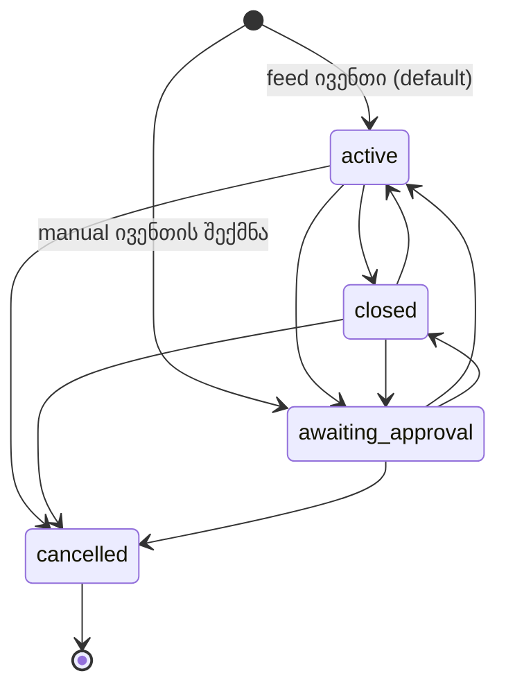

# 12 — Odds მოდული: რეფერენს-ადმინის ანალიზი და იმპლემენტაციის სპეციფიკაცია

> ⚠ შეთანხმებული გადაწყვეტილებები: [docs/09 §2](09-backoffice-plan.md#2-სავალდებულო-გადაწყვეტილებები-0508-ის-შეთანხმება) (პუნქტი 17 ამ დოკუმენტზე მიუთითებს). კონფლიქტის შემთხვევაში docs/09 სავალდებულოა. ეს დოკუმენტი **ცვლის** 06-ის, 07-ისა და 09-ის რამდენიმე პუნქტს; ჩამონათვალი §16-შია.

> **სტატუსი:** spec v1.6, დეველოპმენტისთვის · **თარიღი:** 2026-10-16 (v1.1: D28 — prematch და live game type-ები ცალ-ცალკე; v1.2: D29 — mapping-ის ფლობა; v1.3: D30 — SB-თავსებადი API, §19 — SBS API-ის ანალიზი; v1.4: §19.5 — EB_DWH-ის dictionary-ები, R13, Q15–Q16; v1.5: §20 — Categories › Manage, D31–D38, R14–R17, Q17–Q18, WP-10; v1.6: DWH-ის შედეგები §19.5, §20.10–20.11, R18–R22, D39, Q19–Q23)
> **წყარო:** პროდუქტის მფლობელთან ერთად გავლილი ოპერატორის ამჟამინდელი ადმინი (SB Software, „Admin Console“), მენიუ **Odds**. ის არის **თამასა**: ჩვენი back office ფუნქციურად მას არ უნდა ჩამოუვარდეს, UX-ში კი უკეთესი უნდა იყოს.
> **სფერო:** Odds › Odds (Manage, Results), Odds › Game types (Manage, Sport assign, Sort order, Market types, Sub-market, Mapping, Template map) და Odds › Categories › Manage (§20). დანარჩენი სექციები (Register, Lives, Disallowed, Categories-ის სხვა ტაბები, Participants, BetGenius, Events mapping, Add games, Odds list) შემდეგ ვერსიებში დაემატება.
> **დაკავშირებული:** [02](02-uof-data-model.md) (`sb` DDL) · [04](04-platform-architecture.md) (§9.2 multi-provider) · [06](06-backoffice-catalog-odds-config.md) (CAT, ODDS, CFG §5.8) · [07](07-backoffice-trading-risk-customers.md) (bet engine, settlement, LIM) · [09](09-backoffice-plan.md) (გეგმა, სტატუსი) · [11](11-sportsbook-api-and-whitelabel.md) (Player API).
>
> ნიშნები: **[D#]** = პროდუქტის მფლობელის გადაწყვეტილება (სავალდებულო). **[R#]** = ჩვენი რეკომენდაცია, რომელსაც მფლობელი არ შეწინააღმდეგებია; ⚠ ნიშნიანი R-ები §17-ში დასადასტურებლად რჩება. „რეფერენსი“ = ოპერატორის ამჟამინდელი ადმინი.

## სარჩევი

0. [მოკლედ](#0-მოკლედ)
1. [ტერმინოლოგია: რეფერენსი → ჩვენ](#1-ტერმინოლოგია-რეფერენსი--ჩვენ)
2. [გადაწყვეტილებების რეესტრი](#2-გადაწყვეტილებების-რეესტრი)
3. [ხილვადობის ჯაჭვი: როდის ჩანს მარკეტი ფრონტზე](#3-ხილვადობის-ჯაჭვი-როდის-ჩანს-მარკეტი-ფრონტზე)
4. [Odds › Manage: ივენთების სია](#4-odds--manage-ივენთების-სია)
5. [ივენთის ოპერატორული სტატუსი და ⚙ მენიუ](#5-ივენთის-ოპერატორული-სტატუსი-და--მენიუ)
6. [ლიმიტები, ალერტები, ტიკერი](#6-ლიმიტები-ალერტები-ტიკერი)
7. [Changelog და კომენტარები](#7-changelog-და-კომენტარები)
8. [Odds › Results: რეზალტინგი](#8-odds--results-რეზალტინგი)
9. [Game type კატალოგი (Game types › Manage)](#9-game-type-კატალოგი-game-types--manage)
10. [Sport assign](#10-sport-assign)
11. [Sort order](#11-sort-order)
12. [ტაბები და ქვეტაბები (Market types, Sub-market)](#12-ტაბები-და-ქვეტაბები-market-types-sub-market)
13. [Mapping: პროვაიდერი → game type](#13-mapping-პროვაიდერი--game-type)
14. [Template map და მარკეტის იდენტობა](#14-template-map-და-მარკეტის-იდენტობა)
15. [მონაცემთა მოდელი, CFG, permission-ები, API — შეჯამება](#15-მონაცემთა-მოდელი-cfg-permission-ები-api--შეჯამება)
16. [ცვლილებები სხვა დოკუმენტებში](#16-ცვლილებები-სხვა-დოკუმენტებში)
17. [ღია კითხვები](#17-ღია-კითხვები)
18. [სამუშაო პაკეტები, თანმიმდევრობა, შეფასება](#18-სამუშაო-პაკეტები-თანმიმდევრობა-შეფასება)
19. [SB Software API-ის ანალიზი და თავსებადობის ფენა](#19-sb-software-api-ის-ანალიზი-და-თავსებადობის-ფენა)
20. [Categories (კატეგორიების ხე)](#20-categories-კატეგორიების-ხე)

---

## 0. მოკლედ

რეფერენსის Odds მოდული ხუთ რამეს აკეთებს, და ყველა ჩვენთანაც საჭიროა:

1. **ივენთების სამუშაო სია** (Manage): ფილტრები, ლიგებად დაჯგუფება, 1X2 კოეფიციენტები, ფსონების სტატისტიკა და liability ერთ ცხრილში; ივენთის სტატუსის, დაწყების დროისა და კომენტარის მართვა, ისტორია.
2. **რეზალტინგი** (Results): დაურეზალტებელი ივენთების რიგი და სპორტზე მორგებული ფორმა, სადაც ბუკმეკერი პერიოდების სტატისტიკას შეიყვანს, სისტემა კი ყველა მარკეტის შედეგს ითვლის.
3. **Game type კატალოგი**: მარკეტის ტიპები წყაროს მიუხედავად, თარგმანი, კომბინაციის აკრძალვები, default liability, ჩვენების layout.
4. **ხილვადობა და რიგი**: ტიპი სპორტზე მიბმული (Sport assign), სპორტის/ქვეყნის/ლიგის სიაში დამატებული და დალაგებული (Sort order), ტაბებად და ქვეტაბებად დაჯგუფებული.
5. **Mapping**: Betradar / Genius / LSports-ის ტიპები ჩვენს game type-ებზე, სპორტის მიხედვით.

ჩვენთვის ყველაზე დიდი ახალი კომპონენტებია: **ხილვადობის ჯაჭვი** (§3; ცვლის default-ს „ყველაფერი ჩანს“-დან „ჩანს მხოლოდ დამატებული“-ზე), **resolver** (`Settle.Core`, §8.4) და **game type ფენა + mapping** (prematch/live ცალ-ცალკე, სპორტის მიხედვით, ოპერატორის override-ით; §9.1, §13). დანარჩენი არსებულ მექანიზმებზე (CFG, I18N, `bo.event_override`, `bo.trading_override`, `bo.manual_settlement`) აშენდება.

---

## 1. ტერმინოლოგია: რეფერენსი → ჩვენ

| რეფერენსი | მნიშვნელობა | ჩვენთან (კოდი / UI) |
|---|---|---|
| **Game** | კონკრეტული მარკეტი ივენთზე (მაგ. „Handicap (1X2) 2:0“) | `sb.market` / UI: „მარკეტი“ |
| **Game type** | მარკეტის ტიპი (1X2, Total Goals…); prematch და live ცალკე (D28) | `sb.game_type` → canonical მარკეტი `sb.market_description` (§9.1) / UI: „მარკეტის ტიპი (game type)“ |
| **Market type** | ფრონტის **ტაბი** ივენთის გვერდზე (Main, Corner, Offside…) | `bo.market_group` (level 1) / UI: „ტაბი“ |
| **Sub market type** | ტაბის ქვეტაბი (Corner → 1st Half) | `bo.market_group` (level 2, `parent_id`) / UI: „ქვეტაბი“ |
| **Category / subcategory** | სპორტი / ქვეყანა (+ ლიგა) | `sb.sport` / `sb.category` / `sb.tournament` |
| **Standard** | პრემატჩი | `prematch` |
| **Creation method** | ვინ შექმნა ივენთი/მარკეტი | provider vs `manual` (`sb.provider` id 0, `bo.manual_entity`) |
| **B** (badge) | Betradar | provider badge: **B** Betradar, **G** Genius, **L** LSports, **M** manual |
| **Factor** | მარჟა | `margin.*` (CFG) |
| **Register (result)** | რეზალტის შეყვანა | §8 |
| **Event code id** | პროვაიდერის მიერ მინიჭებული ID | `sb.provider_mapping` (გარე ID), მხოლოდ ჩვენება |

---

## 2. გადაწყვეტილებების რეესტრი

### 2.1 პროდუქტის მფლობელის გადაწყვეტილებები (სავალდებულო)

| # | გადაწყვეტილება | სად |
|---|---|---|
| D1 | **Four-eyes default-ად გამორთულია** ყველგან (ლიმიტები, მარჟა, რეზალტი, cancel, სტატუსი). მექანიზმი რჩება და ოპერატორს შეუძლია ჩართოს. | §15.2 |
| D2 | ივენთის სტატუსები: **Active, Closed, Awaiting approval, Cancelled**. Closed = ფრონტზე არ ჩანს, ბილეთი არ მიიღება (შექცევადი). Cancelled = ყველა selection ივენთზე 1.00. Awaiting approval = დამალულია **და** settlement შეჩერებულია. | §5 |
| D3 | Awaiting approval ძირითადად ლაივში გამოიყენება (მოვლენა მოხდა, შედეგს ველით); manual ივენთი ამ სტატუსში იქმნება და ბუკმეკერი ააქტიურებს. | §5 |
| D4 | **Change start time** ცვლის ფსონების მიღების ზღვარს. წარსულში გადაწევისას ახალი დროის შემდეგ დადებული selection-ები ამ ივენთის მარკეტებზე void (1.00). | §5.3 |
| D5 | ლიმიტი = **alert liability / market liability**. Alert-ზე ბუკმეკერი ტიკერში ალერტს იღებს; market liability-ზე მარკეტი **იხურება** (ფრონტზე არ ჩანს). გასახსნელად ბუკმეკერი თავად ზრდის ლიმიტს, დადასტურების გარეშე. | §6 |
| D6 | S1/SX/S2 სვეტები შეიძლება შეიცვალოს უფრო სასარგებლოთი. | §4.3 |
| D7 | Outright პრემატჩის ქვეტიპია; ფილტრი შეიძლება გაუმჯობესდეს. | §4.2 |
| D8 | **Multi-provider საჭიროა.** Genius = სრული პროვაიდერი (ივენთები, მარკეტები, კოეფიციენტები; ITF-ისა და ლაივისთვის). LSports = გამამდიდრებელი: არსებულ Radar/Genius ივენთს ებმება და მარკეტებს ამატებს (კუთხურები, ბარათები…), ჯერ ლაივში. | §13, §14 |
| D9 | Changelog აჩვენებს ბუკმეკერის **და** სისტემის/პროვაიდერის ცვლილებებს (თვისების დონეზე, IP-ით). | §7 |
| D10 | Event code id = პროვაიდერის ID. ⚠ DWH-ის მონაცემები ეწინააღმდეგება: ეს ლიგის Code range-იდან მინიჭებული მოკლე კოდია (§20.11, Q19). | §1 |
| D11 | ხელით რეზალტი **ძირითადი ფუნქციაა**: manual მარკეტები feed ივენთის შიგნით ჩვეულებრივია. | §8 |
| D12 | ხელით შეიძლება დარეზალტდეს **ნებისმიერი** მარკეტი (პროვაიდერისაც): ივენთის შიგნიდან (outcome-ის არჩევით) ან Register popup-იდან (სტატისტიკით). | §8 |
| D13 | Popup-ის შენახვა არეზალტებს ივენთის **ყველა ჯერ დაურეზალტებელ** მარკეტს (პროვაიდერისაც და manual-საც). უკვე დარეზალტებულს არ ეხება. | §8.5 |
| D14 | ჯერ ხელით, მერე განსხვავებული პროვაიდერის შედეგი → **ხელით შეყვანილი რჩება**, ბუკმეკერს მეილზე მოდის „result change“ ალერტი. | §8.7 |
| D15 | Resettle მოთამაშეს თანხას ჩამოაჭრის, **ბალანსი შეიძლება მინუსში წავიდეს**. | §8.8 |
| D16 | პროვაიდერის შედეგი ყველა ოპერატორისთვის ერთია. Manual მარკეტებს თითო ოპერატორი თავად არეზალტებს. | §8.2 |
| D17 | „Event Finished“ = მთელი მატჩი, **ოვერტაიმის ჩათვლით**. | §8.3 |
| D18 | ფეხბურთს ემატება **Extra time** სვეტი, default-ად დამალული, popup-ში კლიკით ჩნდება. Penalties სვეტი არ ემატება. | §8.3 |
| D19 | ჰოკეიში სერიის გამარჯვებულს Event Finished-ში **+1 არ ემატება**. ოვერტაიმის სვეტი ემატება. | §8.3 |
| D20 | Game type **წყაროზე არ არის მიბმული**: ერთი ტიპი ერთ ივენთზე პროვაიდერისგან მოდის, მეორეზე ხელით იქმნება. Game types › Manage მხოლოდ ზოგადი კონფიგურაციაა. | §9 |
| D21 | ერთი game type რამდენიმე სპორტში შეიძლება (1X2: ფეხბურთი + ჰოკეი). **სხვადასხვა სახელი სპორტის მიხედვით = სხვადასხვა game type** (Total Goals / Total Points). | §9, §13 |
| D22 | Sort order იქმნება **სპორტის, ქვეყნისა და ლიგის** დონეზე. | §11 |
| D23 | ტაბი მხოლოდ **ფილტრავს** (ერთი რიგი, ტაბი მისი ქვესიმრავლეა). | §11 |
| D24 | პროვაიდერის ახალი ტიპი ფრონტზე **თავისით არ ჩნდება**: სანამ არ დაიმეპება game type-ზე, game type სპორტზე არ მიება და Sort order-ის სიაში არ დაემატება. | §3 |
| D25 | ცარიელი ტაბი (ამ ივენთზე მარკეტის გარეშე) იმალება. ტაბების რიგი გლობალურია, სპორტის დონეზე იცვლება. | §12 |
| D26 | Templates (Game types) აღარ გამოიყენება — არ ვაკეთებთ. Long term ფილტრი (Results) არ გამოიყენება — არ ვაკეთებთ. | — |
| D27 | Template map-ის ფუნქცია (პრემატჩის და ლაივის პროვაიდერის ტიპების შესაბამისობა, cash-out-ისთვის) საჭიროა. | §14 |
| D28 | **Prematch და live game type-ები ცალ-ცალკე ჩანაწერებია** (როგორც რეფერენსში): თითოეულს თავისი სახელი, კონფიგურაცია, ტაბები და რიგი აქვს. | §9.1 |
| D30 | **ჩვენი API ბიზნეს-პროცესებით SB Software-ს მიჰყვება, ტექნიკურად კი გაუმჯობესებულია.** Europebet-ის არსებული ფრონტისთვის საჭიროა **SB-თავსებადი ფენა** (compat adapter) ჩვენს Player API-ზე. | §19 |
| D29 | **Mapping-ს საწყისად პლატფორმა (ჩვენი გუნდი) აკეთებს.** ოპერატორებს სხვადასხვა მარკეტი და სია სჭირდებათ, ამიტომ **ერთი ოპერატორისთვის გაკეთებული mapping მეორეზე არ უნდა მოქმედებდეს**. კლიენტის მოთხოვნით მას საკუთარი mapping-ის უფლება ადვილად უნდა მიეცეს. | §9.1, §13.1 |
| D31 | კატეგორიის დონეები: **Level 1 = სპორტი, Level 2 = ქვეყანა / ფედერაცია, Level 3 = ლიგა / თასი** (= `sb.sport` / `sb.category` / `sb.tournament`). | §20.1 |
| D32 | Category status **Offline მალავს** კატეგორიას. „Include in the odds feed“ არ გამოიყენება და არ კეთდება. | §20.2, §20.7 |
| D33 | **Display as საჭიროა**: რამდენიმე კატეგორიის ერთის ქვეშ გაერთიანება ფრონტზე (მაგ. ტურნირის ჯგუფური და პლეი-ოფის ლიგები; `aggregateCategoryId`). | §20.6 |
| D34 | **Live curtain = live bet delay** წამებში, კატეგორიაზე, ცალ-ცალკე პროვაიდერის მიხედვით (Betradar, Betgenius, LSports, Manual). | §20.4 |
| D35 | **Change parent** გამოიყენება, როცა პროვაიდერი ლიგას არასწორ ქვეყანაში დებს. | §20.5 |
| D36 | ერთი კატეგორია **ყველა პროვაიდერისთვის ერთი** უნდა იყოს (რეფერენსში ჯერ ყოველთვის ასე არ არის). | §20.8 |
| D37 | Change parent = **პლატფორმის შესწორება**, ყველა ოპერატორზე მოქმედებს; გადატანილი ლიგა ახალი ქვეყნის ლიმიტებს და მარჟას იღებს (R14 დადასტურდა, Q17). | §20.5 |
| D38 | Display as **მხოლოდ ჩვენებაა**: ლიმიტები, მარჟა, settlement და რეპორტინგი ორიგინალ კატეგორიას რჩება (R16 დადასტურდა, Q18). | §20.6 |
| D39 | **Custom groups P0-ია** (docs/06 §2.2-ის P1-ის ნაცვლად): Treat as sport-ის შემცვლელი („Support The Georgians“, „Transfers“), R20 დადასტურდა. | §20.10 |

### 2.2 ჩვენი რეკომენდაციები (default დიზაინი)

| # | რეკომენდაცია | სად |
|---|---|---|
| R1 | ~~ერთი game type prematch-ისთვისაც და live-ისთვისაც~~ — **გაუქმდა, იხ. D28**. ნაცვლად: game type-ის ქვეშ საერთო canonical მარკეტის განმარტება, რომ ბილეთის იდენტობა და prematch↔live შესაბამისობა ავტომატური დარჩეს. | §9.1 |
| R2 | Sort order: **სპორტის დონე = whitelist + default რიგი**; ქვეყანა/ლიგა ინახავს მხოლოდ განსხვავებას (რიგი, დამალვა, დამატება); სპორტზე დამატებული ტიპი ყველა ლიგაში ჩნდება. | §11.2 |
| R3 | ტაბის „Visible in feed“ = „ტაბი აქტიურია“: გამორთვა მალავს **მხოლოდ ტაბს**, მარკეტები სხვა ტაბებში რჩება. ⚠ | §12.2 |
| R4 | Game type-ის ქვეტაბზე მიბმა **ავტომატურად** ნიშნავს მშობელ ტაბზე მიბმას (რეფერენსში ცალ-ცალკეა). ⚠ | §12.3 |
| R5 | Outcome mapping მარკეტის mapping-თან ერთად, ავტომატური შეთავაზებით; ახალი დაუმეპავი outcome → მარკეტი იმალება + ალერტი. | §13.3 |
| R6 | Template map **ავტომატურია**: prematch და live game type ერთმანეთს შეესაბამება, თუ ერთსა და იმავე canonical მარკეტზეა მიბმული. გვერდი მხოლოდ ამ წყვილებს აჩვენებს და აკლებულზე აფრთხილებს. | §14 |
| R7 | Register popup-ის შენახვამდე **preview**: რომელი outcome მოიგებს/წააგებს/დაბრუნდება, რამდენი ბილეთი, რა თანხა. ⚠ | §8.6 |
| R8 | „Events without bets“ ავტომატური: ბილეთის გარეშე მარკეტი რიგში არ ჩანს და ავტომატურად იხურება. | §8.9 |
| R9 | S1/SX/S2 → **P&L, თუ ეს შედეგი მოვიდა** (ფერით). | §4.3 |
| R10 | Event type ფილტრი = ერთი multi-select (Prematch match · Prematch outright · Live) ორი ცალკე ფილტრის ნაცვლად. | §4.2 |
| R11 | **B2B გაყოფა:** canonical მარკეტები და provider → canonical mapping = **პლატფორმა**; binding (canonical → game type) = პლატფორმის default + **ოპერატორის override** (D29). Sport assign, Sort order, ტაბები, game type-ის კონფიგურაცია, თარგმანის override და custom game type-ები = **ოპერატორი**. | §9.2, §13.1 |
| R12 | პლატფორმა ახალ ოპერატორს აძლევს **default სიებს** (Sort order თითო სპორტზე, ტაბები), რომ ფრონტი ცარიელი არ იყოს. | §3.3 |
| R13 | ერთჯერადი special-ისთვის ახალი game type არ იქმნება: manual მარკეტი თავისუფალი სახელით ზოგად custom ტიპზე. მიგრაციით მხოლოდ ბოლო დროს გამოყენებული ტიპები გადმოდის. | §19.5 |
| R14 | Change parent = **პლატფორმის შესწორება** Feed Ops-ში (ყველა ოპერატორისთვის), adapter-ი მას არ ფარავს. CFG-ის მემკვიდრეობა შესწორებულ ხეს მიჰყვება. ✅ D37 | §20.5 |
| R15 | Live delay პროვაიდერის მიხედვით = CFG-ის ახალი qualifier `pv` `betdelay.live_sec`-ზე. ბილეთის delay = max legs-ზე, თითო leg-ისთვის მისი მარკეტის პროვაიდერის მნიშვნელობით. ⚠ | §20.4 |
| R16 | Display as მხოლოდ **ჩვენებაა**: CFG, settlement და რეპორტინგი ორიგინალ კატეგორიას მიჰყვება. ჯაჭვი არ იქმნება, მხოლოდ იმავე სპორტში და დონეზე. ✅ D38 | §20.6 |
| R17 | Treat as sport და ენის მიხედვით Visible არ კეთდება, სანამ use case არ გამოჩნდება. თუ დაგვჭირდება, ხილვადობა ბრენდით იმართება. | §20.7 |
| R18 | Event code: ოპერატორის Code range-ები ლიგაზე / ქვეყანაზე / სპორტზე, ავტომატური მინიჭება და გათავისუფლება, უნიკალური აქტიურ ივენთებს შორის, ბილეთზე ფიქსირდება. P1 (retail). ⚠ | §20.11 |
| R19 | „Outrights“ ცალკე კატეგორიად არ იქმნება: outright ივენთი თავის ტურნირშია, ფრონტის „Outrights“ სია გამოთვლითია, compat კი ვირტუალურ კატეგორიას აჩვენებს. | §20.10 |
| R20 | Treat as sport (= რომელი სპორტის მენიუში ჩანს კატეგორია) ზოგად ველად არ კეთდება: „Outrights“ = გამოთვლითი სია (R19), დანარჩენი („Support The Georgians“, „Transfers“) = custom groups (docs/06 §2.2), რომლებიც P0-ში გადავიდა (D39). ✅ | §20.10 |
| R21 | Level 4 არ კეთდება: ეტაპი / ვარიანტი = ცალკე ტურნირი + Display as (D33), outright = R19. მიგრაციისას 33 კატეგორია ხელით. | §20.10 |
| R22 | კატეგორიის სტატუსი = მხოლოდ Online / Offline. SBS-ის სისტემური 2 (დაარქივებული) / 3 არ გადმოდის; მიგრაციით მხოლოდ ლიგები ივენთებით ბოლო 12 თვეში ან მომავალში (~14.4 ათასი). | §20.10 |

---

## 3. ხილვადობის ჯაჭვი: როდის ჩანს მარკეტი ფრონტზე

### 3.1 წესი

ოპერატორი O-სთვის, ივენთ E-ზე (სპორტი S, ქვეყანა C, ლიგა T, რეჟიმი M = prematch | live) მარკეტი `m` (game type G) ფრონტზე ჩანს, თუ **ყველა** პირობა სრულდება:

| # | პირობა | წყარო | ვინ მართავს |
|---|---|---|---|
| 1 | პროვაიდერის ტიპი დამეპილია canonical მარკეტზე (manual მარკეტს ეს არ სჭირდება) **და** canonical მარკეტს სპორტ S-სა და რეჟიმ M-ზე აქვს game type G (binding) | `sb.market_type_map` (§13), `sb.game_type_binding` (§9.1) | პლატფორმა; binding-ს + ოპერატორის override (D29) |
| 2 | G (რეჟიმ M-ის game type) მიბმულია S-ზე | Sport assign (§10) | ოპერატორი |
| 3 | G არის O-ს effective Sort order სიაში (S → C → T მემკვიდრეობით, რეჟიმი M) და იქ დამალული არ არის | Sort order (§11) | ოპერატორი |
| 4 | CFG: `offer.visible`, `offer.prematch_enabled` / `offer.live_enabled`, `market.enabled` | CFG (არსებული) | ოპერატორი |
| 5 | ივენთის სტატუსი = Active (§5), არ არის trading close / suspend, liability ლიმიტი არ არის მიღწეული (§6) | `bo.event_override`, `bo.trading_override`, LIM | ოპერატორი / სისტემა |
| 6 | `Offer.Core`-ის არსებული gate-ები (producer down, odds.min, status precedence) | `Offer.Core` | — |

პირობები 1–3 **ახალია**. ისინი ერთ ფუნქციაში ითვლება (`OfferVisibility.Resolve(operator, event, mode)` → `{gameTypeId → (visible, sortKey, reason)}`), შედეგი `Offer.Core`-ს `MarketGate`-ში გადაეცემა ახალი მიზეზებით: `hidden:unmapped`, `hidden:no_game_type`, `hidden:not_assigned`, `hidden:not_in_order`. ეს მიზეზები BO-ის trading view-ში ჩანს („რატომ არ ჩანს ეს მარკეტი?“).

### 3.2 Default-ის ცვლილება

დღეს `market.enabled` default `true`-ა: feed-ის ყველა მარკეტი ჩანს. ახალი default (D24): **მარკეტი არ ჩანს, სანამ პირობები 1–3 არ შესრულდება**. `market.enabled` რჩება როგორც დამატებითი ჩამრთველი (მაგ. ერთ ივენთზე ტიპის გამორთვა).

### 3.3 B2B onboarding (R12)

- პლატფორმას აქვს **default template**: თითო სპორტზე Sport assign + Sort order (ძირითადი ტიპები ჩვეულებრივი რიგით) და ტაბები (Main, Totals, Handicap, 1st Half, Corners, Cards…). Template = `operator_id IS NULL` row-ები იმავე ცხრილებში.
- ოპერატორი მემკვიდრეობით იღებს template-ს. პირველივე ცვლილებისას ოპერატორის row იქმნება (copy-on-write) და ის იგებს.
- UI-ში ჩანს წყარო: „პლატფორმის default“ / „თქვენი“.

### 3.4 ცვლილებების გავრცელება

ყოველი ცვლილება (assign, order, tab) → audit + outbox (`offer.visibility.changed {operator, sport}`) → Player API cache-ის invalidation (docs/11 §4). მიზანი: ფრონტზე ≤ 2 წმ.

### 3.5 ტესტები

- Golden ცხრილი `Offer.Tests`-ში: 12+ შემთხვევა (დაუმეპავი, სპორტზე არ არის, ლიგაში დამალული, ლიგაში მხოლოდ იქ დამატებული, სპორტზე ახლად დამატებული ლიგის override-ის მიუხედავად ჩნდება, live vs prematch).
- RLS: ოპერატორი B ვერ ხედავს / ვერ ცვლის A-ს assign/order/tab row-ებს; template row-ებს ოპერატორი ვერ ცვლის.

---

## 4. Odds › Manage: ივენთების სია

ჩვენი არსებული `/odds` (`features/odds/events.ts`) ამ გვერდით იცვლება. ივენთზე დაჭერა ისევ trading view-ს (`/odds/events/:id`) ხსნის.

### 4.1 ზედა ზოლი

| ელემენტი | ქცევა |
|---|---|
| Start date | თარიღის არჩევა (default ცარიელი = Day-ით განისაზღვრება) |
| Day | Today / Tomorrow / Yesterday / +N |
| Time from / to `HHmm` | დროის ფანჯარა დღის შიგნით (default 0000–2359), ოპერატორის timezone-ით (`Asia/Tbilisi`) |
| Refresh | ხელით განახლება. **დამატებით** (ჩვენი გაუმჯობესება): ჩამრთველი „ავტო-განახლება 10 წმ“, live მწკრივები ყოველთვის ცოცხალი (WebSocket, docs/11 §3) |
| Per page | 50 / 100 / 500 / 1000; ვირტუალური scroll 1000-ზე |

### 4.2 ფილტრები

| ფილტრი | მნიშვნელობები | იმპლემენტაცია |
|---|---|---|
| Creation method | Any · Manual only · Remote only · Remote with manual games | manual = `bo.manual_entity(entity_type='event')`; remote with manual games = feed ივენთი, რომელსაც ამ ოპერატორის `manual:{op}:*` მარკეტი აქვს |
| Event type (R10) | multi-select: Prematch match · Prematch outright · Live | `sb.event.event_type` + `status='live'` |
| Status | Any · Awaiting approval · Active · Closed · Cancelled | ოპერატორული სტატუსი (§5), **არა** feed-ის |
| Team name | ძებნა (გუნდი, ივენთის სახელი, ID, URN) | არსებული `q` |
| Outrights | Include · Exclude · Only | R10-ის შემდეგ ზედმეტია; რჩება URL-პარამეტრად თავსებადობისთვის |
| Category → Subcategory | სპორტი → ქვეყანა (+ ჩვენ: → ლიგა) კასკადი, autocomplete-ით | `sportId`, `categoryId`, `tournamentId` |
| (ახალი) Provider | B / G / L / M | `sb.provider_mapping` |

ფილტრები URL-ში ინახება (გაზიარებადი ბმული), ბოლო არჩევანი — localStorage-ში.

### 4.3 ცხრილი

მწკრივები **დაჯგუფებულია** `Sport / Country / League` სათაურებით, ჯგუფის შიგნით დაწყების დროით.

| სვეტი | შინაარსი | წყარო | ეტაპი |
|---|---|---|---|
| Start | `HH:mm, dd.MM` (effective start, §5.3) | `event_override.display_start_at` ?? `sb.event.scheduled_at` | ახლა |
| ⚙ | ივენთის მენიუ (§5.2) | — | ახლა |
| Event | მონაწილეები / outright-ის სახელი (ოპერატორის თარგმანით) | I18N | ახლა |
| Provider | B / G / L / M badge; LSports-ით გამდიდრებულზე დამატებით „+L“ | `sb.provider_mapping` | ახლა |
| Status | ოპერატორული სტატუსი, ფერით | §5 | ახლა |
| Limits (K) | `alert / limit` ათასებში (effective CFG, ივენთის main market-ზე) | CFG §6 | ახლა (მნიშვნელობა), BO-2 (მიღწევის ფერი) |
| 1 · X · 2 | ბილეთების რაოდენობა თითო შედეგზე | `bet.*` | BO-2 |
| Stake | ჯამური stake (K) | `bet.*` | BO-2 |
| Poss | მაქსიმალური შესაძლო გადახდა / liability (K) | LIM | BO-2 |
| O1 · OX · O2 | main market-ის **შეთავაზებული** კოეფიციენტები (`display.main_market_type`) | `OfferService` | ახლა |
| P1 · PX · P2 (R9, ნაცვლად S1/SX/S2) | ოპერატორის P&L, თუ ეს შედეგი მოვიდა: `Σstake − Σpayout(outcome)`, მწვანე/წითელი | LIM | BO-2 |
| Games | ღია მარკეტების რაოდენობა, ბმული trading view-ზე | არსებული `openMarkets` | ახლა |

BO-2-მდე ფსონების სვეტები **დამალულია** (API აბრუნებს `null`-ს, UI სვეტების ჯგუფს მალავს), ცარიელი ნულებით არ ივსება.

### 4.4 API

```
GET /api/bo/odds/events?date=&day=&from=HHmm&to=HHmm&creation=any|manual|remote|remote_manual
      &types=prematch_match,prematch_outright,live&status=&q=&sportId=&categoryId=&tournamentId=&provider=
      &page=&size=&lang=
→ { groups:[{ sport, category, tournament, events:[{ id, startAt, name, provider:[B,L], status,
      limits:{alert,limit,currency}, main:{ "1":2.10, "X":3.30, "2":3.40 },
      bets:null|{ byOutcome:{"1":5,"X":0,"2":1}, stake, possible, pnl:{"1":..,"X":..,"2":..} },
      openMarkets }] }], total }
```

ერთი SQL main market-ის ფასისთვის არ კმარა (ფასი `Offer.Core`-ით ითვლება): batch — ერთ მოთხოვნაში გვერდის ყველა ივენთის main market `OfferService.PriceMany(...)`-ით. მიზანი: 1000 ივენთი < 800 ms.

### 4.5 მიღების კრიტერიუმები

- ყველა ფილტრი კომბინირდება; ცარიელი შედეგი „No events“-ს აჩვენებს.
- 1000 ივენთზე გვერდი < 1.5 წმ (API + რენდერი).
- სხვა ოპერატორის manual ივენთი/მარკეტი არც სიაში ჩანს, არც `creation` ფილტრზე მოქმედებს (RLS ტესტი).

---

## 5. ივენთის ოპერატორული სტატუსი და ⚙ მენიუ

### 5.1 სტატუსები (D2, D3)

ოპერატორული სტატუსი feed-ის სტატუსისგან (`not_started/live/ended/...`) დამოუკიდებელია და მხოლოდ ამ ოპერატორზე მოქმედებს.



| სტატუსი | ფრონტზე | ბილეთის მიღება | Settlement | შენიშვნა |
|---|---|---|---|---|
| `active` | ჩანს | კი | ჩვეულებრივ | default |
| `closed` | **არ ჩანს** | არა | ჩვეულებრივ (უკვე დადებული ბილეთები სეტლდება) | ყველა მარკეტის ერთად დახურვა |
| `awaiting_approval` | **არ ჩანს** | არა | **შეჩერებულია** (hold): feed-ის და manual settlement-ები ამ ოპერატორის ბილეთებზე რიგში ჩერდება და `active`-ზე დაბრუნებისას გამოიყენება | ლაივში „მოვლენა მოხდა, ველოდებით“; manual ივენთის draft |
| `cancelled` | **არ ჩანს** | არა | ყველა ღია selection ამ ივენთზე → **void (F = 1)** | ტერმინალური; ფულს ამოძრავებს (BO-2) |

**იმპლემენტაცია**
- `bo.event_override`-ს ემატება `status text NOT NULL DEFAULT 'active' CHECK (status IN ('active','closed','awaiting_approval','cancelled'))`, `status_reason text`, `status_changed_at`, `status_changed_by`. Manual ივენთის row იქმნება `awaiting_approval`-ით.
- Event-scope `close` დღეს `bo.trading_override`-შია (TTL-ით). **წესი:** სტატუსი = მუდმივი ოპერატორული გადაწყვეტილება (`event_override.status`); `trading_override` რჩება **დროებითი** suspend/close-ისთვის (TTL) და მარკეტის დონისთვის. ⚙ მენიუს „Set status: Closed“ წერს `status`-ს, არა `trading_override`-ს.
- `Offer.Core`: `MarketGate`-ს ემატება `EventStatus`; `closed/awaiting_approval/cancelled` → `Hidden` (მიზეზი `event:<status>`).
- Settlement hold: settlement-service (BO-2) ამოწმებს `event_override.status` ოპერატორზე; `awaiting_approval` → settlement ჩანაწერი `bet.settlement_hold`-ში, `active`-ზე გადასვლისას (outbox `event.status.changed`) ხელახლა მუშავდება. BO-2-მდე: სტატუსი იწერება და UI-ში ჩანს, hold-ის ლოგიკა BO-2-შია.
- Cancel → bet-engine command API: `POST /internal/events/{id}/cancel {operatorId, reasonCode}` (docs/09 §2.7). BO-2-მდე ღილაკი disabled-ია tooltip-ით.
- ⚠ Cancel-ის გაუქმება (un-cancel) — §17 Q3.

### 5.2 ⚙ მენიუ

| ქმედება | Permission | იმპლემენტაცია |
|---|---|---|
| Change start time | `odds.event.edit` | §5.3 |
| Show bets | `bets.view` | BO-2: ticket search ფილტრით `eventId` |
| Set status: Awaiting approval / Closed / Active | `odds.event.status` | §5.1; reason სავალდებულოა |
| Cancel | `odds.event.cancel` | §5.1; დადასტურების dialog: ბილეთების რაოდენობა და თანხა, reason code |
| Add comment | `odds.event.comment` | §7.2 |
| Changelog | `odds.view` | §7.1 |

ყოველი ქმედება = audit + outbox ერთ ტრანზაქციაში (CLAUDE.md წესი). Four-eyes არ არის (D1).

### 5.3 Change start time (D4)

- `bo.event_override.display_start_at` ხდება **effective start time** (`effective_start_at` სახელით view-ში): ფრონტზე ჩვენებაც და პრემატჩის ფსონების მიღების ზღვარიც.
- **მომავალში:** ივენთი ჩანს და ფსონი მიიღება ახალ დრომდე.
- **წარსულში:** იქმნება void ფანჯარა `bo.void_window(operator_id, event_id, from_ts = new_start, to_ts = now(), reason, created_by)`. settlement-service (BO-2): ამ ოპერატორის ბილეთებში ამ ივენთის **პრემატჩის** selection-ები, დადებული `[from_ts, to_ts]`-ში → void (F = 1), Betradar-ის `bet_cancel start/end`-ის ანალოგიურად.
- **უსაფრთხოების წესი:** თუ feed ივენთს `live`-ად აცხადებს, პრემატჩის მიღება ჩერდება override-ის მიუხედავად.
- Dialog-ში ჩანს: ძველი დრო, ახალი დრო, წარსულში გადაწევისას — რამდენი ბილეთი გახდება void.

---

## 6. ლიმიტები, ალერტები, ტიკერი

### 6.1 CFG key-ები (D5)

| Key | ტიპი | Scope | Default | ცვლილება |
|---|---|---|---|---|
| `limit.alert_liability_market` | money | `O s c t e m` (+mt) | null | **ახალი** |
| `limit.max_liability_market` | money | `O s c t e m` (+mt) | null | არსებული; `requires_approval` → D1-ით ეფექტურად გამორთული |
| `limit.alert_liability_event` | money | `O s c t e` | null | **ახალი** (P1) |

Game type-ის default liability (რეფერენსის Alert/Liability სვეტები) = ამ key-ების მნიშვნელობა `O`-ს დონეზე game type qualifier-ით (prematch და live ცალ-ცალკე, D28); სპორტი/ლიგა/ივენთი მას ჩვეულებრივი CFG მემკვიდრეობით გადაფარავს (docs/09 §2.2).

### 6.2 ქცევა (BO-2, LIM)

- Liability თითო outcome-ზე = ამ outcome-ის მოგებისას გადასახდელი − მარკეტზე მიღებული stake (docs/07 §3).
- `liability ≥ alert` → NOTIF `liability.alert {event, market, value, alert, limit}` → ტიკერი + (CFG) მეილი.
- `liability ≥ limit` → მარკეტი **გამოთვლილად დამალულია** (`Offer.Core` gate `liability:limit`) + NOTIF `liability.limit_reached`. ფსონი, რომელიც ლიმიტს გადააჭარბებდა, უარყოფილია (reason code CMS-იდან).
- **გახსნა:** ბუკმეკერი ზრდის `limit.max_liability_market`-ს ამ ივენთზე/მარკეტზე (ტიკერიდან ან trading view-დან ერთი ქმედებით, „ლიმიტი +50%“ / ზუსტი თანხა). ცვლილება მაშინვე მოქმედებს (D1).

### 6.3 ტიკერი (shell-ის ზედა ზოლი)

- ბოლო N ალერტი: დრო, ივენთი, `[alert/limit]` (K), ტიპი (liability / result change / feed conflict). დაჭერა → trading view.
- წყარო: NOTIF (BO-3). BO-1-ში: shell-ის კომპონენტი და `GET /api/bo/notif/recent` ცარიელი სიით, რომ BO-3-ში მხოლოდ წყარო ჩაერთოს.

---

## 7. Changelog და კომენტარები

### 7.1 Changelog (D9)

Dialog „Event history | Event ID“, სვეტები: **დრო · Property · Admin · IP · Old value · New value**.

| წყარო | რას შეიცავს | Admin სვეტში |
|---|---|---|
| `bo.audit_log` (`entity_type='event'`, ამ ოპერატორის) | სტატუსი, start time, თარგმანი/სახელი, კომენტარი, cancel, manual result | ბუკმეკერის სახელი + ID, IP |
| `sb.event_change_log` (**ახალი**, feed-ის მხარე, ყველა ოპერატორისთვის საერთო) | სახელი, start time, feed status, ანგარიში/შედეგი, provider ID-ის მინიჭება | „System (provider)“, IP ცარიელი |

- `bo.audit_log`-ს ემატება `ip inet` (V008). `Audit.WriteAsync` IP-ს request-იდან იღებს (`X-Forwarded-For` სანდო proxy-დან).
- `sb.event_change_log(event_id, ts, property, old_value, new_value, source)` — წერს **adapter** (`CanonicalStore`), როცა თვალყურის დევნებული ველი იცვლება: `name`, `scheduled_at`, `status`, `home_score/away_score`, `period_scores` (შეკუმშული), `provider_mapping` ახალი row. ⚠ მოცულობა: მხოლოდ ცვლილება, არა ყოველი message; partition თვეებით.
- API: `GET /api/bo/odds/events/{id}/history?lang=` → ორივე წყაროს შერწყმა დროით.
- Property-ის სახელები UI-ში ითარგმნება (ka/en).

### 7.2 კომენტარები

- `bo.event_comment(id, operator_id, event_id, text, created_by, created_by_name, created_at, deleted_at)`, RLS.
- ჩანს: ⚙ მენიუ → Add comment; ივენთის მწკრივზე კომენტარის ხატულა (რაოდენობა); trading view-ში ბლოკი. Changelog-შიც ჩაიწერება.
- `POST /api/bo/odds/events/{id}/comments`, `GET …/comments`, `DELETE …/comments/{cid}` (საკუთარი, ან `odds.event.comment.manage`).

---

## 8. Odds › Results: რეზალტინგი

### 8.1 რიგი (`/odds/results`)

**ზედა ზოლი:** Show (Last 24h / 48h / 7d / custom), Refresh, ექსპორტი **CSV / XLSX** (PDF არა), **Resulting progress** (§8.9). „Events without bets“ ღილაკი არ არის (R8).

**ფილტრები:** Creation method, Event type, Sport, Team name, **Not older than X hours** (ივენთის start ბოლო X საათშია), Outrights. (Long term არა — D26.)

**ცხრილი:**

| სვეტი | შინაარსი |
|---|---|
| ☐ | ჯგუფური მონიშვნა |
| Event start | ბმული trading view-ზე |
| Category | Sport / Country / League |
| Event, provider badge | |
| Bets | ბილეთების რაოდენობა (BO-2-მდე —) |
| Result | ანგარიში (`?-?` თუ არ ვიცით) |
| **Register** | popup (§8.3) |
| Unresulted `a/b/c/d` | a = დაურეზალტებელი მარკეტები · b = manual მარკეტები · c = პროვაიდერის მარკეტები (d − b) · d = სულ |
| Games | ივენთის მარკეტები (outcome-ის ხელით არჩევით რეზალტისთვის) |
| Cancel | §5.1 |

**ჯგუფური ქმედებები:** Cancel selected, **Show selected** — მონიშნული ივენთების დაურეზალტებელი მარკეტები ერთ გვერდზე (`/odds/results/bulk?events=…`), თითო მარკეტზე outcome-ის არჩევა, ერთი Save.

რიგში ხვდება ივენთი, რომელსაც ამ ოპერატორისთვის აქვს ≥ 1 დაურეზალტებელი მარკეტი **ბილეთებით** (R8), ან manual მარკეტი (მიუხედავად ბილეთებისა, BO-2-მდე).

### 8.2 ვინ რას არეზალტებს (D12, D16)

- პროვაიდერის შედეგი = პლატფორმის მონაცემი (`sb.settlement`), ყველა ოპერატორისთვის ერთი.
- ოპერატორის ხელით შედეგი (სტატისტიკა ან outcome) = `bo` ცხრილები RLS-ით; მოქმედებს **მხოლოდ ამ ოპერატორის ბილეთებზე**. ორ ოპერატორს ერთ ივენთზე შეიძლება სხვადასხვა სტატისტიკა ჰქონდეს.
- ყოველი ხელით შედეგი → `bo.manual_settlement` (docs/09 §2.4) + `source` (`stats` | `outcome_pick`), `lock_feed = true`.

### 8.3 Register popup: result schema (D17–D19)

Popup სპორტის **result schema**-დან იწყობა (კონფიგურაცია, არა თითო სპორტის კოდი):

```jsonc
// platform/src/Settle.Core/Schemas/soccer.json (კოდში, როგორც MessageCatalog; პლატფორმის დონე)
{
  "sport": "sr:sport:1",
  "periods": [
    { "code": "ft",  "label": "Event Finished", "kind": "total" },          // მთელი მატჩი, ET-ის ჩათვლით (D17)
    { "code": "h1",  "label": "First Half",    "kind": "regular" },
    { "code": "h2",  "label": "Second Half",   "kind": "regular", "derive": "ft - h1 - et" },
    { "code": "et",  "label": "Extra time",    "kind": "extra", "optional": true, "hiddenByDefault": true }  // D18
  ],
  "aggregates": { "regular": "h1 + h2", "total": "ft" },
  "stats": [
    { "code": "score",   "label": "Score",   "cell": "pair", "required": true },
    { "code": "corners", "label": "Corners", "cell": "pair" },
    { "code": "cards",   "label": "Cards",   "cell": "pair" },
    { "code": "booking_points", "label": "Booking points", "cell": "pair" }
    // … shots on/off target, shots, fouls, offsides, throw ins, possession, saves, goal kicks, posts, blocked shots,
    //   tackles, interceptions, dribbles, aerial duels, touches, free kicks, attacks, dangerous attacks, crosses, passes
  ]
}
```

| სპორტი | Periods (სვეტები) | Event Finished | სპეციფიკა |
|---|---|---|---|
| ფეხბურთი | FT, 1H, 2H, **ET** (დამალული, „+ Extra time“) | ET-ის ჩათვლით | regular (90') = 1H + 2H; Penalties სვეტი არა (D18) |
| კალათბურთი | FT, Q1–Q4, OT | OT-ის ჩათვლით | rebounds = defensive + offensive (derive) |
| ჰოკეი | FT, P1–P3, **OT** (ახალი, D19), Shootout | OT-ის ჩათვლით, **სერიის გარეშე** (+1 არა) | regular = P1+P2+P3; „Winner incl. shootout“ გამარჯვებულს Shootout სვეტით ადგენს |
| ჩოგბურთი | FT, Set 1–5 | Sets score მხოლოდ FT-ში | Minutes = ერთი მნიშვნელობა (`cell: single`); სეტების ანგარიში გეიმებიდან (derive) |

**UI ქცევა**
- ცარიელი უჯრები = „არ ვიცით“ (≠ 0). Derive-ის შედეგი ავტომატურად ივსება, ხელით გადაწერადია (ფერით მონიშნული).
- ვალიდაცია: Σ პერიოდები ≠ FT → გაფრთხილება (შენახვას არ ბლოკავს, preview-ში ჩანს); უარყოფითი/წილადი მნიშვნელობები ბლოკავს.
- **წინასწარი შევსება:** feed ივენთზე `sb.event.period_scores` და `sb.event.statistics`-დან, ნიშნით „feed“.
- კლავიატურით სრული ნავიგაცია (Tab, Enter = შემდეგი მწკრივი).

### 8.4 Resolver: `Settle.Core` (ახალი ბიბლიოთეკა)

`Offer.Core`-ის მსგავსად: დამოკიდებულებების გარეშე, golden ტესტებით (`platform/tests/Settle.Tests/Golden/*.json`), შედეგები დამოუკიდებელი იმპლემენტაციით გადამოწმებული.

```
Resolve(ResultSheet sheet, MarketInstance market, RuleBinding rule) → MarketResult | Unresolvable(reason)
MarketResult = { outcomes: [{ code, result: won|lost|void|half_won|half_lost, deadHeat? }] }
```

**წესის ოჯახები** (თითო canonical მარკეტს ერთი ოჯახი + პარამეტრები `stat`, `period` ∈ {ft, regular, h1, h2, q1…, et, ot, shootout}, `team` ∈ {home, away, any}):

| ოჯახი | მაგალითები |
|---|---|
| `winner_3way` / `winner_2way` | 1X2, 12, Draw no bet, Double chance |
| `total` (O/U, specifier `total`; .25/.75 → half) | Total Goals, Corners O/U 1H, Team total |
| `handicap_3way` / `asian_handicap` | Handicap (1X2) 0:1, Asian handicap −1.25 |
| `exact` / `range` | Exact goals, Goal range, Correct score |
| `odd_even` | Total odd/even |
| `both_teams` | BTTS, BTTS 1H |
| `most` (რომელ ნაწილში/გუნდს მეტი) | Most scoring half, Most corners 3-way |
| `htft`, `combo` | Halftime/Fulltime, Result & Total |
| `first_last` (P1, მოითხოვს მოვლენების თანმიმდევრობას) | First/Last goal — popup-ით არ რეზალტდება, outcome-ის არჩევით |

**წესის მიბმა canonical მარკეტზე** (არა game type-ზე: prematch და live ტიპი ერთ წესს იზიარებს, D28) = **პლატფორმის** კატალოგი (`sb.market_settle_rule(market_description_id, family, params jsonb)`), რომელსაც platform staff მართავს (Feed Ops). ეს **არ არის** ოპერატორის Game types › Manage გვერდის ველი (D20). ოპერატორის საკუთარ (custom) game type-ზე წესი არასავალდებულოა: თუ არ აქვს, მარკეტი outcome-ის ხელით არჩევით რეზალტდება.

### 8.5 Save → „upload to games“ (D13)

1. `bo.result_sheet(operator_id, event_id, data jsonb, version, created_by, created_at)` — ყოველი შენახვა ახალი ვერსიაა (ისტორია).
2. Resolver ეშვება ივენთის **ყველა ჯერ დაურეზალტებელ** მარკეტზე (ამ ოპერატორისთვის): პროვაიდერისა და ოპერატორის manual. უკვე დარეზალტებულს (feed-ით ან ხელით) არ ეხება.
3. `Unresolvable` (წესი არ აქვს, ან სტატისტიკა აკლია) → მარკეტი რიგში რჩება მიზეზით.
4. თითო resolved მარკეტი → `bo.manual_settlement` (`source='stats'`, `result_sheet_version`), audit + outbox `settlement.manual.created`. BO-2-მდე ჩანაწერი იქმნება, ფული არ მოძრაობს.

### 8.6 Preview (R7)

Save-მდე: ცხრილი თითო მარკეტზე — outcome-ები won/lost/void, ბილეთების რაოდენობა, გადასახდელი თანხა (BO-2-მდე მხოლოდ outcome-ები), გაფრთხილებები (Σ ≠ FT, დაურეზალტებელი დარჩა). „Confirm“ ერთი დაჭერით. ⚠ §17 Q1.

### 8.7 კონფლიქტი feed-თან (D14)

- `lock_feed = true`: feed-ის მოგვიანებით შედეგი ამ ოპერატორის ბილეთებზე ხელით შედეგს არ გადაწერს.
- თუ ის განსხვავდება → NOTIF `settlement.feed_conflict` → **მეილი** (არხი `email`, მიმღები: CFG `notif.result_change_recipients`) + ტიკერი. ბუკმეკერს შეუძლია „feed-ის შედეგის მიღება“ ერთი ქმედებით (= resettle feed-ის შედეგით).

### 8.8 გასწორება / resettle (D15)

- გზა 1: მარკეტის ხელახლა გახსნა (Games → market → „Reopen result“) → ახალი სტატისტიკა/outcome.
- გზა 2: Games-ში პირდაპირ ახალი outcome.
- ორივე → `bo.manual_settlement` ახალი row (`supersedes_id`) → settlement-service: rollback + resettle (delta), docs/07 §4.
- **უკვე გადახდილი ბილეთი:** delta ჩამოიჭრება, ბალანსი შეიძლება მინუსში წავიდეს. ⇒ **INT კონტრაქტის სავალდებულო პუნქტი (BO-2):** PAM-მა უნდა მიიღოს `debit` ტიპის `resettlement_adjustment`, რომელსაც უარს ვერ ეტყვის (insufficient funds-ის გარეშე).

### 8.9 Events without bets, Resulting progress

- R8: ბილეთის გარეშე მარკეტი, როცა ივენთი დასრულდა და feed არ არეზალტებს, `ended + 24h`-ის შემდეგ ავტომატურად იხურება (`settled_without_bets`), რიგში არ ჩანს. Manual მარკეტი ბილეთის გარეშე — იგივე.
- Resulting progress: settlement-ის რიგის მდგომარეობა (pending / processing / failed თითო ივენთზე), `GET /api/bo/odds/results/progress`. BO-2-მდე — მხოლოდ `bo.manual_settlement`-ის სტატუსები.

### 8.10 API

```
GET  /api/bo/odds/results?show=24h&creation=&types=&sportId=&q=&notOlderThanHours=&outrights=&page=
GET  /api/bo/odds/results/schema?eventId=          → result schema + feed prefill + არსებული sheet
POST /api/bo/odds/results/{eventId}/preview        {data} → per-market outcomes, warnings
POST /api/bo/odds/results/{eventId}                {data, expectedVersion} → manual_settlement rows
POST /api/bo/odds/markets/{marketId}/result        {outcomes:[{code,result,deadHeat?}], reason}  (outcome pick)
POST /api/bo/odds/markets/{marketId}/result/reopen {reason}
GET  /api/bo/odds/results/progress
GET  /api/bo/odds/results/export?format=csv|xlsx&…
```

Permission: `odds.result.enter` (ახალი), `odds.result.reopen` (ახალი).

---

## 9. Game type კატალოგი (Game types › Manage)

### 9.1 სამი ფენა (D20, D21, D28)

```
პროვაიდერის მარკეტი          Betradar 18 · Genius 10414 (live) · LSports …
        │  provider mapping (§13): specifier map + outcome map
        ▼
canonical მარკეტი             sb.market_description  — იდენტობა, outcome-ები, specifier-ები, settlement, resolver-ის წესი
        │  game type binding (sport, mode)
        ▼
game type                     sb.game_type (prematch ან live) — სახელი, კონფიგურაცია, ხილვადობა, ტაბები, რიგი
```

- **`sb.market` row და ბილეთები canonical მარკეტზე რჩება** (`market_description_id`). ის kickoff-ზე არ იცვლება, ამიტომ ბილეთის იდენტობა, settlement და cash-out სტაბილურია.
- **Game type runtime-ში ითვლება:** `binding(market_description, sport, mode)`, სადაც `mode = live`, თუ ივენთი live-ია, სხვა შემთხვევაში `prematch`. Kickoff-ზე მარკეტი ავტომატურად გადადის live game type-ზე და მასთან ერთად მის სახელზე, მარჟაზე, ლიმიტებზე, ტაბებსა და რიგზე (D28).
- **სპორტის მიხედვით სახელი (D21)** იმავე binding-ით: Betradar 18 → canonical „total“ → (ფეხბურთი, prematch) „Total Goals“ / (კალათბურთი, prematch) „Total Points“ / (ფეხბურთი, live) „Total Goals (Live)“.
- **Prematch ↔ live შესაბამისობა (Template map, D27)** ავტომატურია: ორი game type ერთმანეთს შეესაბამება, თუ ერთსა და იმავე canonical მარკეტზე და სპორტზეა მიბმული (§14).

**ცხრილები (V009, პლატფორმა):**

```sql
CREATE TABLE sb.game_type (
  id           integer GENERATED ALWAYS AS IDENTITY PRIMARY KEY,
  code         text NOT NULL UNIQUE,                 -- 'soccer_total_goals_pm', 'custom:{op}:{slug}'
  mode         text NOT NULL CHECK (mode IN ('prematch','live')),
  name_i18n    jsonb NOT NULL,                       -- name template, named specifier-ებით: {"en":"Handicap {hcp}"}
  operator_id  bigint,                               -- NULL = პლატფორმის; არა NULL = ოპერატორის custom (RLS, V007-ის ნიმუში)
  is_active    boolean NOT NULL DEFAULT true,
  created_at   timestamptz NOT NULL DEFAULT now()
);
CREATE TABLE sb.game_type_binding (
  operator_id           bigint,                               -- NULL = პლატფორმის default; არა NULL = ოპერატორის override (D29, RLS)
  market_description_id integer NOT NULL REFERENCES sb.market_description(id),
  sport_id              integer REFERENCES sb.sport(id),   -- NULL = ყველა სპორტი
  mode                  text NOT NULL CHECK (mode IN ('prematch','live')),
  game_type_id          integer NOT NULL REFERENCES sb.game_type(id),
  is_hidden             boolean NOT NULL DEFAULT false,       -- ოპერატორის override: „ეს canonical მარკეტი ამ სპორტში/რეჟიმში ჩემთან არ არსებობს“
  PRIMARY KEY (operator_id, market_description_id, sport_id, mode)  -- NULLS NOT DISTINCT
);
-- resolution ოპერატორ O-სთვის: (O, md, sport, mode) → (O, md, NULL, mode) → (NULL, md, sport, mode) → (NULL, md, NULL, mode)
```

- Betradar-ის ახალი ტიპის პირველ მიღებაზე adapter (როგორც დღეს) ქმნის canonical მარკეტს და **ორ** game type-ს (prematch + live) `sport_id = NULL` binding-ით, ერთნაირი სახელით. სპორტის მიხედვით გაყოფა და live-ის სახელი — Duplicate-ით (§9.4).
- Binding-ის გარეშე canonical მარკეტი ფრონტზე არ ჩანს (`hidden:no_game_type`, ხილვადობის ჯაჭვის პირობა 1).
- **CFG-ის `mt` qualifier ახლა game type ID-ს ნიშნავს** (არა `market_description` ID-ს). ამიტომ prematch და live კონფიგურაცია ბუნებრივად ცალკეა და CFG-ს ცალკე `mode` qualifier არ სჭირდება. BO-1b-ის `mt`-იანი row-ები (dev) migration-ით გადაიწერება ან იშლება.
- I18N: `market_type` entity ხდება `game_type` (სახელის template + `description`); outcome-ების სახელები canonical მარკეტიდან (`outcome_type`), game type-ის დონის override — P1.

### 9.2 ვინ რას ფლობს (R11)

| ნაწილი | დონე | ცხრილი / მექანიზმი |
|---|---|---|
| Canonical მარკეტი, outcome შაბლონები, specifier-ები, resolver-ის წესი | **პლატფორმა** | `sb.market_description` (+ `_outcome`, `market_specifier_def`), `sb.market_settle_rule` |
| Provider → canonical mapping (outcome/specifier map) | **პლატფორმა** (ყველასთვის საერთო: ბილეთის იდენტობა და settlement) | `sb.market_type_map` (§13) |
| პლატფორმის game type-ები და default binding-ები | **პლატფორმა** | `sb.game_type`, `sb.game_type_binding` (`operator_id IS NULL`) |
| ოპერატორის binding override (D29) | **ოპერატორი** (საწყისად მხოლოდ ჩვენი გუნდი მისი სახელით; მოგვიანებით თვითონ, permission-ით) | `sb.game_type_binding` (`operator_id = O`), RLS |
| სახელი/pattern/description | პლატფორმა default + **ოპერატორის override** | I18N `game_type` |
| Combinations, alert/liability, layout-ები | **ოპერატორი** | CFG `mt` = game type (§9.3) |
| Sport assign, Sort order, ტაბები | **ოპერატორი** | §10–12 |
| საკუთარი game type (Add) | **ოპერატორი** | `sb.game_type.operator_id` + საჭიროების შემთხვევაში საკუთარი canonical მარკეტი `custom:{op}:{slug}` (RLS) |

### 9.3 ველები

| რეფერენსის ველი | ჩვენთან | შენიშვნა |
|---|---|---|
| Game type ID | `sb.game_type.id` | პლატფორმის ტიპები და custom-ები ერთ ID-სივრცეში, UI-ში badge „Platform / Custom“ და „Prematch / Live“ |
| Name, Pattern `{0}` | name template named specifier-ებით (`Handicap {hcp}`) | არსებული; I18N lint + preview |
| Languages (name, pattern, description, outcome-ები) | I18N `game_type` (`template`, **`description`** ახალი), `outcome_type` | არსებული ეკრანი `features/i18n`; Game type-ის Edit dialog-იდან ბმული/ჩაშენება |
| Group (Two way / Three way) | გამოთვლილი outcome-ების რაოდენობიდან | ცალკე ველი არ არის |
| **Combinations** | CFG `bet.conflict_tags` (string_list, `O s t e`, mt) | ორ selection-ს ერთ ივენთზე, რომელთა ტიპებს საერთო ტეგი აქვთ, ერთ ბილეთში ვერ გააერთიანებ. **Bet engine ამოწმებს სერვერზე** (reason code `COMBINATION_CONFLICT`), Player API ტეგებს მარკეტთან აბრუნებს ფრონტის წინასწარი გაფრთხილებისთვის |
| Alert, Liability | `limit.alert_liability_market`, `limit.max_liability_market` | §6 |
| Category builder, Event builder | CFG `display.category_layout`, `display.event_layout` (enum, mt) | მნიშვნელობები: `two_way`, `three_way`, `three_way_123`, `two_columns`, `two_columns_by_odds`, `*_with_event_name`, `*_with_game_name`. Player API აბრუნებს hint-ად |
| 1 in event | — | ⚠ ჩვენი დაკვირვება: „ერთხაზიანი ტიპი“. ჩვენთან specifier-ის არსებობიდან ჩანს + `market.max_lines`. §17 Q4 |
| Market types / Sub market types | ტაბები | §12 |

### 9.4 გვერდი `/odds/game-types`

- ფილტრები: ID, სახელი, ტაბი, layout, combination tag, სპორტი (assign), Platform/Custom. **Prematch / Live გადამრთველი** — სხვადასხვა ჩანაწერებს აჩვენებს (D28). ყოველ ტიპთან ჩანს მისი წყვილი მეორე რეჟიმში (ბმული) ან „წყვილი არ აქვს“.
- ცხრილი: ID, სახელი (ოპერატორის ენაზე), outcome-ები, ტაბები (chips), conflict tags, alert/limit (K), layout-ები, სპორტები (რაოდენობა). ექსპორტი CSV/XLSX.
- **Bulk change:** მონიშნულ ტიპებზე ერთი ქმედებით: tags, alert/limit, layout, ტაბზე მიბმა.
- **Add (custom):** სახელი + თარგმანი, outcome-ები (სტატიკური სია ან „დინამიკური“), specifier-ები, ტაბები. Resolver-ის წესი — არჩევითი ოჯახებიდან (§8.4).
- **Duplicate (D21, D28):** ერთი ქმედებით ასლი ახალი სახელით (თარგმანი, CFG მნიშვნელობები, ტაბები, binding). ორი ვარიანტი: **„სხვა სპორტისთვის“** (Total Goals → Total Points, binding ამ სპორტზე) და **„Live-ისთვის“** (იგივე canonical მარკეტი, `mode = live`).

### 9.5 API

```
GET    /api/bo/odds/game-types?q=&tab=&sportId=&mode=&kind=platform|custom&page=
GET    /api/bo/odds/game-types/{id}                  → definition + binding + pair + effective CFG + tabs + sports
PATCH  /api/bo/odds/game-types/{id}/config           {conflictTags?, alert?, limit?, categoryLayout?, eventLayout?, reason}
                                                      (→ CFG change set, D1: immediate)
POST   /api/bo/odds/game-types/bulk                  {ids, patch, reason}
POST   /api/bo/odds/game-types                       custom type
POST   /api/bo/odds/game-types/{id}/duplicate        {target: sport|live, sportId?, name, texts}
```

ახლანდელი `GET/PUT /api/bo/odds/market-types` (BO-1b matrix) ამ endpoint-ებით და §10-ით ჩანაცვლდება.

---

## 10. Sport assign

- **რას ნიშნავს:** game type G (prematch ან live, D28) ხელმისაწვდომია სპორტ S-ზე (ხილვადობის ჯაჭვის პირობა 2, §3) **და** ჩანს ხელით მარკეტის შექმნის სიაში (Add games, manual market) ამ სპორტის ივენთებზე.
- **ცხრილი:** `bo.sport_game_type(operator_id NULL=template, sport_id, game_type_id, created_by, created_at)`, PK `(operator_id, sport_id, game_type_id)` `NULLS NOT DISTINCT`, RLS.
- BO-1b-ის `market.enabled` matrix UI იცვლება; `market.enabled` CFG რჩება დამატებით ჩამრთველად (§3.2).
- **UI (`/odds/sport-assign`):** მარცხნივ სპორტების სია, მარჯვნივ არჩეული სპორტის ტიპები (ძებნა, Prematch/Live ფილტრი). **„წყვილის დამატებაც“**: prematch ტიპის მიბმისას შეთავაზება, რომ მისი live წყვილიც მიება. Add (autocomplete, მრავალჯერადი), Remove, **„კოპირება სხვა სპორტიდან“**, bulk add. ტიპის წაშლისას გაფრთხილება: რამდენ Sort order სიაშია და რამდენ ღია მარკეტს დამალავს.
- API: `GET/POST/DELETE /api/bo/odds/sport-assign?sportId=&mode=` (`mode` მხოლოდ ფილტრია), `POST /api/bo/odds/sport-assign/copy {fromSportId, toSportId, mode?}`.

---

## 11. Sort order

### 11.1 მნიშვნელობა (D22–D24)

Sort order სია = **whitelist + რიგი**. Game type ფრონტზე მხოლოდ მაშინ ჩანს, თუ effective სიაშია. ტაბი ამ სიის ფილტრია (D23): ტაბში მარკეტები იმავე რიგით ჩანს.

### 11.2 მემკვიდრეობა (R2)

```
effective(T) = apply(diff(T), apply(diff(C), base(S)))
base(S)      = სპორტის სია (operator row ან პლატფორმის template)
diff(X)      = { reorder: [ids…], hidden: [ids…], added: [ids…] }  // მხოლოდ განსხვავება
```

- სპორტზე ახლად დამატებული ტიპი ჩნდება ყველა ქვეყანასა და ლიგაში, მათ შორის override-იანებშიც (diff-ის `reorder`-ში არ არის → ჩაჯდება base-ის პოზიციაზე, მის მეზობელთან ახლოს).
- ლიგაში შეიძლება: გადალაგება, დამალვა, მხოლოდ ამ ლიგისთვის დამატება (`added`; ტიპი სპორტზე assign-ით უნდა იყოს).
- „მშობელზე დაბრუნება“ = diff-ის წაშლა.

**ცხრილები**
- `bo.game_type_order(operator_id NULL=template, scope_type 'sport'|'category'|'tournament', scope_id, mode, items jsonb, version, updated_by, updated_at)`, PK `(operator_id, scope_type, scope_id, mode)` `NULLS NOT DISTINCT`, RLS.
  - sport: `items = [{id, pos}]` (pos = fractional/LexoRank სტრიქონი; გადატანა = ერთი ელემენტის ცვლილება).
  - category/tournament: `items = {reorder:[{id,pos}], hidden:[id], added:[{id,pos}]}`.
- Optimistic concurrency: `version` (ორი ბუკმეკერი ერთდროულად).

### 11.3 UI (`/odds/sort-order`) — გაუმჯობესებული UX

- მარცხნივ კატალოგის ხე (სპორტი → ქვეყანა → ლიგა) ძებნით და ნიშნით „საკუთარი რიგი აქვს“.
- მარჯვნივ: Prematch/Live, ტაბის ფილტრი, სია **drag & drop**-ით (Angular CDK `DragDrop`, Material-ის ნაწილი, ლიცენზია არ სჭირდება).
- კლავიატურა: ↑/↓ (Alt), „თავში“, „ბოლოში“, „N-ე ადგილზე“; რამდენიმე ელემენტის მონიშვნა და ბლოკად გადატანა.
- ყოველ ელემენტს ნიშანი: „სპორტიდან“, „აქ გადალაგებული“, „აქ დამალული“, „მხოლოდ აქ“. ღილაკები: „ამ ლიგისთვის შეცვლა“, „მშობელზე დაბრუნება“.
- Add: autocomplete მხოლოდ სპორტზე assign-ით მიბმული ტიპებიდან.
- **Preview**: მარჯვნივ რეალური (ან ბოლო) ივენთის მარკეტები ტაბებით, ზუსტად ფრონტის რიგით.
- კოპირება: prematch → live (prematch ტიპი იცვლება თავისი live წყვილით, §14; წყვილის გარეშე ტიპი გამოტოვდება და ჩამოიწერება), სპორტი → სპორტი, ლიგა → ლიგა.
- Undo ბოლო ცვლილებაზე (ვერსიის დაბრუნება). შენახვა ავტომატური (debounce 1 წმ), audit + outbox.
- „Resort“ ღილაკი არ არის (რიცხვები აღარ იწერება).

### 11.4 API

```
GET  /api/bo/odds/order?scopeType=&scopeId=&mode=   → effective list + per-item origin + version
PUT  /api/bo/odds/order                             {scopeType, scopeId, mode, items|diff, expectedVersion}
DELETE /api/bo/odds/order?scopeType=&scopeId=&mode= (მშობელზე დაბრუნება)
POST /api/bo/odds/order/copy                        {from:{…}, to:{…}}
```

---

## 12. ტაბები და ქვეტაბები (Market types, Sub-market)

### 12.1 მოდელი

- `bo.market_group(id, operator_id NULL=template, parent_id NULL, code, name, sort_pos, is_active, created_at, updated_at)`, RLS. ორი დონე (`parent_id` ერთი დონით).
- `bo.market_group_member(operator_id, group_id, game_type_id)`, RLS. Many-to-many; prematch და live ტიპი ცალ-ცალკე ებმება (D28).
- თარგმანი: I18N ახალი entity type `market_group` (ka/en/ru/tr, CSV-ით).
- ტაბების რიგი: გლობალური (`sort_pos`) + სპორტის override (`bo.market_group_order(operator_id, sport_id, items)`), იგივე diff-ის ლოგიკით (D25).
- ცარიელი ტაბი/ქვეტაბი ივენთზე იმალება (D25) — Player API-ს ლოგიკა.

### 12.2 „Visible in feed“ (R3)

`is_active = false` → ტაბი ფრონტზე არ ჩანს; მისი მარკეტები სხვა ტაბებში ჩანს. მარკეტის ხილვადობა მხოლოდ ჯაჭვით იმართება (§3). გამოყენება: ახალი/სეზონური ტაბის მომზადება და ერთი ქმედებით გამოჩენა. ⚠ §17 Q2.

### 12.3 მიბმა (R4)

- ქვეტაბზე მიბმა ავტომატურად ქმნის მშობელ ტაბზე მიბმასაც; მშობლიდან მოხსნა ქვეტაბებიდანაც ხსნის (dialog-ით).
- ტაბზე მიბმა ქვეტაბის გარეშე დასაშვებია.
- მიბმა ხდება ორი ადგილიდან, ერთსა და იმავე ჩანაწერზე: Game type-ის Edit და ტაბების გვერდი.

### 12.4 UI (`/odds/tabs`)

- ერთი გვერდი ორის ნაცვლად: ხე ტაბი → ქვეტაბი, drag & drop (რიგი, ქვეტაბის სხვა ტაბში გადატანა).
- ტაბზე დაჭერა → მარჯვნივ მიბმული game type-ები, autocomplete-ით დამატება/მოხსნა.
- თარგმანი inline; ახალი ქვეტაბის სახელი თუ უკვე არსებობს სხვა ტაბში (მაგ. „1st Half“), **თარგმანი ავტომატურად შეივსება** არსებულიდან.
- ნაკლული სავალდებულო ენა (`i18n.required_langs`) → გაფრთხილება.
- „აქტიური“ ჩამრთველი თითო ტაბზე/ქვეტაბზე.

### 12.5 API

```
GET/POST/PATCH/DELETE /api/bo/odds/tabs[/{id}]            (tree, create, rename/move/activate, delete)
PUT  /api/bo/odds/tabs/{id}/members                       {add:[gameTypeId], remove:[gameTypeId]}
PUT  /api/bo/odds/tabs/order?sportId=                     {items}
```

---

## 13. Mapping: პროვაიდერი → game type

### 13.1 ფლობა და ადგილი (R11, D29)

Mapping ორი ფენისგან შედგება და ისინი სხვადასხვანაირად იყოფა:

| ფენა | რას აკეთებს | ვინ | რატომ |
|---|---|---|---|
| **Provider → canonical** (`sb.market_type_map`) | Betradar `18` / Genius `10414` = ჩვენი canonical „total“, outcome-ებითა და specifier-ებით | **მხოლოდ პლატფორმა**, ყველასთვის ერთი | `sb.market` row და ბილეთები ამაზეა დამოკიდებული (იდენტობა, settlement). ორ ოპერატორს ერთი feed მარკეტი ორ სხვადასხვა მარკეტად ვერ ექნება |
| **Canonical → game type** (`sb.game_type_binding`) | რა სახელით და რომელ game type-ად ჩანს canonical მარკეტი ამ სპორტსა და რეჟიმში, ან საერთოდ არ ჩანს | პლატფორმის default + **ოპერატორის override** | ეს ბიზნესია: სხვადასხვა ოპერატორს სხვადასხვა მარკეტი და სია სჭირდება (D29) |

**იზოლაციის გარანტიები (D29):**
- ოპერატორის binding override მხოლოდ მასზე მოქმედებს (RLS, `operator_id`); ტესტი: A-ს override B-ს ხილვადობას და სახელებს არ ცვლის.
- პლატფორმის **ახალი** mapping (მაგ. A-ს მოთხოვნით დამატებული Genius ტიპი) სხვა ოპერატორთან **არ ჩნდება**, რადგან ხილვადობის ჯაჭვში მათ Sort order სიაში ეს ტიპი არ არის (§3).
- პლატფორმის **არსებული** default binding-ის შეცვლა (მაგ. game type-ის გადარქმევა / სხვა ტიპზე გადატანა) ოპერატორებზე ჩუმად არ ვრცელდება: ვინც ამ binding-ს იყენებს (Sport assign / Sort order-ში აქვს), მას მიმდინარე მნიშვნელობა ავტომატურად override-ად ეწერება (snapshot) და შეტყობინება მოდის „პლატფორმამ შესთავაზა ცვლილება: მიღება / უარი“.

**დღეს (საწყისი ვერსია):** ორივე ფენას ჩვენი გუნდი მართავს Feed Ops-იდან. ოპერატორის override-საც ჩვენი გუნდი ქმნის კლიენტის თხოვნით (ოპერატორის არჩევით ეკრანზე). ოპერატორი BO-ში **ხედავს** (read-only, „რატომ არ ჩანს მარკეტი“) და შეუძლია მოითხოვოს („Request mapping“ → Feed Ops-ის რიგი).

**მოგვიანებით (კლიენტის მოთხოვნით), დამატებითი სამუშაოს გარეშე მოდელში:** BO-ში იგივე binding-ის ეკრანი (საერთო Angular კომპონენტი `@admin/ui`-ში), ოპერატორის override row-ებზე, permission `odds.mapping.edit`-ით და CFG `odds.operator_mapping_enabled` (O, default false). Provider → canonical ფენა ოპერატორისთვის ისევ მხოლოდ მოთხოვნით რჩება.

### 13.2 მოდელი

არსებული: `sb.market_description` (საკუთარი ID) + `sb.provider_mapping(provider, 'market_type', '18') → internal_id`, adapter ავტომატურად ქმნის 1:1-ს. სპორტისა და რეჟიმის მიხედვით სახელები (D21, D28) **binding**-ით წყდება (§9.1), ამიტომ provider mapping-ს სპორტის განზომილება ჩვეულებრივ არ სჭირდება. აკლია: outcome/specifier map და ის იშვიათი შემთხვევა, როცა პროვაიდერის ერთი ID სხვადასხვა სპორტში სხვადასხვა რამეს ნიშნავს.

ახალი ცხრილი (V009):

```sql
CREATE TABLE sb.market_type_map (
  provider_id            smallint NOT NULL REFERENCES sb.provider(id),
  provider_market_id     text     NOT NULL,              -- '18', Genius '10414'
  sport_id               bigint   REFERENCES sb.sport(id), -- NULL = ყველა სპორტი (default; სპორტით მხოლოდ გამონაკლისები)
  mode                   text     CHECK (mode IN ('prematch','live')), -- NULL = ორივე (Genius-ს შეიძლება განსხვავებული ID ჰქონდეს)
  market_description_id  integer  NOT NULL REFERENCES sb.market_description(id),
  specifier_map          jsonb    NOT NULL DEFAULT '{}',  -- {"{0}":"hcp"} Genius-ის positional → ჩვენი named
  outcome_map            jsonb    NOT NULL DEFAULT '{}',  -- {"1":"1","2":"X","3":"2"}; dynamic = {"*":"passthrough"}
  status                 text     NOT NULL DEFAULT 'mapped' CHECK (status IN ('mapped','detached','ignored')),
  mapped_by text, mapped_at timestamptz NOT NULL DEFAULT now(),
  PRIMARY KEY (provider_id, provider_market_id, sport_id, mode) -- NULLS NOT DISTINCT
);
```

- Resolution adapter-ში: `(provider, market, sport, mode)` → `(…, sport, NULL)` → `(…, NULL, mode)` → `(…, NULL, NULL)`.
- **Betradar:** ახალი ტიპის პირველ მიღებაზე adapter (როგორც დღეს) ქმნის `market_description`-ს, `sport_id = NULL` mapping row-ს და prematch + live game type-ებს binding-ით (§9.1) — დღევანდელი ქცევა არ ირღვევა. სპორტის მიხედვით სახელი = ახალი game type + binding ამ სპორტზე (Duplicate).
- **Genius / LSports:** ავტომატური შექმნა **არ ხდება**: ტიპი ჯდება „დაუმეპავ“ რიგში (`sb.provider_market_seen(provider, id, sport, first_seen, last_seen, events_count, sample)`), მარკეტი იგნორირდება, სანამ არ დაიმეპება.
- **DETACH** = ტიპის მოხსნა სპორტიდან (`status='detached'`).
- Mapping-ის ცვლილება ღია მარკეტებზე: ახალი `odds_change`-იდან მოქმედებს; უკვე შექმნილი `sb.market` row-ები არ გადაიწერება (ბილეთების იდენტობა). ⚠ re-map-ის ქცევა — §17 Q6.

### 13.3 Outcome mapping (R5)

- **სტატიკური** outcome-ები: ავტომატური შეთავაზება provider outcome ID-ით და ნორმალიზებული სახელით; ბუკმეკერი/staff ადასტურებს.
- **დინამიკური** (correct score, მოთამაშე, გუნდი): `passthrough` — სახელი პროვაიდერის მონაცემიდან, code ნორმალიზებული (`2:1`, `sr:player:…` → canonical player).
- ვალიდაცია: outcome-ების რაოდენობა/ტიპი უნდა ემთხვეოდეს (3-way ≠ 2-way) — mapping ვერ შეინახება.
- **ახალი დაუმეპავი outcome** უკვე დამეპილ მარკეტზე → მარკეტი იმალება (`hidden:outcome_unmapped`) + Feed Ops ალერტი. ნაწილობრივი მარკეტი არ ჩანს.
- Settlement იმავე `outcome_map`-ით: provider-ის შედეგი → ჩვენი outcome code.

### 13.4 UI (Feed Ops: `/mapping/markets`)

- Provider, Prematch/Live, ძებნა, სპორტი, Mapped / Unmapped / Detached.
- ცხრილი: ჩვენი canonical მარკეტი (და მისი game type-ები), სპორტი, provider ID, provider-ის სახელის შაბლონი, MAP / UNMAP / DETACH.
- **დაუმეპავების რიგი პრიორიტეტით:** `events_count` (რამდენ ღია ივენთზე მოდის) კლებით. მასში ჩანს ოპერატორების „Request mapping“ მოთხოვნებიც.
- **Binding-ის ეკრანი:** canonical მარკეტი → game type სპორტისა და რეჟიმის მიხედვით (ცხრილი: სპორტი × prematch/live); ცარიელი უჯრა = ამ სპორტში/რეჟიმში არ ჩანს.
- **ავტო-შეთავაზება:** სახელი + specifier-ები + outcome-ები → top-3 canonical მარკეტი, ერთი დაჭერით დადასტურება.
- MAP dialog: მარცხნივ provider-ის outcome-ები, მარჯვნივ canonical მარკეტის, შეთავაზებული წყვილებით; specifier-ების შესაბამისობა; preview რეალური ივენთის მარკეტზე.
- Bulk: ერთი ტიპი რამდენიმე სპორტზე.

### 13.5 API (Admin.Api)

```
GET  /api/feedops/mapping/markets?provider=&mode=&sportId=&state=mapped|unmapped|detached&q=
GET  /api/feedops/mapping/markets/suggest?provider=&providerMarketId=&sportId=
PUT  /api/feedops/mapping/markets                 {provider, providerMarketId, sportId, mode, marketDescriptionId, specifierMap, outcomeMap}
POST /api/feedops/mapping/markets/detach          {provider, providerMarketId, sportId, mode}
DELETE /api/feedops/mapping/markets               (unmap)
```

---

## 14. Template map და მარკეტის იდენტობა

### 14.1 Template map ავტომატურია (R6, D27, D28)

რეფერენსში prematch/live ტიპები და პროვაიდერები ცალ-ცალკე ჩანაწერებია და მათი შესაბამისობა ხელით იწერება (Betradar prematch „Handicap (1X2) x“ ↔ Genius live „Handicap 1X2“). ჩვენთანაც prematch და live game type ცალკეა (D28), მაგრამ ორივე **ერთსა და იმავე canonical მარკეტზეა** მიბმული (§9.1), ხოლო Betradar-იც და Genius-იც ამ canonical მარკეტზე იმეპება (§13). ამიტომ:

- წყვილი `(prematch game type, live game type)` = ერთი canonical მარკეტისა და სპორტის ორი binding. ხელით ჩანაწერი არ სჭირდება.
- **გვერდი `/odds/template-map`** (read-only, ოპერატორისთვის და Feed Ops-ისთვის): სპორტი, prematch ტიპი, prematch პროვაიდერი, live ტიპი, live პროვაიდერი. ფილტრი „წყვილი არ აქვს“ — prematch ტიპი, რომლის live binding არ არსებობს (cash-out live-ში ვერ იმუშავებს), და პირიქით.
- თუ Genius-ის live ტიპი შეცდომით **სხვა** canonical მარკეტზე დაიმეპა, წყვილი არ გამოჩნდება; Mapping-ის ეკრანი აფრთხილებს (ავტო-შეთავაზების ლოგიკით: „მსგავსი Betradar ტიპი უკვე დამეპილია X-ზე“).

### 14.2 მარკეტის იდენტობა

```
MarketKey = (canonical event id, market_description_id, normalized specifiers)
OutcomeKey = MarketKey + outcome code
```

- Specifier-ების ნორმალიზება: Betradar `hcp=-1.5`, Genius `{0}=-1.5` → `hcp=-1.5` (`specifier_map`). რიცხვების ფორმატი ერთიანი (`-1.5`, არა `-1.50`).
- ერთ `MarketKey`-ზე ერთდროულად ერთი **აქტიური წყარო** (prematch-ში A, live-ში B — §14.3). `sb.market`-ში ერთი row; `source_provider_id` სვეტი (ახალი) აჩვენებს, ვინ აწვდის ახლა.
- Cash-out (BO-3) და ბილეთის live-ში „გაგრძელება“ `OutcomeKey`-ით პოულობს მიმდინარე ფასს, წყაროს მიუხედავად.

### 14.3 დამოკიდებულება: ივენთების mapping და პროვაიდერის პრიორიტეტი

- Betradar / Genius / LSports ივენთები ერთ canonical ივენთად (`sb.provider_mapping` entity `event`) — **შემდეგი walkthrough** (Odds › Events › Mapping).
- სად წყდება, რომელი პროვაიდერი იძლევა პრემატჩს და რომელი ლაივს (სპორტი / ლიგა / ივენთი) — ⚠ §17 Q7.
- LSports (D8): ივენთს არ ქმნის; მხოლოდ არსებულ canonical ივენთზე ამატებს მარკეტებს, რომლებიც პირველადი პროვაიდერისგან არ მოდის. ერთი და იგივე `MarketKey` ორი პროვაიდერისგან → პრიორიტეტი (პირველადი იგებს).

---

## 15. მონაცემთა მოდელი, CFG, permission-ები, API — შეჯამება

### 15.1 მიგრაციები

| მიგრაცია | შინაარსი | RLS + იზოლაციის ტესტი |
|---|---|---|
| **V008** `bo_odds_manage` | `bo.event_override` + `status`, `status_reason`, `status_changed_*`; `bo.audit_log` + `ip inet`; `bo.event_comment`; `bo.void_window`; CFG `mt` qualifier-ის მნიშვნელობა → game type ID (§9.1) | კი (`event_comment`, `void_window`) |
| **V009** `game_type_catalog` | `sb.game_type`, `sb.game_type_binding`, `sb.market_type_map`, `sb.provider_market_seen`, `sb.market_settle_rule`, `sb.event_change_log`, `sb.market.source_provider_id`; `custom:{op}:*` code RLS (V007-ის ნიმუში) | `bo_app` ვერ წერს `market_type_map`/`settle_rule`-ში; custom ტიპს მხოლოდ მფლობელი ხედავს |
| **V010** `offer_visibility` | `bo.sport_game_type`, `bo.game_type_order`, `bo.market_group`, `bo.market_group_member`, `bo.market_group_order`; პლატფორმის template-ის seed | კი, ყველა ცხრილზე; template row-ს ოპერატორი ვერ ცვლის |
| **V011** `results` | `bo.result_sheet`; `bo.manual_settlement` (თუ BO-2-მდე იქმნება) + `source`, `result_sheet_version`, `supersedes_id`, `lock_feed` | კი |

ყოველი ახალი `bo` ცხრილი: policies V005/V006-ის მსგავსად + ტესტი „ოპერატორი B ვერ ხედავს / ვერ ცვლის A-ს row-ს“ (CLAUDE.md).

### 15.2 Four-eyes (D1)

- ახალი key `cfg.four_eyes_enabled` (bool, scope `P O`, default **false**, `is_operator_editable = true`).
- Change set-ის ლოგიკა: `requires_approval` key-ზე დადასტურება საჭიროა **მხოლოდ** თუ ოპერატორის effective `cfg.four_eyes_enabled = true`. სხვა შემთხვევაში change set მაშინვე `applied`-ია (audit-ში `approval: not_required`).
- Platform-scope (`P`) ცვლილებებზე ⚠ — პლატფორმის staff-ისთვის ჩართული დავტოვოთ? §17 Q8.
- არსებული ტესტები (`Bo.Tests` four-eyes) ჩართული flag-ით რჩება; ემატება გამორთულის ტესტი.

### 15.3 ახალი CFG key-ები

| Key | ტიპი | Scope | Qualifier | Default |
|---|---|---|---|---|
| `cfg.four_eyes_enabled` | bool | P O | — | false |
| `limit.alert_liability_market` | money | O s c t e m | mt | null |
| `limit.alert_liability_event` (P1) | money | O s c t e | — | null |
| `bet.conflict_tags` | string_list | O s t e | mt | [] |
| `display.category_layout` | enum | O s t | mt | `three_way` |
| `display.event_layout` | enum | O s t | mt | `three_way` |
| `notif.result_change_recipients` | string_list | O | — | [] |
| `odds.operator_mapping_enabled` | bool | P O | — | false (D29: ოპერატორი binding-ს თვითონ ცვლის) |

### 15.4 ახალი permission-ები

`odds.event.edit`, `odds.event.status`, `odds.event.cancel`, `odds.event.comment`, `odds.event.comment.manage`, `odds.result.enter`, `odds.result.reopen`, `odds.catalog.edit` (game type config, custom types), `odds.visibility.edit` (sport assign, order, tabs), `odds.mapping.edit` (ოპერატორის binding override; მოქმედებს მხოლოდ `odds.operator_mapping_enabled = true`-ზე). როლებზე განაწილება: trader — event.*, result.enter; head_trader — + cancel, result.reopen, catalog, visibility; viewer — მხოლოდ view.

### 15.5 Frontend (backoffice, Angular Material)

| Route | გვერდი | ცვლის |
|---|---|---|
| `/odds` | Manage (§4) | `features/odds/events.ts` |
| `/odds/events/:id` | trading view (არსებული) + კომენტარები, history, სტატუსი | `trading.ts` |
| `/odds/results`, `/odds/results/bulk` | Results (§8) | ახალი |
| `/odds/game-types` | კატალოგი (§9) | `market-types.ts` (matrix) |
| `/odds/sport-assign` | §10 | ახალი |
| `/odds/sort-order` | §11 | ახალი |
| `/odds/tabs` | §12 | ახალი |
| `/odds/template-map` | §14.1 (read-only) | ახალი |
| shell | ტიკერი (§6.3) | `shell/shell.ts` |
| Feed Ops `/mapping/markets` | §13 | ახალი (`feed-ops` პროექტი) |

Nav: ჯგუფი „Odds“ — Events, Results, Game types, Sport assign, Sort order, Tabs, Overrides, Margins.

---

## 16. ცვლილებები სხვა დოკუმენტებში

| დოკუმენტი | რა იცვლება |
|---|---|
| 06 §4.6, §4.10 | „market groups / display order“ → §11–§12 (whitelist + რიგი, ორდონიანი ტაბები). Custom manual markets → custom game types (§9.1) |
| 06 §5.8 | CFG catalog-ს ემატება §15.3-ის key-ები; `mt` qualifier = game type ID (prematch/live ცალ-ცალკე) |
| 06 §2.5 (manual ივენთი) | ქმნის `awaiting_approval` სტატუსით (D3) |
| 06 §1.2, `market.enabled` | default ხილვადობა → ჯაჭვი (§3); `market.enabled` დამატებითი ჩამრთველია |
| 07 §4 (settlement) | settlement hold (`awaiting_approval`), void window (start time), `lock_feed` + email (D14), resettle უარყოფით ბალანსამდე (D15) |
| 07 §7 (INT) | სავალდებულო `resettlement_adjustment` debit (§8.8) |
| 07 (bet engine) | `bet.conflict_tags` შემოწმება; prematch cut-off = effective start |
| 09 §2 | პუნქტი 17 → ეს დოკუმენტი; four-eyes default off (D1) |
| 09 §5 | BO-1-ს ემატება §18-ის WP-1…WP-5; BO-2-ს WP-6 |
| 06 §2.2, §7 (P0/P1) | custom groups P1 → **P0** (D39) |
| 11 §2 | Player API: მარკეტზე `tabs`, `subTabs`, `conflictTags`, `layout` hint; ხილვადობა §3-ით; ცარიელი ტაბების დამალვა |

---

## 17. ღია კითხვები

| # | კითხვა | ვის | ბლოკავს |
|---|---|---|---|
| Q1 | Preview Register-ის შენახვამდე (R7) — თანახმა ხართ? | მფლობელი | WP-5 UI |
| Q2 | ტაბის „Visible“ = მხოლოდ ტაბის დამალვა (R3) — თანახმა ხართ? | მფლობელი | WP-3 |
| Q3 | Cancelled ივენთის აღდგენა (un-cancel) საჭიროა? | მფლობელი | BO-2 |
| Q4 | „1 in event“ რეალურად რას აკეთებს რეფერენსში? ჰიპოთეზა (§19.2): `combinationType = 1` = ერთი ივენთიდან ბილეთში ერთი არჩევანი. შემოწმება: ერთ ბილეთში ერთი ივენთის 1X2 + ჰანდიკაპი | მფლობელი | არა (P1) |
| Q5 | ✅ გადაწყდა (D29): საწყისად პლატფორმა; ოპერატორის override იზოლირებულია და მოგვიანებით ოპერატორსაც შეიძლება მიეცეს | — | — |
| Q6 | Re-map ღია მარკეტებზე: ახალი ტიპით ხელახლა შექმნა თუ მხოლოდ ახალ ივენთებზე? | ტექნიკური | WP-2 |
| Q7 | პროვაიდერის პრიორიტეტი (prematch Radar / live Genius) — სად და რა დონეზე? | მფლობელი (შემდეგი walkthrough) | WP-8 |
| Q8 | Four-eyes პლატფორმის staff-ის (`P` scope) ცვლილებებზე — ჩართული დარჩეს? | მფლობელი | WP-1 |
| Q9 | ✅ გადაწყდა (D28): prematch და live game type-ები ცალ-ცალკე | — | — |
| Q10 | R4 (ქვეტაბი ⇒ ტაბი ავტომატურად) — საბოლოო დადასტურება | მფლობელი | WP-3 |
| Q11 | Awaiting approval სისტემა ავტომატურად სვამს რაიმე შემთხვევაში (რეფერენსი SB Software-ის მხრიდან)? | მფლობელი | არა |
| Q12 | Europebet-ის ფრონტი SBS ODDS API-ის რომელ endpoint-ებს იყენებს რეალურად (HAR / proxy log)? ეს განსაზღვრავს compat ფენის მოცულობას (§19.4) | მფლობელი / Europebet | WP-9 |
| Q13 | ⚠ მონაცემებით (§20.11): `eventCodeId` (855) = მოკლე კოდი ლიგის Code range-იდან (Premier League 101–110 = ტურის 10 მატჩი), **არა** პროვაიდერის ID. D10 სწორდება → Q19 | მფლობელი | არა |
| Q14 | ⚖ SBS-თავსებადი interface-ის აწყობა SB Software-თან Europebet-ის ხელშეკრულებას ხომ არ ეწინააღმდეგება? (docs/09 §6) | იურისტი | WP-9 |
| Q15 | ⚖ Bet slip tax (`transaction_type` 506/507) ახლაც გამოიყენება? ვინ ითვლის (sportsbook / PAM) და რა წესით? | მფლობელი / იურისტი | BO-2 (INT) |
| Q16 | ✅ მონაცემებით (§19.5): 0 pending, 1 open, 2 settled, 5 cash-out, 10 cancelled | — | — |
| Q17 | ✅ გადაწყდა (D37): Change parent პლატფორმის შესწორებაა, CFG ახალ მშობელს მიჰყვება | — | — |
| Q18 | ✅ გადაწყდა (D38): Display as მხოლოდ ჩვენებაა | — | — |
| Q19 | Event code = ლიგის Code range-იდან მინიჭებული მოკლე კოდი, ყოველ ტურზე თავიდან (§20.11)? სად გამოიყენება (მაღაზია, ტელეფონი, ძებნა)? `gameCode` რა არის? | მფლობელი | P1 (retail) |
| Q20 | `event.event_type` 5, 6, 8, 13, 15, 17, 19 (2019–2022) — რა პროდუქტებია? | მფლობელი (DWH) | არა |
| Q21 | ✅ გადაწყდა: `category_type = 2` = Outrights (R19), `treat_as_sport` = მენიუს სპორტი → custom groups P0 (D39) | — | — |
| Q22 | ✅ მონაცემებით (R21): Level 4 = ეტაპი / ვარიანტი / outright / სტატისტიკა, ჩვენთან ცალკე ტურნირი + Display as | — | — |
| Q23 | ✅ UI-ში 0 Offline / 1 Online; 2 = სისტემური „დაარქივებული“ (ივენთები 1+ წელია არ აქვს), 3 = სისტემური, მხოლოდ სპორტებზე (R22) | — | — |

---

## 18. სამუშაო პაკეტები, თანმიმდევრობა, შეფასება

შეფასება დევ-კვირებში (backend + frontend ერთად), 3–4 კაციან გუნდზე; ტესტები და E2E შედის.

| WP | შინაარსი | დამოკიდებულება | ეტაპი | ~დკ |
|---|---|---|---|---|
| **WP-1 CFG** | `cfg.four_eyes_enabled` (D1), ახალი key-ები (§15.3), ტესტები | — | BO-1c | 1 |
| **WP-2 Catalog + mapping** | V009, `sb.game_type` + binding პლატფორმის default-ით და ოპერატორის override-ით (RLS + იზოლაციის ტესტი, snapshot პლატფორმის ცვლილებაზე; adapter ქმნის prematch/live წყვილს), `mt` → game type ID (`Offer.Core`, `OfferService`, CFG, I18N `game_type`), adapter-ის resolution, `provider_market_seen`, outcome/specifier map, Feed Ops mapping + binding UI + suggest, `event_change_log` წერა | WP-1 | BO-1c | 5 |
| **WP-3 ხილვადობა** | V010, `OfferVisibility.Resolve` + `Offer.Core` gate-ები, Sport assign, Sort order (diff, drag & drop, preview), ტაბები/ქვეტაბები, template seed, golden + RLS ტესტები | WP-1, WP-2 (ნაწილობრივ) | BO-1c | 5 |
| **WP-4 Game types გვერდი** | §9: სია, config, bulk, custom, duplicate, I18N `description`/`market_group` | WP-1, WP-3 | BO-1c | 2.5 |
| **WP-5 Manage + Results (BO-1-ის ნაწილი)** | V008, V011; Manage გვერდი (§4, ფსონების სვეტების გარეშე), სტატუსები, start time (ჩანაწერი), კომენტარები, changelog, ტიკერის ჩონჩხი; `Settle.Core` + schema-ები (4 სპორტი) + golden; Results რიგი, Register popup, preview, outcome pick, `bo.manual_settlement` ჩანაწერები | WP-1, WP-2 (`settle_rule`) | BO-1c | 6 |
| **WP-6 BO-2 ინტეგრაცია** | ფსონების სვეტები, liability + auto-close + alert, cancel/void, void window, settlement hold, feed conflict email, resettle + INT debit, Events without bets auto, Resulting progress | BO-2 bet engine | BO-2 | 4 |
| **WP-7 Player API** | tabs/subTabs/conflictTags/layout, ხილვადობა, invalidation | WP-3, SB-0 | SB-1 | 1.5 |
| **WP-8 Multi-provider** | Genius adapter, LSports adapter (enrichment), event matching (§19.3), provider პრიორიტეტი | WP-2, შემდეგი walkthrough | BO-2/3 პარალელურად | 8–10 |
| **WP-9 SB-compat ფენა** | §19.4: ID mapping, endpoint-ების ქვესიმრავლე (Q12), კოდების ცხრილები, session bridge, contract ტესტები | SB-1, BO-2 (place bet, cash-out) | SB-2 / pilot-მდე | 5–7 (Q12-ზე დამოკიდებული) |
| **WP-10 Categories** | §20: ხე + პანელი (status, limits, live delay, Display as, history), Game limits dialog, Display as + Player API, Feed Ops-ის „Move to category“ + adapter, `pv` qualifier (WP-1-ში) | WP-1, WP-2 | BO-1c | 2.5 (+0.5 WP-1) |

**თანმიმდევრობა:** WP-1 → WP-2 → (WP-3 ‖ WP-5) → WP-4 → WP-7; WP-6 BO-2-თან ერთად; WP-8 ცალკე ნაკადი.

**BO-1c სულ:** ~19.5 დკ (3–4 დეველოპერზე ≈ 5–6 კვირა). ეს ცვლის docs/09 §5-ის BO-1-ის მოცულობას (+5–6 კვირა), სანაცვლოდ BO-2-ში settlement-ის UI და resolver მზად იქნება.

### მიღების საერთო კრიტერიუმები

- ყოველი BO write: audit + outbox ერთ ტრანზაქციაში; ყოველი ახალი `bo` ცხრილი: RLS + იზოლაციის ტესტი.
- `Offer.Tests` და `Settle.Tests` golden ფაილების ცვლილება = მოთამაშის ფასის/შედეგის ცვლილება → review აუცილებელია.
- UI: Angular Material, ka/en, კლავიატურით მართვადი ძირითადი ნაკადები; E2E სკრიპტი `e2e/`-ში თითო WP-ზე (Playwright).
- TESTING.md-ს ემატება სცენარები B7+ (Manage, Results, Sort order, Mapping) მომხმარებლის MacBook-ზე გასაშვებად.

---

## 19. SB Software API-ის ანალიზი და თავსებადობის ფენა

წყარო: SB Software-ის სამი დოკუმენტი (ODDS API v1.20, Admin Console API v1.4, „prematch Betradar / live Betgenius mapping for cash-out“), Restricted. აქ მხოლოდ **ჩვენი დასკვნებია**; მათი ტექსტი repo-ში არ ინახება.

### 19.1 რას ადასტურებს

| ჩვენი დიზაინი | SBS API |
|---|---|
| სტატუსები (D2) | კოდები: 0 awaiting approval, 10 cancelled, 20 closed, 100 active, 105 settled. **იგივე ნაკრები მარკეტსა (game) და outcome-ზეც** — ჩვენთანაც სტატუსი სამივე დონეზე იქნება (§5; მარკეტის/outcome-ის დონე = `bo.trading_override`-ის გაფართოება `awaiting_approval`-ით და მუდმივი რეჟიმით) |
| ტაბები/ქვეტაბები (§12) | game-ზე `marketTypes: [..]` + `subMarketTypeMap`, ივენთზე `marketTypesOrder`; ცალკე endpoint აბრუნებს **სპორტის ტაბების სიას** → §12: ტაბების ხელმისაწვდომობა სპორტის მიხედვით (`bo.market_group_order`-ის sport row-ი = ამ სპორტის ტაბების სია + რიგი) |
| Combinations (§9.3) | `combinationTypes: [..]` თითო game-ზე, ფრონტამდე მიდის |
| Builder-ები (§9.3) | `gameLayout`, `eventLayout` (prematch), `eventBuilder`, `categoryBuilder` (live) — int კოდები |
| Pattern | ერთი პოზიციური `argument` (`{0}`); game type details = id + default name + pattern |
| Template map (D27, §14) | cash-out მხოლოდ დაკავშირებულ ივენთებზე და დამეპილ ტიპებზე; outcome-ების რაოდენობა ტოლი, რიგი სწორდება |
| Game ≠ game type | game = მარკეტი ივენთში (`gameId`, `gameType`, `argument`, outcome-ები); game type = ზოგადი ტიპი |

### 19.2 ახალი ფაქტები

- **Prematch და live = ორი ცალკე ივენთი SBS-ში** (`eventId` ცალ-ცალკე, `liveEventId` კავშირით, live-ს სახელში „(live)“). ჩვენთან ერთი canonical ივენთია (§14). Compat ფენა ორ ID-ს აჩვენებს (§19.4), მიგრაციისას კი მათი ორი ივენთი ჩვენს ერთზე ერთიანდება.
- **კომბინაციის წესები:** `combinationType` (game-ზე) + `combinationTypes` (ტეგები); შეცდომის კოდები: ერთი ივენთის რამდენიმე game, game არაკომბინირებადი, ივენთი არაკომბინირებადი, „მხოლოდ იმავე ID-თან“ / „არა იმავე ID-თან“. ⇒ §9.3: `bet.conflict_tags` ორი რეჟიმით (`exclusive` — საერთო ტეგი კრძალავს, `inclusive` — მხოლოდ საერთო ტეგით) + `bet.max_selections_per_event` (mt) — ⚠ Q4-ის ჰიპოთეზა.
- **`periodId`** game-ზეა (მნიშვნელობები დოკუმენტში არ არის). ჩვენ პერიოდს resolver-ის წესში ვინახავთ (§8.4); ცალკე ველი არ ემატება, სანამ ცოცხალი API-ით არ დავადგენთ, რას შეიცავს.
- **Event code / game code** (`eventCodeId`, `gameCode`) — მოკლე რიცხვითი კოდები, ⚠ Q13.
- **BO-2/BO-3 მოცულობა, რომელიც რეფერენსში მუშაობს** (docs/07, 10-ის შესავსებად): სისტემური ბილეთები (Trixie … Goliath, Canadian, Round Robin) + **banker** + **blocks**; cash-out: სრული, ნაწილობრივი, **order** (ავტომატური cash-out თანხაზე), live countdown; **Add game** (დადებულ ბილეთზე არჩევანის დამატება ტრეიდერის დადასტურებით); approve flow (stake/odds changed = referral + counter-offer, docs/10); **odds history** (`sb` outcome odds history ჩასართავია); custom bet (Betradar, Kickertech); ~100 ბილეთის შეცდომის კოდი = CMS reason code-ების checklist (live timeout, liability limit, ერთ outcome-ზე ბევრი ბილეთი, outcome similarity, დაბლოკილი სპორტი/კატეგორია, MTS…); პასუხისმგებლიანი თამაშის ლიმიტები (დღე/კვირა/თვე stake/loss/deposit, session time, exclusion) — PAM/INT.
- **Admin Console API:** login (session cookie, `allowedViews` + `allowedButtons` = view-ისა და ღილაკის დონის უფლებები — ჩვენი permission-ების სიზუსტე ემთხვევა), ბონუსის მიბმა (Techsson ID-ით), სეგმენტაცია (ხელით/ავტომატური) — CUS/PROMO-ს შენიშვნა BO-2/4-ისთვის.

### 19.3 ივენთების ავტომატური mapping (WP-8-ის სპეციფიკაცია)

რეფერენსის ალგორითმი, ჩვენს მოდელზე (ივენთები ერთ canonical ივენთად ერთიანდება, არა წყვილად):
- წინაპირობა: ორივე მონაწილე დამეპილია (Participants › Mapping; კატეგორიის ყველა გუნდი);
- start time-ის სხვაობა ≤ 60 წთ (CFG, პლატფორმა) სპორტებზე: ფეხბურთი, კალათბურთი, ბეისბოლი, ჰოკეი, ჩოგბურთი, ხელბურთი, ფრენბურთი, რაგბი, MMA; დანარჩენზე ზუსტი დამთხვევა;
- ორივე აქტიური; start ≤ 3 დღეში; ერთ ივენთზე ერთი live წყარო;
- job ყოველ 2 წთ-ში; ხელით pairing (Add → Select → Pair) და გაყოფა (unpair) Feed Ops-ში;
- ორი კომბინაცია: Radar prematch + Genius live, Radar prematch + Radar live.

### 19.4 SB-თავსებადი ფენა (D30, WP-9)

**მიზანი:** Europebet-ის ამჟამინდელი ფრონტი (რომელიც SBS ODDS API-ს იყენებს) ჩვენზე მინიმალური ცვლილებით გადმოვიდეს. ჩვენი ძირითადი API (`/v1`, docs/11) და მოდელი SBS-ის ტექნიკურ შეზღუდვებს **არ** იღებს.

- **ცალკე სერვისი** `SbCompat.Api` (Player API-ის წინ, ან მისი ცალკე host): მხოლოდ თარგმნის, ბიზნეს-ლოგიკა არ აქვს. ჩვენი `/v1`-ის კლიენტია, როგორც white-label ფრონტი (docs/09 §2.16).
- **Endpoint-ების ქვესიმრავლე** = ის, რასაც Europebet-ის ფრონტი რეალურად იძახებს (Q12). სავარაუდო ბირთვი: market (categories, events by categories, event details, game type details, market groups by sport), livebetting running, betting (place / calculate / approve / add-outcome / refresh), cashout (bets, maxAmount, full, partial, order, countdown), transactions, customer session, favourites.
- **ID-ები:** SBS-ს int ID-ები აქვს და prematch/live ცალკე ივენთებია. `compat.id_map(kind: event|game|outcome|category|participant, our_ref, mode, compat_id int)` — სტაბილური int-ები, prematch და live ცალ-ცალკე. **მიგრაციისას** Europebet-ის არსებული ID-ები (განსაკუთრებით კატეგორიები: 1 = Soccer და ა.შ., რომლებიც ფრონტში შეიძლება hardcoded იყოს) ამ ცხრილში იმპორტდება.
- **კოდების ცხრილები:** სტატუსები, bet type, event type, ბილეთის შეცდომები (ჩვენი reason code → SBS კოდი), ტაბების ID-ები, layout-ები — კონფიგურაციად, ვერსიონირებული.
- **Session:** SBS-ის `X-ODDS-SESSION` (adapter `gameContent` launch-ით) → ჩვენი player token (docs/11 §6 launch).
- **ხარისხი:** contract ტესტები — SBS test env-ის ჩაწერილი პასუხები (anonymized, repo-ს გარეთ ან მხოლოდ სტრუქტურა) vs compat-ის პასუხები, ველების და ტიპების დონეზე.
- **ვადა:** compat მიგრაციის ხიდია; ახალი ოპერატორები `/v1`-ს იყენებენ. ⚖ Q14.


### 19.5 EB_DWH-ის dictionary-ები (2026-10-13)

წყარო: მომხმარებლის მიერ გაშვებული select-ები Europebet-ის replica DWH-ზე (`public.game_type`, `slip_types_dic`, `transaction_type`, `bet_slip.status`). ნედლი ფაილები repo-ში **არ** ინახება, აქ მხოლოდ სტრუქტურა და დასკვნებია.

**`game_type` (10 054 row, 8 913 განსხვავებული სახელი):**
- **ID-ს ნიშანი = რეჟიმი:** უარყოფითი = prematch (4 080), დადებითი = live (5 974). ეს **D28-ს ადასტურებს**: SBS-შიც prematch და live ცალ-ცალკე ტიპებია. გამონაკლისია ძველი ბლოკი `1…199` (1X2 = 1, Double chance = 4) და `200 Livebetting`-ის შემდეგ live-ის ასლები (1X2 = 201, Double chance = 247).
- **ID-ის ბლოკები პროვაიდერის მიხედვით.** ბლოკს მარკერ-row-ი იწყებს (`BETRADAR PREMATCH` −8000, `BETGENIUS LIVE` 6000, `LSPORT LIVE` 15000, `Start of manual PREMATCH game types` −30000, `Start of manual LIVE game types` 20000 და სხვ.). ისტორიულად ნახსენებია 10 პროვაიდერი: Betradar, Betgenius, LSports, Odds&More, Playtech, RTSmunity, BetConstruct, Bayes/Bodex, Betbazar, SIS. ⇒ SBS-ში game type **პროვაიდერზეა მიბმული**. ჩვენთან ის წყაროსგან დამოუკიდებელია (D20), ამიტომ მიგრაციის რუკა (WP-9) ასეთია: `SBS game_type_id → (პროვაიდერი, რეჟიმი, პროვაიდერის market id) → ჩვენი canonical მარკეტი + game type`. ერთ ჩვენს game type-ს რამდენიმე SBS ID შეესაბამება, `compat.id_map(kind = game_type)` ორივე მიმართულებით.
- **Manual ტიპები:** prematch ≈ 1 600 (≤ −30000), live ≈ 100 (≥ 20000). ბევრი მათგანი ერთჯერადი special-ია: გუნდის ან სპორტსმენის სახელი, „World Cup 2014 (Winner)“, ტემპერატურა. **R13:** special-ისთვის ახალი game type არ იქმნება. ესაა manual მარკეტი თავისუფალი სახელით ერთ ზოგად custom ტიპზე (`custom:{op}:special`, P1 „custom manual markets“, HANDOFF §3.3). ასე კატალოგი არ ივსება ერთჯერადი ტიპებით. მიგრაციისას გადმოდის მხოლოდ ის ტიპები, რომლებიც ბოლო N თვეში გამოიყენებოდა (N ⚠ მიგრაციის გეგმაში).
- **ერთი სახელი, ბევრი ტიპი:** „Match Winner“ 9-ჯერაა, „1st Half Handicap“ 8-ჯერ. ესაა სპორტების და რეჟიმების ასლები, რაც **D21-ს ადასტურებს**.
- **`game_group`** (0–4, −1 = მარკერი) = outcome-ების სტრუქტურა / layout. DWH-ში შემოწმდა ბოლო 200 000 მარკეტზე:

  | group | მარკეტი | outcome-ები: საშ. (min–max) | მნიშვნელობა |
  |---|---|---|---|
  | 2 | 123 878 | 2.0 (2–6) | two-way |
  | 3 | 17 605 | 3.0 (2–7) | three-way |
  | 0 | 49 419 | 4.7 (1–82) | სია (მოთამაშეები, correct score) |
  | 1 | 9 038 | 7.1 (1–46) | მრავალ-outcome-იანი / კომბინირებული (HT/FT, Matchbet + Totals) |
  | 4 | 60 | 8.8 (2–136) | outright / winner |

  ⇒ ჩვენთან ცალკე ველი არ გვჭირდება: სტრუქტურა outcome-ების რაოდენობიდან და layout hint-იდან (§9.3) გამოითვლება. Compat ფენისთვის group ინახება game type-ის mapping-ში: მიგრირებულ ტიპებს SBS-ის მნიშვნელობა მიჰყვება, ახლებისთვის ის ავტომატურად ითვლება (2 outcome → 2, 3 → 3, outright → 4, დანარჩენი → 0). 0-სა და 1-ს შორის ზუსტი განსხვავება (სავარაუდოდ, სია vs ბადე) ფრონტის layout-ს ეხება და WP-9-ში Q12-თან ერთად დაზუსტდება.
- **Pattern:** `{0}` = ერთი პოზიციური არგუმენტი (§19.1-ის დადასტურება, 3 122 ტიპი). `{1}`/`{2}` = გუნდების სახელები („{2} - To Win At Least One Half“). ~900 ტიპში Betradar UOF-ის სინტაქსია (`{!mapnr}`, `{$competitor1}`, `{%player}`, `{+-0}`), ანუ UOF-ის template-ებია გადმოწერილი. ჩვენი name template-ები UOF-ს პირდაპირ კითხულობს, ამიტომ compat ფენამ named → `{0}` უნდა გარდაქმნას.
- **„zzz“ პრეფიქსი** (19) და „Test x“ = გაუქმებული/სატესტო ჩანაწერები. ჩვენთან ამისთვის `sb.game_type.is_active` გვაქვს, პრეფიქსი არ არის საჭირო.

**`slip_types_dic` (ბილეთის ტიპი):** 0 ACCUMULATOR, 1 SINGLES, 100 SINGLE, 2–9 DOUBLES … NINE_FOLD, 10–40 SYSTEM_BET_k, 101–111 full cover (Trixie, Patent, Round Robin, Yankee, Lucky 15/31/63, Heinz, Super Heinz, Goliath, Canadian), **200 + k** = „k + ACCUMULATOR“, **300 + k** = „k AND UP“ (350 = ზღვარი). ⇒ BO-2-ის bet engine-ში ბილეთის ტიპი **სტრუქტურულია** და ენუმერაცია არ არის: `kind (single | accumulator | system | full_cover)`, `k`, `plus_accumulator`, `and_up`, `full_cover_name`. SBS-ის რიცხვითი კოდი compat ფენის ცხრილშია (§19.4). docs/07-ის ბილეთის მოდელს ეს ემატება BO-2-ში.

**`transaction_type` (~350):** სპორტის ბირთვი: 1 Bet placed, 2 Bet won, 3 Bet cancelled, 4 Bet won reversal, 5 Bet stake reversal, 11 / 12 Cashout / reversal, 504 / 505 Promotion betting / reversal, 506 / 507 **Bet slip tax** / reversal, 1501 / 1502 Bet cashback / cancel, 2670 / 2671 slip cashback bonus. დანარჩენი გადახდებს, კაზინოს/გარე პროვაიდერებს, მაღაზიებს/აგენტებს და სესხებს ეხება (PAM-ის სფეროა, ჩვენი არა). ⇒ INT-ის (PAM wallet) ტრანზაქციების მინიმალური ნაკრები BO-2-ში: `stake`, `win`, `refund` (cancel/void), `win_reversal` (resettle, D15), `stake_reversal`, `cashout`, `cashout_reversal`, `tax`, `tax_reversal`, `promo_*`. ⚠ **Q15:** bet slip tax ახლაც გამოიყენება? ვინ ითვლის (sportsbook თუ PAM) და რა წესით? (⚖ docs/09 §6)

**`bet_slip.status` (ბოლო 90 დღე, 1.31 მლნ ბილეთი):**

| კოდი | რაოდენობა | `confirmed_return > 0` | საშ. return / stake | დასკვნა |
|---|---|---|---|---|
| 0 | 1 (ახლახან) | 0 | 0 | მიღების პროცესშია (delay / approve) |
| 1 | 2 851 | 0.7 % | 0.01 | **ღია** (accepted, not settled) |
| 2 | 1 282 171 | 13.8 % | 0.63 | **დარეზალტებული** (მოგებული და წაგებული ერთად) |
| 5 | 25 272 | 100 % | 1.24 | **cash-out** |
| 10 | 13 | 100 % | 1.00 | **გაუქმებული** (stake დაბრუნდა) |

⇒ მოგება და წაგება სტატუსში ცალკე არ ინახება, ის `confirmed_return`-იდან (და `bet_slip_stat.won_status`-იდან) ჩანს. ჩვენს ბილეთს (docs/07) აქვს `status` (pending / open / settled / cashed_out / cancelled) და `result` (won / lost / void / half_won / half_lost) ცალ-ცალკე. compat-ის ცხრილი: `0 ↔ pending`, `1 ↔ open`, `2 ↔ settled`, `5 ↔ cashed_out`, `10 ↔ cancelled`. Q16 მონაცემებით დადგინდა, ⚠ მფლობელის დადასტურება სასურველია.

**`event.event_type`:** 1 = 5.2 მლნ (prematch მატჩი), 2 = 2.2 მლნ, 2017 წლიდან (**live, ცალკე ივენთი**, §19.2-ის დადასტურება), 3 = 61 ათასი (outright). 5, 6, 8, 13, 15, 17, 19 მხოლოდ 2019–2022 წლებშია (≈ 42 ათასი), სავარაუდოდ ვირტუალები ან შეწყვეტილი პროდუქტები. ⇒ მიგრაციაში მხოლოდ 1 / 2 / 3 შედის, 2 იერთიანდება 1-თან ერთ canonical ივენთად (§19.2). ⚠ სხვა ტიპების მნიშვნელობა: Q20.

**გამოყენებული game type-ები (ბოლო 12 თვე):** prematch 1 159, live 598, ჯამში **1 757 / 10 054 (17 %)**. ეს არის მიგრაციის რეალური მოცულობა (R13, N = 12 თვე). ID-ის ნიშნით დათვლილია, ამიტომ ძველი ბლოკი `1…199` live-ში მოხვდა; ცდომილება მცირეა.

---

## 20. Categories (კატეგორიების ხე)

წყარო: რეფერენსის Odds › Categories › Manage (Africa, Level 2, ფეხბურთი) და მისი სამი dialog-ი: Game limits, Live curtain, Change parent category; walkthrough 2026-10-13 … 10-16. Categories-ის დანარჩენი ტაბები (Order, Default factor, Code ranges, Flags, Top leagues, Icons) და Add sport / Add category ფორმა ჯერ არ გავლილა (§20.12).

### 20.1 იერარქია (D31)

| რეფერენსი | მნიშვნელობა | ჩვენთან |
|---|---|---|
| Level 1 | სპორტი | `sb.sport` |
| Level 2 | ქვეყანა / ფედერაცია (Africa, England, UEFA) | `sb.category` |
| Level 3 | ლიგა / თასი | `sb.tournament` |

ჩვენი სამდონიანი მოდელი რეფერენსს ზუსტად ემთხვევა, ახალი დონე არ სჭირდება. DWH-ში (`category.level`, `sport_id`, `parent_category`) იგივე სამი დონეა.

### 20.2 Manage: ფორმა → ჩვენთან

| რეფერენსის ველი | ჩვენთან | შენიშვნა |
|---|---|---|
| Parent category, Level | ხის პოზიცია | მხოლოდ ჩვენება |
| Category ID | `sb.category.id` / `sb.tournament.id` | SBS-ის ID compat-ში (§19.4, `compat.id_map(kind = category)`) |
| Category name, Local names | `bo.translation` (`field = 'name'`) | `sb`-ის სახელს BO არ ცვლის (docs/09 §2). „Copy from Name“ = ღილაკი, რომელიც ცარიელ ენებს ავსებს |
| Category status: Online / Offline | CFG `offer.visible` (`c` / `t`) | **D32:** Offline მალავს კატეგორიას და ყველა შვილს |
| Provider | `sb.provider_mapping` | badge-ები B / G / L / M. ერთ კატეგორიაზე რამდენიმე პროვაიდერი (D36) |
| Registered by / date | audit (`bo.audit_log`) / feed-ის პირველი მიღება | changelog §7 |
| Alert, Market liability | `limit.alert_liability_market`, `limit.max_liability_market` (`c` / `t`) | §6.1; ცარიელი = მემკვიდრეობა |
| Game limits | იგივე key-ები game type qualifier-ით | §20.3 |
| Live curtain | `betdelay.live_sec` პროვაიდერის qualifier-ით | §20.4 |
| Change parent category | პლატფორმის შესწორება Feed Ops-ში | §20.5 |
| Display as | `bo.catalog_node.display_as_*` | §20.6 |
| Include in the odds feed, Treat as sport, ენის Visible | — | არ ვაკეთებთ, §20.7 |

### 20.3 Game limits

**რეფერენსი:** dialog „Manage game limits“. ფილტრებია Event type (Prematch / Live) და Market group (ტაბი). ცხრილში game type-ებია Alert amount და Market liability სვეტებით, „Change for all“ ორივე მნიშვნელობას ყველა ხაზს ერთად უსვამს, გვერდებად არის დაყოფილი.

**ჩვენთან:** ცალკე ცხრილი არ არის. ეს `limit.alert_liability_market` / `limit.max_liability_market`-ის CFG row-ებია `c` ან `t` scope-ზე, `mt` qualifier-ით. `mt` = game type (§9.1), ამიტომ Event type ფილტრი უბრალოდ game type-ის `mode`-ია (D28) და ცალკე qualifier-ს არ საჭიროებს. ყველა ცვლილება ერთ change set-ში მიდის (four-eyes default-ად გამორთულია, D1).

**UX-ის გაუმჯობესება:**
- ცარიელ უჯრაში ჩანს მემკვიდრეობით მიღებული მნიშვნელობა და მისი წყარო („500 · Soccer“ ან „200 · game type default“), CFG trace-ით. რეფერენსში ცარიელი უჯრა არაფერს გვეუბნება.
- სია ნაგულისხმევად შეიცავს მხოლოდ ამ სპორტზე მიბმულ ტიპებს (Sport assign, §10), გადამრთველით „ყველა“. გვაქვს ძებნა სახელით.
- „Change for all“ ზემოქმედებს **გაფილტრულ ან მონიშნულ** ხაზებზე, არა ყველა გვერდზე. შენახვამდე ჩანს diff („12 ტიპი: 200 → 300“).
- „მემკვიდრეობაზე დაბრუნება“ (row-ის წაშლა) თითო ხაზზე და მასობრივად.
- ამავე dialog-ში იმავე ნიმუშით შეიძლება სხვა `mt` key-ების (max stake, margin) ჩვენება, ჩანართებად. ეს P1-ია.

### 20.4 Live curtain = live bet delay (D34)

**რეფერენსი:** „Live curtain delay [in seconds]“ კატეგორიაზე, ცალ-ცალკე Betradar, Betgenius, LSports და Manual. ყველგან 0 წერია.

**ჩვენთან (R15 ⚠):**
- `betdelay.live_sec` უკვე არსებობს (`O s c t e`, `mt`, customer max, default 5). ემატება **პროვაიდერის qualifier** (`pv`: `betradar | betgenius | lsports | manual`), `mt`-ის ანალოგიურად. ეს CFG-ის ძრავის ზოგადი ცვლილებაა: qualifier-ის მეორე განზომილება. resolution: `(scope, mt, pv) → (scope, mt) → (scope, pv) → (scope)`, შემდეგ მშობელი scope.
- ბილეთის delay = `max` ყველა live leg-ზე, თითო leg-ისთვის აიღება იმ პროვაიდერის მნიშვნელობა, რომლისგანაც ამ leg-ის **მარკეტი** მოდის. LSports-ით გამდიდრებულ ივენთზე (D8) ერთი ივენთის მარკეტებს სხვადასხვა delay შეიძლება ჰქონდეს. ესაა docs/07 §2.3, ნაბიჯი 9.
- რეფერენსში default 0-ია, ჩვენთან 5 წმ. Europebet-ის onboarding-ზე ოპერატორის default მიგრაციით გადმოდის (R12).

### 20.5 Change parent category (D35)

**რეფერენსი:** dialog-ში მხოლოდ ერთი ველია „Parent ID“, რიცხვი ხელით იწერება. გამოიყენება, როცა პროვაიდერი ლიგას არასწორ ქვეყანაში დებს.

**ჩვენთან (D37):** ეს **პლატფორმის შესწორებაა** და ყველა ოპერატორზე მოქმედებს, რადგან ეს feed-ის შეცდომაა და არა ოპერატორის ჩვენების არჩევანი. ოპერატორის დონეზე გაერთიანებისთვის Display as გამოიყენება (§20.6). ასე მიჰყვება ის D29-ის ლოგიკას: mapping-ს პლატფორმა აკეთებს.
- Feed Ops: „Move to category“ ლიგაზე, საძიებო picker-ით (სპორტი → ქვეყანა), ID-ის ხელით აკრეფის ნაცვლად. ჩანს ღია ივენთების რაოდენობა, რომლებსაც ცვლილება შეეხება.
- შენახვა: `sb.tournament_parent_override(tournament_id, category_id, reason, by, at)`. adapter ამ ცხრილს პატივს სცემს და `fixture_change`-ზე მშობელს აღარ გადააწერს. ასეთ შემთხვევაში audit-ში იწერება „პროვაიდერი სხვა მშობელს აგზავნის“, რომ ცვლილება ჩანდეს.
- CFG-ის მემკვიდრეობა **შესწორებულ** ხეს მიჰყვება: ლიგა ახალი ქვეყნის ლიმიტებს და მარჟას იღებს. თუ ლიგაზე უკვე არსებობს ოპერატორის row-ები, ისინი რჩება. გადატანის წინ UI აჩვენებს, რომელი მემკვიდრეობითი მნიშვნელობა შეიცვლება.
- Level 2-ის სხვა სპორტში გადატანა არ არის დაშვებული.

### 20.6 Display as = კატეგორიების გაერთიანება (D33)

**რეფერენსი:** dropdown-ში სხვა კატეგორიებია. გამოიყენება, როცა ტურნირის ჯგუფური და პლეი-ოფის მატჩები ცალ-ცალკე ლიგებად მოდის და ფრონტზე ერთი ლიგის ქვეშ უნდა გამოჩნდეს. API-ში ეს `aggregateCategoryId`-ია, DWH-ში `category_aggregator`.

**ჩვენთან:**
- `bo.catalog_node` იღებს ველებს `display_as_type`, `display_as_id`. გაერთიანება ოპერატორის დონეზეა, RLS უკვე არსებული ცხრილის policy-ით ხდება.
- წესები: იმავე სპორტში და იმავე დონეზე (ლიგა → ლიგა, ქვეყანა → ქვეყანა). ჯაჭვი არ იქმნება: თუ სამიზნე თავადაა სხვაში გაერთიანებული, შენახვა უარყოფილია. გაერთიანებული კვანძი მენიუში ცალკე აღარ ჩანს.
- **D38:** გაერთიანება მხოლოდ **ჩვენებაა**: ხე, Player API (`/v1/catalog/tree`, ივენთის `displayTournamentId`), compat-ის `aggregateCategoryId`. CFG (ლიმიტები, მარჟა, ხილვადობა), settlement და რეპორტინგი ორიგინალ კატეგორიას მიჰყვება. ასე ჯგუფური ეტაპის ლიმიტები პლეი-ოფში არ „გადაიპარება“. რეპორტში გაერთიანებული ხედი ფილტრით იქნება.
- docs/06-ის custom groups (P1) სხვა რამეა: ის **ახალ** კვანძს ქმნის („ქართული ფეხბურთი“), Display as კი არსებულ კვანძში აერთიანებს.

### 20.7 რას არ ვაკეთებთ (R17)

| ველი | მიზეზი |
|---|---|
| Include in the odds feed | მფლობელი: არ გამოიყენება (D32) |
| Treat as sport | ~730 კატეგორიაზე გამოიყენება (§20.10): კატეგორიის ჩვენება სხვა (ფსევდო) სპორტის მენიუში. ზოგადი ველი არ კეთდება: Outrights = R19, „Support The Georgians“ და მსგავსი = custom groups (R20) |
| Local names › Visible (ენის მიხედვით) | use case უცნობია. თუ დაგვჭირდება, ხილვადობა **ბრენდით** იმართება (CFG `O` scope brand-ით), არა ენით |

### 20.8 კატეგორიები პროვაიდერებს შორის (D36)

ერთი კატეგორია (ქვეყანა ან ლიგა) ყველა პროვაიდერისთვის ერთი უნდა იყოს. რეფერენსში ეს ყოველთვის ასე არ არის: იგივე ლიგა ორჯერ შეიძლება შეგხვდეს, Radar-ისა და Genius-ის ცალ-ცალკე ჩანაწერებად. ჩვენთან:
- პროვაიდერის category/tournament → canonical `sb.category` / `sb.tournament`: `sb.provider_mapping`-ით, პლატფორმის ოპერაცია (Feed Ops, WP-8). ავტომატური შეთავაზება სახელისა და ქვეყნის მიხედვით, საბოლოო დადასტურება ხელით.
- ივენთების mapping-ის (§19.3) წინაპირობაა მონაწილეების mapping და **ლიგის mapping**.
- მიგრაცია (WP-9): SBS-ის დუბლიკატი კატეგორიები ჩვენს ერთზე ერთიანდება. `compat.id_map` ორივე ძველ ID-ს ერთ კვანძზე მიუთითებს.

### 20.9 UI და API

**`/cat` (არსებული `features/cat/tree.ts`, გაფართოება):**
- ხე ძებნით. ზედა ხატულები: „მხოლოდ ივენთებით“, „დამალულიც“, „თარგმანი აკლია“. თითო კვანძზე: badge-ები (Offline, გაერთიანებული → სამიზნე, provider B/G/L/M, manual) და ღია/live ივენთების რაოდენობა.
- მარჯვენა პანელი ტაბებით: **General** (სახელი, თარგმანები, სტატუსი, Display as), **Limits** (Alert / Market liability, Game limits, Live delay, ყველგან მემკვიდრეობა + trace), **History** (audit + changelog).
- ერთდროული მონიშვნა რამდენიმე კვანძზე: Offline / Online, ლიმიტი, Display as.

**API (`/api/bo/cat`, არსებულზე დამატება):**
```
PATCH /api/bo/cat/nodes/{type}/{id}         + displayAs: {type,id} | null
GET   /api/bo/cat/nodes/{type}/{id}/limits?mode=prematch|live&tab=&q=   game type-ები + effective მნიშვნელობა + წყარო
PUT   /api/bo/cat/nodes/{type}/{id}/limits  [{gameTypeId, alert, liability}] (null = მემკვიდრეობა) → ერთი change set
```
Live delay და Offline / Online არსებული CFG endpoint-ებით (`/api/bo/cfg/...`) იმართება, ახალი endpoint არ სჭირდება.
Feed Ops (Admin.Api): `POST /api/tournaments/{id}/move {categoryId, reason}`, `DELETE .../move` (override-ის მოხსნა).

**მიგრაციები:** `bo.catalog_node.display_as_*` (+ CHECK იმავე `node_type`-ზე), `sb.tournament_parent_override` (პლატფორმა; `bo_app`-ს წვდომა არ აქვს), CFG qualifier `pv`. ტესტები: RLS (BetGeo ვერ ხედავს Acme-ს Display as-ს), ჯაჭვის აკრძალვა, adapter-ი override-ს არ ფარავს, `pv` resolution, ბილეთის delay = max legs-ზე.

**WP-10 Categories** (BO-1c, WP-1-ისა და WP-2-ის შემდეგ): ~2.5 დკ (ხე + პანელი 1, Game limits 0.5, Display as + Player API 0.5, Feed Ops move + adapter 0.5). CFG `pv` qualifier: +0.5 WP-1-ში.

### 20.10 DWH-ის მონაცემები `category`-ზე (2026-10-16)

- **Level 4** (33 კატეგორია, query 7b) და Level −1 (1, root). Level 4-ის მშობელი ყოველთვის ლიგაა (Level 3). შიგთავსი ოთხი სახისაა:
  - **ეტაპი / ფაზა:** „Placement 9-16“, „Classification Round 13-16“, „Play-off. Ankara“;
  - **ვარიანტი:** „ATP Cup, Doubles“, „Friendlies, Women“, „Liga U19“, „Vyschaya Liga Reserves“;
  - **outright:** „Premier League 2011/2012 Winner“, „KNVB Beker Winner“, „Winner“ (Gold Cup);
  - **სტატისტიკა / H2H / ტურები:** „NBA - Matchday statistics“, „H2H - Race - Drivers“, ჭადრაკის ტურები.

  უმეტესობა ძველია (დაბალი ID-ები), ზოგი აშკარად არასწორ მშობელზეა („Beach Soccer - Russia“ ფრენბურთის ლიგის ქვეშ).
  **R21:** მეოთხე დონე არ კეთდება, D31 ძალაში რჩება. ეტაპი ან ვარიანტი = ცალკე ტურნირი იმავე ქვეყანაში, საჭიროებისას Display as-ით მშობელში გაერთიანებული (D33). Outright = ივენთის ტიპი (R19). სტატისტიკის / H2H მარკეტები = მშობელი ლიგის ივენთები ან manual მარკეტები. მიგრაციისას 33 კატეგორია ხელით გადაიხედება, ძველები და ცარიელები არ გადმოდის.
- **`status` 0–3:** 1 ≈ online, 0 ≈ offline. 2 ≈ 24.5 ათასი ლიგა, 3 = 95 სპორტი. ⚠ Q23: რას ნიშნავს 2 და 3 (archived / finished / deleted?). Category status dropdown-ის სკრინი ამას პირდაპირ აჩვენებს.
  მაგალითები (query 10): status 2 = „Football 80“ (სპორტი), „Gamma Ethniki (group_stage,Promotion Round, Group 1)“ (ლიგა, ნედლი პროვაიდერის სახელით); status 3 = „ESport Motorsport“ (სპორტი); status 0 = „zzzDivision 1, Women“, „SoccerSpecials“. მფლობელი (2026-10-17): UI-ის dropdown-ში მხოლოდ **0 = Offline და 1 = Online** არის, 2 და 3 იქ არ ჩანს. ⇒ 2 და 3 **სისტემური** სტატუსებია (ხელით არ ისმება). ⚠ ჰიპოთეზა: 2 = feed-ის მიერ ავტომატურად შექმნილი ან დასრულებული / დაარქივებული; 3 = სპორტის სპეციალური რეჟიმი. შემოწმება: query 11 (მომავალი ივენთები სტატუსის მიხედვით).
  **R22:** ჩვენთან კატეგორიას ოპერატორული სტატუსი მხოლოდ Online / Offline აქვს (`offer.visible`). „ავტომატურად შექმნილი / გადაუხედავი“ = Feed Ops-ის mapping-ის მდგომარეობა (D36), „დასრულებული“ = ღია ივენთების არქონა (ხეში ფილტრი „მხოლოდ ივენთებით“, §20.9).
  **query 11 (ლიგები, Level 3):** მომავალი 60 დღის ივენთები აქვს მხოლოდ status 1-ის **2 137** ლიგას (42 739 ივენთი). ბოლო 1 წლის ივენთები აქვს status 1-ის **14 248** ლიგას (1.37 მლნ ივენთი) და status 0-ის 115-ს (4 549). Status 2-ის ~24.5 ათას ლიგას **არც ერთი ივენთი** არ აქვს ბოლო წელს ან მომავალში. ⇒ **2 = დაარქივებული / დასრულებული** (სისტემური). 3 მხოლოდ სპორტებზეა და ივენთი პირდაპირ სპორტს არ ებმება, ამიტომ query ამას ვერ აჩვენებს; პრაქტიკულად ესეც არააქტიურია.
  **მიგრაცია (R22):** გადმოდის მხოლოდ ლიგა, რომელსაც ბოლო 12 თვეში ან მომავალში ივენთი აქვს (~14.4 ათასი ~55 ათასიდან), და მისი მშობლები. 0 → Offline, 1 → Online, 2 / 3 არ გადმოდის. ⚠ საბოლოო რიცხვი მიგრაციის გეგმაში (WP-9) ხელახლა დაითვლება.
- **`category_type = 2` = „Outrights“ კონტეინერი** (query 7, 80 მაგალითი): Level 3-ის კვანძია სახელით „Outrights“ ქვეყნის ქვეშ (Spain › Outrights, UFC › Outrights, Formula 1 › Outrights). ამ ქვეყნის ყველა outright ივენთს აერთიანებს. გამონაკლისი: „Eurovision“ (Specials › Music). `category_type = 1` = ჩვეულებრივი კატეგორია. უმეტესად `treat_as_sport` აქვს შევსებული (Q21 ღიაა).
- **არასპორტული ხე:** სპორტი „Specials“ ქვეყნებით Religion, Awards, Music, Sports; „Olympic Games“ სპორტად, დისციპლინები (Judo, Fencing) კი Level 2-ზე. „zzz“ პრეფიქსი კატეგორიებზეც გაუქმებულს ნიშნავს (zzzPesapallo).

- **`treat_as_sport` = სხვა კატეგორიის ID** (query 9, 50 მაგალითი). შეხვედრილი მნიშვნელობები:
  - **−500** აქვს Outrights-სა და special კონტეინერებს: „Special Bets“, „Player Goals“, „Group A - Specials“, „Season 2026“ (F1), „Medals“, „NHL Specials“. სავარაუდოდ, ესაა ვირტუალური „Specials / Outrights“ სპორტი, რომლის game type-ები, layout და რეზალტის ფორმა ამ კვანძებზე მოქმედებს.
  - **5** აქვს ITF-ის ტურნირებს (ჩოგბურთი);
  - **86** აქვს „RAF Chimaev VS Woodly“-ს (Wrestling);
  - **85087** აქვს „Lausanne Grand Slam 2026“-ს (Judo);
  - **24** აქვს Russia-ს (Field Hockey, Level 2).
  
  - განაწილება (query 8, 673 კატეგორია): **−500 = 608 (90 %)**; დანარჩენი 65 რამდენიმე ID-ზეა: 1 (23), 5 (21), 93588 (5), 29 (4), 2 (3), 20 (2), დანარჩენი თითო (30, 38, 10, 24, 86, 85087, 48518, −100). მცირე ID-ები, სავარაუდოდ, სპორტებია (1 = Soccer, §19.4).

  - ID-ების სახელები (query 9b): **−500 = „zzzOutrights“**, −100 = „zzzEsport“, 1 Soccer, 2 Basketball, 5 Tennis, 10 Volleyball, 20 Table tennis, 24 Field Hockey, 29 Futsal, 30 Olympic Games, 38 zzzRink Hockey, 86 Wrestling, 85087 Judo, **48518 „Transfers“**, **93588 „Support The Georgians“**. ყველა Level 1-ია, ანუ `treat_as_sport` = **სპორტის ID**.
  - ხშირად ეს საკუთარივე სპორტია (ITF → Tennis, „RAF Chimaev VS Woodly“ → Wrestling, Lausanne GS → Judo), ანუ ეფექტი არ აქვს.

  **დასკვნა:** Treat as sport = **რომელი სპორტის ქვეშ ჩანს კატეგორია ფრონტის მენიუში**. მაგალითად, ყველა Outrights კონტეინერი ფსევდო-სპორტ „Outrights“-ში ჩანს (608), ფეხბურთის 5 კატეგორია ცალკე სპორტ-მენიუში „Support The Georgians“ (ქართველების მატჩები / special-ები), ზოგი კი „Transfers“-ში.

**Treat as sport ჩვენთან (R20 ✅ D39):** ზოგადი ველი არ კეთდება, ორივე შემთხვევა უკვე დაგეგმილი მექანიზმით იფარება.
1. „Outrights“ მენიუ = გამოთვლითი სია ივენთის ტიპის მიხედვით (R19).
2. „Support The Georgians“, „Transfers“ და მსგავსი = **custom group** (docs/06 §2.2, P1): ოპერატორის საკუთარი კვანძი მენიუს ზედა დონეზე, რომელშიც ნებისმიერი სპორტის ლიგები ან ივენთები შედის. კატეგორია თავის სპორტში რჩება (CFG, settlement, mapping არ იცვლება) და დამატებით ჯგუფშიც ჩანს.

**D39:** custom groups გადადის **P0-ში** (მფლობელი, 2026-10-17): Europebet ამას დღეს იყენებს.

**Outrights ჩვენთან (R19):** ცალკე „Outrights“ კატეგორია არ იქმნება. Outright ივენთი თავისი ტურნირის ქვეშ რჩება (Premier League › „Winner 2026/27“), როგორც Betradar-ის მოდელშია (season / stage outright). ფრონტზე ის ჩანს ფილტრით Event type = Outright (D7, R10), ტურნირის გვერდზე ცალკე ბლოკად და სპორტის „Outrights“ სიაში, რომელიც გამოთვლითია (ყველა outright სპორტში, ქვეყნების მიხედვით). Compat ფენა SBS-ის ფრონტს ვირტუალურ „Outrights“ კატეგორიას აჩვენებს თითო ქვეყანაზე, `compat.id_map(kind = category, mode = outright)`-ით. მიგრაციისას SBS-ის Outrights კატეგორიის ივენთი თავის ტურნირს ებმება, თუ პროვაიდერის mapping ამას აჩვენებს. თუ არა, ის ქვეყნის manual ტურნირში „Outrights“ ხვდება.
- **`include_in_odds_feed`:** ~5.6 ათას კატეგორიაზე true, მაგრამ მფლობელის თქმით არ გამოიყენება (D32). ისტორიული ველია.
- **Code ranges:** სპორტი 5, ქვეყანა 142, ლიგა 51. §20.11.

### 20.11 Event codes (Code ranges)

DWH-ის მაგალითები: Premier League **101–110**, FA Cup 111–114, Championship 115–126, League One 127–138, Bundesliga 301–309, LaLiga 475–484, Ligue 1 571–580. დიაპაზონის სიგრძე **ერთი ტურის მატჩების რაოდენობაა** (PL 10, Championship 12, Bundesliga 9). Q13-ის `eventCodeId = 855` ამ სივრცეშია.

**დასკვნა (⚠ Q19):** event code = მოკლე რიცხვი, რომელიც ივენთს ენიჭება მისი ლიგის (ან მშობლის) დიაპაზონიდან და ყოველ ტურზე **ხელახლა გამოიყენება**. სავარაუდო მიზანი: retail (მაღაზიის კუპონი, მოლარე / ტერმინალი, ტელეფონით ფსონი) და სწრაფი ძებნა. ეს **არ არის** პროვაიდერის ID, ამიტომ D10 გასასწორებელია.

**ჩვენთან (R18, P1, retail-ის გაჩენამდე არ ბლოკავს):**
- `bo.code_range(operator_id, node_type, node_id, code_from, code_to)`: ოპერატორის დონეზე, RLS. დიაპაზონები ერთი ოპერატორის შიგნით არ უნდა გადაიფაროს (exclusion constraint).
- `bo.event_code(operator_id, event_id, code, assigned_at, released_at)`. **უნიკალურია ოპერატორის აქტიურ ივენთებს შორის** (partial unique index `WHERE released_at IS NULL`).
- მინიჭება ავტომატურია, როცა ივენთი ოპერატორის ოფერში ჩნდება: ლიგის დიაპაზონი → თუ არ არის, ქვეყნის → სპორტის; პირველი თავისუფალი კოდი start time-ის რიგით. კოდი თავისუფლდება ივენთის settlement-ზე / გაუქმებაზე (CFG `catalog.event_code_release`: `settled | ended`). დიაპაზონის ამოწურვაზე NOTIF alert, ივენთი კოდის გარეშე რჩება.
- Player API და compat: `eventCode` ივენთზე, ძებნა კოდით (`/v1/events?code=`). ბილეთზე ფიქსირდება მიღების მომენტის კოდი, რადგან კოდი მერე სხვა ივენთს გადაეცემა.
- `gameCode` (226140) ჯერ გაურკვეველია, სავარაუდოდ მარკეტის / outcome-ის მოკლე კოდი retail-ისთვის. Q19-ის ნაწილი.

### 20.12 დარჩენილი (შემდეგი walkthrough)

- **Add sport / Add category:** ფორმა. ხეში ჩანს „Oscar (1)“, ანუ არასპორტული special-ის ხელით შექმნილი სპორტი. ჩვენთან ესაა `bo.manual_entity` (`sport` / `category` / `tournament`), CLAUDE.md „Next“ 1-ის manual ივენთების ნაწილი.
- Level 3-ის ფორმა (თუ Level 2-ისგან განსხვავდება).
- ტაბები: Order (`bo.catalog_node.sort_order`), Default factor (მარჟა `c` / `t`), Code ranges (Q13), Flags, Top leagues (`is_top`), Icons (`bo.media_link`).
