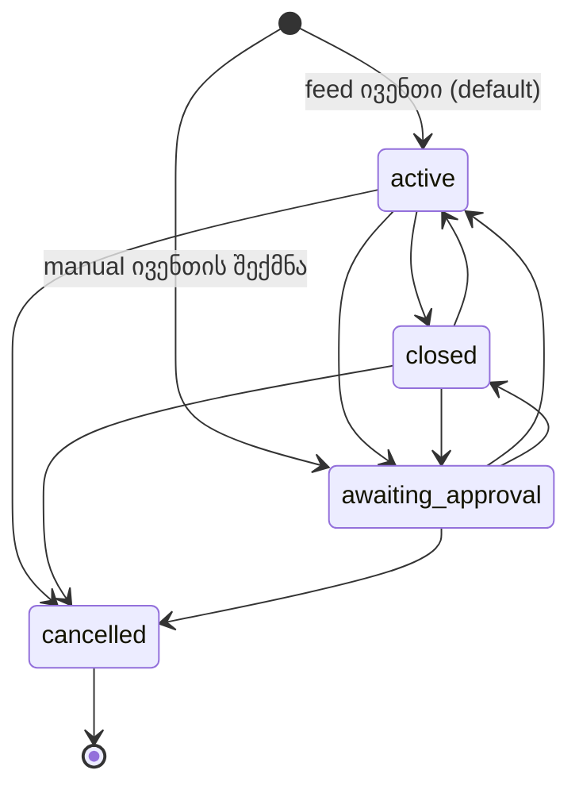

# 12 — Odds მოდული: რეფერენს-ადმინის ანალიზი და იმპლემენტაციის სპეციფიკაცია

> ⚠ შეთანხმებული გადაწყვეტილებები: [docs/09 §2](09-backoffice-plan.md#2-სავალდებულო-გადაწყვეტილებები-0508-ის-შეთანხმება) (პუნქტი 17 ამ დოკუმენტზე მიუთითებს). კონფლიქტის შემთხვევაში docs/09 სავალდებულოა. ეს დოკუმენტი **ცვლის** 06-ის, 07-ისა და 09-ის რამდენიმე პუნქტს; ჩამონათვალი §16-შია.

> **სტატუსი:** spec v1.0, დეველოპმენტისთვის · **თარიღი:** 2026-10-11
> **წყარო:** პროდუქტის მფლობელთან ერთად გავლილი ოპერატორის ამჟამინდელი ადმინი (SB Software, „Admin Console“), მენიუ **Odds**. ის არის **თამასა**: ჩვენი back office ფუნქციურად მას არ უნდა ჩამოუვარდეს, UX-ში კი უკეთესი უნდა იყოს.
> **სფერო:** Odds › Odds (Manage, Results) და Odds › Game types (Manage, Sport assign, Sort order, Market types, Sub-market, Mapping, Template map). დანარჩენი სექციები (Register, Lives, Disallowed, Categories, Participants, BetGenius, Events mapping, Add games, Odds list) შემდეგ ვერსიებში დაემატება.
> **დაკავშირებული:** [02](02-uof-data-model.md) (`sb` DDL) · [04](04-platform-architecture.md) (§9.2 multi-provider) · [06](06-backoffice-catalog-odds-config.md) (CAT, ODDS, CFG §5.8) · [07](07-backoffice-trading-risk-customers.md) (bet engine, settlement, LIM) · [09](09-backoffice-plan.md) (გეგმა, სტატუსი) · [11](11-sportsbook-api-and-whitelabel.md) (Player API).
>
> ნიშნები: **[D#]** = პროდუქტის მფლობელის გადაწყვეტილება (სავალდებულო). **[R#]** = ჩვენი რეკომენდაცია, რომელსაც მფლობელი არ შეწინააღმდეგებია; ⚠ ნიშნიანი R-ები §17-ში დასადასტურებლად რჩება. „რეფერენსი“ = ოპერატორის ამჟამინდელი ადმინი.

## სარჩევი

0. [მოკლედ](#0-მოკლედ)
1. [ტერმინოლოგია: რეფერენსი → ჩვენ](#1-ტერმინოლოგია-რეფერენსი--ჩვენ)
2. [გადაწყვეტილებების რეესტრი](#2-გადაწყვეტილებების-რეესტრი)
3. [ხილვადობის ჯაჭვი: როდის ჩანს მარკეტი ფრონტზე](#3-ხილვადობის-ჯაჭვი-როდის-ჩანს-მარკეტი-ფრონტზე)
4. [Odds › Manage: ივენთების სია](#4-odds--manage-ივენთების-სია)
5. [ივენთის ოპერატორული სტატუსი და ⚙ მენიუ](#5-ივენთის-ოპერატორული-სტატუსი-და--მენიუ)
6. [ლიმიტები, ალერტები, ტიკერი](#6-ლიმიტები-ალერტები-ტიკერი)
7. [Changelog და კომენტარები](#7-changelog-და-კომენტარები)
8. [Odds › Results: რეზალტინგი](#8-odds--results-რეზალტინგი)
9. [Game type კატალოგი (Game types › Manage)](#9-game-type-კატალოგი-game-types--manage)
10. [Sport assign](#10-sport-assign)
11. [Sort order](#11-sort-order)
12. [ტაბები და ქვეტაბები (Market types, Sub-market)](#12-ტაბები-და-ქვეტაბები-market-types-sub-market)
13. [Mapping: პროვაიდერი → game type](#13-mapping-პროვაიდერი--game-type)
14. [Template map და მარკეტის იდენტობა](#14-template-map-და-მარკეტის-იდენტობა)
15. [მონაცემთა მოდელი, CFG, permission-ები, API — შეჯამება](#15-მონაცემთა-მოდელი-cfg-permission-ები-api--შეჯამება)
16. [ცვლილებები სხვა დოკუმენტებში](#16-ცვლილებები-სხვა-დოკუმენტებში)
17. [ღია კითხვები](#17-ღია-კითხვები)
18. [სამუშაო პაკეტები, თანმიმდევრობა, შეფასება](#18-სამუშაო-პაკეტები-თანმიმდევრობა-შეფასება)

---

## 0. მოკლედ

რეფერენსის Odds მოდული ხუთ რამეს აკეთებს, და ყველა ჩვენთანაც საჭიროა:

1. **ივენთების სამუშაო სია** (Manage): ფილტრები, ლიგებად დაჯგუფება, 1X2 კოეფიციენტები, ფსონების სტატისტიკა და liability ერთ ცხრილში; ივენთის სტატუსის, დაწყების დროისა და კომენტარის მართვა, ისტორია.
2. **რეზალტინგი** (Results): დაურეზალტებელი ივენთების რიგი და სპორტზე მორგებული ფორმა, სადაც ბუკმეკერი პერიოდების სტატისტიკას შეიყვანს, სისტემა კი ყველა მარკეტის შედეგს ითვლის.
3. **Game type კატალოგი**: მარკეტის ტიპები წყაროს მიუხედავად, თარგმანი, კომბინაციის აკრძალვები, default liability, ჩვენების layout.
4. **ხილვადობა და რიგი**: ტიპი სპორტზე მიბმული (Sport assign), სპორტის/ქვეყნის/ლიგის სიაში დამატებული და დალაგებული (Sort order), ტაბებად და ქვეტაბებად დაჯგუფებული.
5. **Mapping**: Betradar / Genius / LSports-ის ტიპები ჩვენს game type-ებზე, სპორტის მიხედვით.

ჩვენთვის ყველაზე დიდი ახალი კომპონენტებია: **ხილვადობის ჯაჭვი** (§3; ცვლის default-ს „ყველაფერი ჩანს“-დან „ჩანს მხოლოდ დამატებული“-ზე), **resolver** (`Settle.Core`, §8.4) და **სპორტის მიხედვით mapping** (§13). დანარჩენი არსებულ მექანიზმებზე (CFG, I18N, `bo.event_override`, `bo.trading_override`, `bo.manual_settlement`) აშენდება.

---

## 1. ტერმინოლოგია: რეფერენსი → ჩვენ

| რეფერენსი | მნიშვნელობა | ჩვენთან (კოდი / UI) |
|---|---|---|
| **Game** | კონკრეტული მარკეტი ივენთზე (მაგ. „Handicap (1X2) 2:0“) | `sb.market` / UI: „მარკეტი“ |
| **Game type** | მარკეტის ტიპი (1X2, Total Goals…) | `sb.market_description` / UI: „მარკეტის ტიპი (game type)“ |
| **Market type** | ფრონტის **ტაბი** ივენთის გვერდზე (Main, Corner, Offside…) | `bo.market_group` (level 1) / UI: „ტაბი“ |
| **Sub market type** | ტაბის ქვეტაბი (Corner → 1st Half) | `bo.market_group` (level 2, `parent_id`) / UI: „ქვეტაბი“ |
| **Category / subcategory** | სპორტი / ქვეყანა (+ ლიგა) | `sb.sport` / `sb.category` / `sb.tournament` |
| **Standard** | პრემატჩი | `prematch` |
| **Creation method** | ვინ შექმნა ივენთი/მარკეტი | provider vs `manual` (`sb.provider` id 0, `bo.manual_entity`) |
| **B** (badge) | Betradar | provider badge: **B** Betradar, **G** Genius, **L** LSports, **M** manual |
| **Factor** | მარჟა | `margin.*` (CFG) |
| **Register (result)** | რეზალტის შეყვანა | §8 |
| **Event code id** | პროვაიდერის მიერ მინიჭებული ID | `sb.provider_mapping` (გარე ID), მხოლოდ ჩვენება |

---

## 2. გადაწყვეტილებების რეესტრი

### 2.1 პროდუქტის მფლობელის გადაწყვეტილებები (სავალდებულო)

| # | გადაწყვეტილება | სად |
|---|---|---|
| D1 | **Four-eyes default-ად გამორთულია** ყველგან (ლიმიტები, მარჟა, რეზალტი, cancel, სტატუსი). მექანიზმი რჩება და ოპერატორს შეუძლია ჩართოს. | §15.2 |
| D2 | ივენთის სტატუსები: **Active, Closed, Awaiting approval, Cancelled**. Closed = ფრონტზე არ ჩანს, ბილეთი არ მიიღება (შექცევადი). Cancelled = ყველა selection ივენთზე 1.00. Awaiting approval = დამალულია **და** settlement შეჩერებულია. | §5 |
| D3 | Awaiting approval ძირითადად ლაივში გამოიყენება (მოვლენა მოხდა, შედეგს ველით); manual ივენთი ამ სტატუსში იქმნება და ბუკმეკერი ააქტიურებს. | §5 |
| D4 | **Change start time** ცვლის ფსონების მიღების ზღვარს. წარსულში გადაწევისას ახალი დროის შემდეგ დადებული selection-ები ამ ივენთის მარკეტებზე void (1.00). | §5.3 |
| D5 | ლიმიტი = **alert liability / market liability**. Alert-ზე ბუკმეკერი ტიკერში ალერტს იღებს; market liability-ზე მარკეტი **იხურება** (ფრონტზე არ ჩანს). გასახსნელად ბუკმეკერი თავად ზრდის ლიმიტს, დადასტურების გარეშე. | §6 |
| D6 | S1/SX/S2 სვეტები შეიძლება შეიცვალოს უფრო სასარგებლოთი. | §4.3 |
| D7 | Outright პრემატჩის ქვეტიპია; ფილტრი შეიძლება გაუმჯობესდეს. | §4.2 |
| D8 | **Multi-provider საჭიროა.** Genius = სრული პროვაიდერი (ივენთები, მარკეტები, კოეფიციენტები; ITF-ისა და ლაივისთვის). LSports = გამამდიდრებელი: არსებულ Radar/Genius ივენთს ებმება და მარკეტებს ამატებს (კუთხურები, ბარათები…), ჯერ ლაივში. | §13, §14 |
| D9 | Changelog აჩვენებს ბუკმეკერის **და** სისტემის/პროვაიდერის ცვლილებებს (თვისების დონეზე, IP-ით). | §7 |
| D10 | Event code id = პროვაიდერის ID. | §1 |
| D11 | ხელით რეზალტი **ძირითადი ფუნქციაა**: manual მარკეტები feed ივენთის შიგნით ჩვეულებრივია. | §8 |
| D12 | ხელით შეიძლება დარეზალტდეს **ნებისმიერი** მარკეტი (პროვაიდერისაც): ივენთის შიგნიდან (outcome-ის არჩევით) ან Register popup-იდან (სტატისტიკით). | §8 |
| D13 | Popup-ის შენახვა არეზალტებს ივენთის **ყველა ჯერ დაურეზალტებელ** მარკეტს (პროვაიდერისაც და manual-საც). უკვე დარეზალტებულს არ ეხება. | §8.5 |
| D14 | ჯერ ხელით, მერე განსხვავებული პროვაიდერის შედეგი → **ხელით შეყვანილი რჩება**, ბუკმეკერს მეილზე მოდის „result change“ ალერტი. | §8.7 |
| D15 | Resettle მოთამაშეს თანხას ჩამოაჭრის, **ბალანსი შეიძლება მინუსში წავიდეს**. | §8.8 |
| D16 | პროვაიდერის შედეგი ყველა ოპერატორისთვის ერთია. Manual მარკეტებს თითო ოპერატორი თავად არეზალტებს. | §8.2 |
| D17 | „Event Finished“ = მთელი მატჩი, **ოვერტაიმის ჩათვლით**. | §8.3 |
| D18 | ფეხბურთს ემატება **Extra time** სვეტი, default-ად დამალული, popup-ში კლიკით ჩნდება. Penalties სვეტი არ ემატება. | §8.3 |
| D19 | ჰოკეიში სერიის გამარჯვებულს Event Finished-ში **+1 არ ემატება**. ოვერტაიმის სვეტი ემატება. | §8.3 |
| D20 | Game type **წყაროზე არ არის მიბმული**: ერთი ტიპი ერთ ივენთზე პროვაიდერისგან მოდის, მეორეზე ხელით იქმნება. Game types › Manage მხოლოდ ზოგადი კონფიგურაციაა. | §9 |
| D21 | ერთი game type რამდენიმე სპორტში შეიძლება (1X2: ფეხბურთი + ჰოკეი). **სხვადასხვა სახელი სპორტის მიხედვით = სხვადასხვა game type** (Total Goals / Total Points). | §9, §13 |
| D22 | Sort order იქმნება **სპორტის, ქვეყნისა და ლიგის** დონეზე. | §11 |
| D23 | ტაბი მხოლოდ **ფილტრავს** (ერთი რიგი, ტაბი მისი ქვესიმრავლეა). | §11 |
| D24 | პროვაიდერის ახალი ტიპი ფრონტზე **თავისით არ ჩნდება**: სანამ არ დაიმეპება game type-ზე, game type სპორტზე არ მიება და Sort order-ის სიაში არ დაემატება. | §3 |
| D25 | ცარიელი ტაბი (ამ ივენთზე მარკეტის გარეშე) იმალება. ტაბების რიგი გლობალურია, სპორტის დონეზე იცვლება. | §12 |
| D26 | Templates (Game types) აღარ გამოიყენება — არ ვაკეთებთ. Long term ფილტრი (Results) არ გამოიყენება — არ ვაკეთებთ. | — |
| D27 | Template map-ის ფუნქცია (პრემატჩის და ლაივის პროვაიდერის ტიპების შესაბამისობა, cash-out-ისთვის) საჭიროა. | §14 |

### 2.2 ჩვენი რეკომენდაციები (default დიზაინი)

| # | რეკომენდაცია | სად |
|---|---|---|
| R1 | **ერთი game type prematch-ისთვისაც და live-ისთვისაც** (რეფერენსში ორი ჩანაწერია). განსხვავება (ლიმიტი, alert, მარჟა, layout, რიგი) CFG-ში და სიებში `mode` განზომილებით. ⚠ | §9.2 |
| R2 | Sort order: **სპორტის დონე = whitelist + default რიგი**; ქვეყანა/ლიგა ინახავს მხოლოდ განსხვავებას (რიგი, დამალვა, დამატება); სპორტზე დამატებული ტიპი ყველა ლიგაში ჩნდება. | §11.2 |
| R3 | ტაბის „Visible in feed“ = „ტაბი აქტიურია“: გამორთვა მალავს **მხოლოდ ტაბს**, მარკეტები სხვა ტაბებში რჩება. ⚠ | §12.2 |
| R4 | Game type-ის ქვეტაბზე მიბმა **ავტომატურად** ნიშნავს მშობელ ტაბზე მიბმას (რეფერენსში ცალ-ცალკეა). ⚠ | §12.3 |
| R5 | Outcome mapping მარკეტის mapping-თან ერთად, ავტომატური შეთავაზებით; ახალი დაუმეპავი outcome → მარკეტი იმალება + ალერტი. | §13.3 |
| R6 | Template map ცალკე გვერდად **არ** კეთდება: ის Mapping-იდან გამოდის, რადგან ყველა პროვაიდერი ერთსა და იმავე game type-ზე იმეპება. | §14 |
| R7 | Register popup-ის შენახვამდე **preview**: რომელი outcome მოიგებს/წააგებს/დაბრუნდება, რამდენი ბილეთი, რა თანხა. ⚠ | §8.6 |
| R8 | „Events without bets“ ავტომატური: ბილეთის გარეშე მარკეტი რიგში არ ჩანს და ავტომატურად იხურება. | §8.9 |
| R9 | S1/SX/S2 → **P&L, თუ ეს შედეგი მოვიდა** (ფერით). | §4.3 |
| R10 | Event type ფილტრი = ერთი multi-select (Prematch match · Prematch outright · Live) ორი ცალკე ფილტრის ნაცვლად. | §4.2 |
| R11 | **B2B გაყოფა:** game type კატალოგი და provider mapping = **პლატფორმა** (Feed Ops, platform staff). Sport assign, Sort order, ტაბები, game type-ის კონფიგურაცია, თარგმანის override და საკუთარი (custom) game type-ები = **ოპერატორი**. ⚠ | §9.1, §13.1 |
| R12 | პლატფორმა ახალ ოპერატორს აძლევს **default სიებს** (Sort order თითო სპორტზე, ტაბები), რომ ფრონტი ცარიელი არ იყოს. | §3.3 |

---

## 3. ხილვადობის ჯაჭვი: როდის ჩანს მარკეტი ფრონტზე

### 3.1 წესი

ოპერატორი O-სთვის, ივენთ E-ზე (სპორტი S, ქვეყანა C, ლიგა T, რეჟიმი M = prematch | live) მარკეტი `m` (game type G) ფრონტზე ჩანს, თუ **ყველა** პირობა სრულდება:

| # | პირობა | წყარო | ვინ მართავს |
|---|---|---|---|
| 1 | პროვაიდერის ტიპი დამეპილია G-ზე სპორტ S-ისთვის (manual მარკეტს ეს არ სჭირდება) | `sb.market_type_map` (§13) | პლატფორმა |
| 2 | G მიბმულია S-ზე რეჟიმ M-ისთვის | Sport assign (§10) | ოპერატორი |
| 3 | G არის O-ს effective Sort order სიაში (S → C → T მემკვიდრეობით, რეჟიმი M) და იქ დამალული არ არის | Sort order (§11) | ოპერატორი |
| 4 | CFG: `offer.visible`, `offer.prematch_enabled` / `offer.live_enabled`, `market.enabled` | CFG (არსებული) | ოპერატორი |
| 5 | ივენთის სტატუსი = Active (§5), არ არის trading close / suspend, liability ლიმიტი არ არის მიღწეული (§6) | `bo.event_override`, `bo.trading_override`, LIM | ოპერატორი / სისტემა |
| 6 | `Offer.Core`-ის არსებული gate-ები (producer down, odds.min, status precedence) | `Offer.Core` | — |

პირობები 1–3 **ახალია**. ისინი ერთ ფუნქციაში ითვლება (`OfferVisibility.Resolve(operator, event, mode)` → `{gameTypeId → (visible, sortKey, reason)}`), შედეგი `Offer.Core`-ს `MarketGate`-ში გადაეცემა ახალი მიზეზებით: `hidden:unmapped`, `hidden:not_assigned`, `hidden:not_in_order`. ეს მიზეზები BO-ის trading view-ში ჩანს („რატომ არ ჩანს ეს მარკეტი?“).

### 3.2 Default-ის ცვლილება

დღეს `market.enabled` default `true`-ა: feed-ის ყველა მარკეტი ჩანს. ახალი default (D24): **მარკეტი არ ჩანს, სანამ პირობები 1–3 არ შესრულდება**. `market.enabled` რჩება როგორც დამატებითი ჩამრთველი (მაგ. ერთ ივენთზე ტიპის გამორთვა).

### 3.3 B2B onboarding (R12)

- პლატფორმას აქვს **default template**: თითო სპორტზე Sport assign + Sort order (ძირითადი ტიპები ჩვეულებრივი რიგით) და ტაბები (Main, Totals, Handicap, 1st Half, Corners, Cards…). Template = `operator_id IS NULL` row-ები იმავე ცხრილებში.
- ოპერატორი მემკვიდრეობით იღებს template-ს. პირველივე ცვლილებისას ოპერატორის row იქმნება (copy-on-write) და ის იგებს.
- UI-ში ჩანს წყარო: „პლატფორმის default“ / „თქვენი“.

### 3.4 ცვლილებების გავრცელება

ყოველი ცვლილება (assign, order, tab) → audit + outbox (`offer.visibility.changed {operator, sport}`) → Player API cache-ის invalidation (docs/11 §4). მიზანი: ფრონტზე ≤ 2 წმ.

### 3.5 ტესტები

- Golden ცხრილი `Offer.Tests`-ში: 12+ შემთხვევა (დაუმეპავი, სპორტზე არ არის, ლიგაში დამალული, ლიგაში მხოლოდ იქ დამატებული, სპორტზე ახლად დამატებული ლიგის override-ის მიუხედავად ჩნდება, live vs prematch).
- RLS: ოპერატორი B ვერ ხედავს / ვერ ცვლის A-ს assign/order/tab row-ებს; template row-ებს ოპერატორი ვერ ცვლის.

---

## 4. Odds › Manage: ივენთების სია

ჩვენი არსებული `/odds` (`features/odds/events.ts`) ამ გვერდით იცვლება. ივენთზე დაჭერა ისევ trading view-ს (`/odds/events/:id`) ხსნის.

### 4.1 ზედა ზოლი

| ელემენტი | ქცევა |
|---|---|
| Start date | თარიღის არჩევა (default ცარიელი = Day-ით განისაზღვრება) |
| Day | Today / Tomorrow / Yesterday / +N |
| Time from / to `HHmm` | დროის ფანჯარა დღის შიგნით (default 0000–2359), ოპერატორის timezone-ით (`Asia/Tbilisi`) |
| Refresh | ხელით განახლება. **დამატებით** (ჩვენი გაუმჯობესება): ჩამრთველი „ავტო-განახლება 10 წმ“, live მწკრივები ყოველთვის ცოცხალი (WebSocket, docs/11 §3) |
| Per page | 50 / 100 / 500 / 1000; ვირტუალური scroll 1000-ზე |

### 4.2 ფილტრები

| ფილტრი | მნიშვნელობები | იმპლემენტაცია |
|---|---|---|
| Creation method | Any · Manual only · Remote only · Remote with manual games | manual = `bo.manual_entity(entity_type='event')`; remote with manual games = feed ივენთი, რომელსაც ამ ოპერატორის `manual:{op}:*` მარკეტი აქვს |
| Event type (R10) | multi-select: Prematch match · Prematch outright · Live | `sb.event.event_type` + `status='live'` |
| Status | Any · Awaiting approval · Active · Closed · Cancelled | ოპერატორული სტატუსი (§5), **არა** feed-ის |
| Team name | ძებნა (გუნდი, ივენთის სახელი, ID, URN) | არსებული `q` |
| Outrights | Include · Exclude · Only | R10-ის შემდეგ ზედმეტია; რჩება URL-პარამეტრად თავსებადობისთვის |
| Category → Subcategory | სპორტი → ქვეყანა (+ ჩვენ: → ლიგა) კასკადი, autocomplete-ით | `sportId`, `categoryId`, `tournamentId` |
| (ახალი) Provider | B / G / L / M | `sb.provider_mapping` |

ფილტრები URL-ში ინახება (გაზიარებადი ბმული), ბოლო არჩევანი — localStorage-ში.

### 4.3 ცხრილი

მწკრივები **დაჯგუფებულია** `Sport / Country / League` სათაურებით, ჯგუფის შიგნით დაწყების დროით.

| სვეტი | შინაარსი | წყარო | ეტაპი |
|---|---|---|---|
| Start | `HH:mm, dd.MM` (effective start, §5.3) | `event_override.display_start_at` ?? `sb.event.scheduled_at` | ახლა |
| ⚙ | ივენთის მენიუ (§5.2) | — | ახლა |
| Event | მონაწილეები / outright-ის სახელი (ოპერატორის თარგმანით) | I18N | ახლა |
| Provider | B / G / L / M badge; LSports-ით გამდიდრებულზე დამატებით „+L“ | `sb.provider_mapping` | ახლა |
| Status | ოპერატორული სტატუსი, ფერით | §5 | ახლა |
| Limits (K) | `alert / limit` ათასებში (effective CFG, ივენთის main market-ზე) | CFG §6 | ახლა (მნიშვნელობა), BO-2 (მიღწევის ფერი) |
| 1 · X · 2 | ბილეთების რაოდენობა თითო შედეგზე | `bet.*` | BO-2 |
| Stake | ჯამური stake (K) | `bet.*` | BO-2 |
| Poss | მაქსიმალური შესაძლო გადახდა / liability (K) | LIM | BO-2 |
| O1 · OX · O2 | main market-ის **შეთავაზებული** კოეფიციენტები (`display.main_market_type`) | `OfferService` | ახლა |
| P1 · PX · P2 (R9, ნაცვლად S1/SX/S2) | ოპერატორის P&L, თუ ეს შედეგი მოვიდა: `Σstake − Σpayout(outcome)`, მწვანე/წითელი | LIM | BO-2 |
| Games | ღია მარკეტების რაოდენობა, ბმული trading view-ზე | არსებული `openMarkets` | ახლა |

BO-2-მდე ფსონების სვეტები **დამალულია** (API აბრუნებს `null`-ს, UI სვეტების ჯგუფს მალავს), ცარიელი ნულებით არ ივსება.

### 4.4 API

```
GET /api/bo/odds/events?date=&day=&from=HHmm&to=HHmm&creation=any|manual|remote|remote_manual
      &types=prematch_match,prematch_outright,live&status=&q=&sportId=&categoryId=&tournamentId=&provider=
      &page=&size=&lang=
→ { groups:[{ sport, category, tournament, events:[{ id, startAt, name, provider:[B,L], status,
      limits:{alert,limit,currency}, main:{ "1":2.10, "X":3.30, "2":3.40 },
      bets:null|{ byOutcome:{"1":5,"X":0,"2":1}, stake, possible, pnl:{"1":..,"X":..,"2":..} },
      openMarkets }] }], total }
```

ერთი SQL main market-ის ფასისთვის არ კმარა (ფასი `Offer.Core`-ით ითვლება): batch — ერთ მოთხოვნაში გვერდის ყველა ივენთის main market `OfferService.PriceMany(...)`-ით. მიზანი: 1000 ივენთი < 800 ms.

### 4.5 მიღების კრიტერიუმები

- ყველა ფილტრი კომბინირდება; ცარიელი შედეგი „No events“-ს აჩვენებს.
- 1000 ივენთზე გვერდი < 1.5 წმ (API + რენდერი).
- სხვა ოპერატორის manual ივენთი/მარკეტი არც სიაში ჩანს, არც `creation` ფილტრზე მოქმედებს (RLS ტესტი).

---

## 5. ივენთის ოპერატორული სტატუსი და ⚙ მენიუ

### 5.1 სტატუსები (D2, D3)

ოპერატორული სტატუსი feed-ის სტატუსისგან (`not_started/live/ended/...`) დამოუკიდებელია და მხოლოდ ამ ოპერატორზე მოქმედებს.



| სტატუსი | ფრონტზე | ბილეთის მიღება | Settlement | შენიშვნა |
|---|---|---|---|---|
| `active` | ჩანს | კი | ჩვეულებრივ | default |
| `closed` | **არ ჩანს** | არა | ჩვეულებრივ (უკვე დადებული ბილეთები სეტლდება) | ყველა მარკეტის ერთად დახურვა |
| `awaiting_approval` | **არ ჩანს** | არა | **შეჩერებულია** (hold): feed-ის და manual settlement-ები ამ ოპერატორის ბილეთებზე რიგში ჩერდება და `active`-ზე დაბრუნებისას გამოიყენება | ლაივში „მოვლენა მოხდა, ველოდებით“; manual ივენთის draft |
| `cancelled` | **არ ჩანს** | არა | ყველა ღია selection ამ ივენთზე → **void (F = 1)** | ტერმინალური; ფულს ამოძრავებს (BO-2) |

**იმპლემენტაცია**
- `bo.event_override`-ს ემატება `status text NOT NULL DEFAULT 'active' CHECK (status IN ('active','closed','awaiting_approval','cancelled'))`, `status_reason text`, `status_changed_at`, `status_changed_by`. Manual ივენთის row იქმნება `awaiting_approval`-ით.
- Event-scope `close` დღეს `bo.trading_override`-შია (TTL-ით). **წესი:** სტატუსი = მუდმივი ოპერატორული გადაწყვეტილება (`event_override.status`); `trading_override` რჩება **დროებითი** suspend/close-ისთვის (TTL) და მარკეტის დონისთვის. ⚙ მენიუს „Set status: Closed“ წერს `status`-ს, არა `trading_override`-ს.
- `Offer.Core`: `MarketGate`-ს ემატება `EventStatus`; `closed/awaiting_approval/cancelled` → `Hidden` (მიზეზი `event:<status>`).
- Settlement hold: settlement-service (BO-2) ამოწმებს `event_override.status` ოპერატორზე; `awaiting_approval` → settlement ჩანაწერი `bet.settlement_hold`-ში, `active`-ზე გადასვლისას (outbox `event.status.changed`) ხელახლა მუშავდება. BO-2-მდე: სტატუსი იწერება და UI-ში ჩანს, hold-ის ლოგიკა BO-2-შია.
- Cancel → bet-engine command API: `POST /internal/events/{id}/cancel {operatorId, reasonCode}` (docs/09 §2.7). BO-2-მდე ღილაკი disabled-ია tooltip-ით.
- ⚠ Cancel-ის გაუქმება (un-cancel) — §17 Q3.

### 5.2 ⚙ მენიუ

| ქმედება | Permission | იმპლემენტაცია |
|---|---|---|
| Change start time | `odds.event.edit` | §5.3 |
| Show bets | `bets.view` | BO-2: ticket search ფილტრით `eventId` |
| Set status: Awaiting approval / Closed / Active | `odds.event.status` | §5.1; reason სავალდებულოა |
| Cancel | `odds.event.cancel` | §5.1; დადასტურების dialog: ბილეთების რაოდენობა და თანხა, reason code |
| Add comment | `odds.event.comment` | §7.2 |
| Changelog | `odds.view` | §7.1 |

ყოველი ქმედება = audit + outbox ერთ ტრანზაქციაში (CLAUDE.md წესი). Four-eyes არ არის (D1).

### 5.3 Change start time (D4)

- `bo.event_override.display_start_at` ხდება **effective start time** (`effective_start_at` სახელით view-ში): ფრონტზე ჩვენებაც და პრემატჩის ფსონების მიღების ზღვარიც.
- **მომავალში:** ივენთი ჩანს და ფსონი მიიღება ახალ დრომდე.
- **წარსულში:** იქმნება void ფანჯარა `bo.void_window(operator_id, event_id, from_ts = new_start, to_ts = now(), reason, created_by)`. settlement-service (BO-2): ამ ოპერატორის ბილეთებში ამ ივენთის **პრემატჩის** selection-ები, დადებული `[from_ts, to_ts]`-ში → void (F = 1), Betradar-ის `bet_cancel start/end`-ის ანალოგიურად.
- **უსაფრთხოების წესი:** თუ feed ივენთს `live`-ად აცხადებს, პრემატჩის მიღება ჩერდება override-ის მიუხედავად.
- Dialog-ში ჩანს: ძველი დრო, ახალი დრო, წარსულში გადაწევისას — რამდენი ბილეთი გახდება void.

---

## 6. ლიმიტები, ალერტები, ტიკერი

### 6.1 CFG key-ები (D5)

| Key | ტიპი | Scope | Default | ცვლილება |
|---|---|---|---|---|
| `limit.alert_liability_market` | money | `O s c t e m` (+mt, +mode) | null | **ახალი** |
| `limit.max_liability_market` | money | `O s c t e m` (+mt, +mode) | null | არსებული; `requires_approval` → D1-ით ეფექტურად გამორთული |
| `limit.alert_liability_event` | money | `O s c t e` | null | **ახალი** (P1) |

Game type-ის default liability (რეფერენსის Alert/Liability სვეტები) = ამ key-ების მნიშვნელობა `O`-ს დონეზე market-type qualifier-ით; სპორტი/ლიგა/ივენთი მას ჩვეულებრივი CFG მემკვიდრეობით გადაფარავს (docs/09 §2.2).

### 6.2 ქცევა (BO-2, LIM)

- Liability თითო outcome-ზე = ამ outcome-ის მოგებისას გადასახდელი − მარკეტზე მიღებული stake (docs/07 §3).
- `liability ≥ alert` → NOTIF `liability.alert {event, market, value, alert, limit}` → ტიკერი + (CFG) მეილი.
- `liability ≥ limit` → მარკეტი **გამოთვლილად დამალულია** (`Offer.Core` gate `liability:limit`) + NOTIF `liability.limit_reached`. ფსონი, რომელიც ლიმიტს გადააჭარბებდა, უარყოფილია (reason code CMS-იდან).
- **გახსნა:** ბუკმეკერი ზრდის `limit.max_liability_market`-ს ამ ივენთზე/მარკეტზე (ტიკერიდან ან trading view-დან ერთი ქმედებით, „ლიმიტი +50%“ / ზუსტი თანხა). ცვლილება მაშინვე მოქმედებს (D1).

### 6.3 ტიკერი (shell-ის ზედა ზოლი)

- ბოლო N ალერტი: დრო, ივენთი, `[alert/limit]` (K), ტიპი (liability / result change / feed conflict). დაჭერა → trading view.
- წყარო: NOTIF (BO-3). BO-1-ში: shell-ის კომპონენტი და `GET /api/bo/notif/recent` ცარიელი სიით, რომ BO-3-ში მხოლოდ წყარო ჩაერთოს.

---

## 7. Changelog და კომენტარები

### 7.1 Changelog (D9)

Dialog „Event history | Event ID“, სვეტები: **დრო · Property · Admin · IP · Old value · New value**.

| წყარო | რას შეიცავს | Admin სვეტში |
|---|---|---|
| `bo.audit_log` (`entity_type='event'`, ამ ოპერატორის) | სტატუსი, start time, თარგმანი/სახელი, კომენტარი, cancel, manual result | ბუკმეკერის სახელი + ID, IP |
| `sb.event_change_log` (**ახალი**, feed-ის მხარე, ყველა ოპერატორისთვის საერთო) | სახელი, start time, feed status, ანგარიში/შედეგი, provider ID-ის მინიჭება | „System (provider)“, IP ცარიელი |

- `bo.audit_log`-ს ემატება `ip inet` (V008). `Audit.WriteAsync` IP-ს request-იდან იღებს (`X-Forwarded-For` სანდო proxy-დან).
- `sb.event_change_log(event_id, ts, property, old_value, new_value, source)` — წერს **adapter** (`CanonicalStore`), როცა თვალყურის დევნებული ველი იცვლება: `name`, `scheduled_at`, `status`, `home_score/away_score`, `period_scores` (შეკუმშული), `provider_mapping` ახალი row. ⚠ მოცულობა: მხოლოდ ცვლილება, არა ყოველი message; partition თვეებით.
- API: `GET /api/bo/odds/events/{id}/history?lang=` → ორივე წყაროს შერწყმა დროით.
- Property-ის სახელები UI-ში ითარგმნება (ka/en).

### 7.2 კომენტარები

- `bo.event_comment(id, operator_id, event_id, text, created_by, created_by_name, created_at, deleted_at)`, RLS.
- ჩანს: ⚙ მენიუ → Add comment; ივენთის მწკრივზე კომენტარის ხატულა (რაოდენობა); trading view-ში ბლოკი. Changelog-შიც ჩაიწერება.
- `POST /api/bo/odds/events/{id}/comments`, `GET …/comments`, `DELETE …/comments/{cid}` (საკუთარი, ან `odds.event.comment.manage`).

---

## 8. Odds › Results: რეზალტინგი

### 8.1 რიგი (`/odds/results`)

**ზედა ზოლი:** Show (Last 24h / 48h / 7d / custom), Refresh, ექსპორტი **CSV / XLSX** (PDF არა), **Resulting progress** (§8.9). „Events without bets“ ღილაკი არ არის (R8).

**ფილტრები:** Creation method, Event type, Sport, Team name, **Not older than X hours** (ივენთის start ბოლო X საათშია), Outrights. (Long term არა — D26.)

**ცხრილი:**

| სვეტი | შინაარსი |
|---|---|
| ☐ | ჯგუფური მონიშვნა |
| Event start | ბმული trading view-ზე |
| Category | Sport / Country / League |
| Event, provider badge | |
| Bets | ბილეთების რაოდენობა (BO-2-მდე —) |
| Result | ანგარიში (`?-?` თუ არ ვიცით) |
| **Register** | popup (§8.3) |
| Unresulted `a/b/c/d` | a = დაურეზალტებელი მარკეტები · b = manual მარკეტები · c = პროვაიდერის მარკეტები (d − b) · d = სულ |
| Games | ივენთის მარკეტები (outcome-ის ხელით არჩევით რეზალტისთვის) |
| Cancel | §5.1 |

**ჯგუფური ქმედებები:** Cancel selected, **Show selected** — მონიშნული ივენთების დაურეზალტებელი მარკეტები ერთ გვერდზე (`/odds/results/bulk?events=…`), თითო მარკეტზე outcome-ის არჩევა, ერთი Save.

რიგში ხვდება ივენთი, რომელსაც ამ ოპერატორისთვის აქვს ≥ 1 დაურეზალტებელი მარკეტი **ბილეთებით** (R8), ან manual მარკეტი (მიუხედავად ბილეთებისა, BO-2-მდე).

### 8.2 ვინ რას არეზალტებს (D12, D16)

- პროვაიდერის შედეგი = პლატფორმის მონაცემი (`sb.settlement`), ყველა ოპერატორისთვის ერთი.
- ოპერატორის ხელით შედეგი (სტატისტიკა ან outcome) = `bo` ცხრილები RLS-ით; მოქმედებს **მხოლოდ ამ ოპერატორის ბილეთებზე**. ორ ოპერატორს ერთ ივენთზე შეიძლება სხვადასხვა სტატისტიკა ჰქონდეს.
- ყოველი ხელით შედეგი → `bo.manual_settlement` (docs/09 §2.4) + `source` (`stats` | `outcome_pick`), `lock_feed = true`.

### 8.3 Register popup: result schema (D17–D19)

Popup სპორტის **result schema**-დან იწყობა (კონფიგურაცია, არა თითო სპორტის კოდი):

```jsonc
// platform/src/Settle.Core/Schemas/soccer.json (კოდში, როგორც MessageCatalog; პლატფორმის დონე)
{
  "sport": "sr:sport:1",
  "periods": [
    { "code": "ft",  "label": "Event Finished", "kind": "total" },          // მთელი მატჩი, ET-ის ჩათვლით (D17)
    { "code": "h1",  "label": "First Half",    "kind": "regular" },
    { "code": "h2",  "label": "Second Half",   "kind": "regular", "derive": "ft - h1 - et" },
    { "code": "et",  "label": "Extra time",    "kind": "extra", "optional": true, "hiddenByDefault": true }  // D18
  ],
  "aggregates": { "regular": "h1 + h2", "total": "ft" },
  "stats": [
    { "code": "score",   "label": "Score",   "cell": "pair", "required": true },
    { "code": "corners", "label": "Corners", "cell": "pair" },
    { "code": "cards",   "label": "Cards",   "cell": "pair" },
    { "code": "booking_points", "label": "Booking points", "cell": "pair" }
    // … shots on/off target, shots, fouls, offsides, throw ins, possession, saves, goal kicks, posts, blocked shots,
    //   tackles, interceptions, dribbles, aerial duels, touches, free kicks, attacks, dangerous attacks, crosses, passes
  ]
}
```

| სპორტი | Periods (სვეტები) | Event Finished | სპეციფიკა |
|---|---|---|---|
| ფეხბურთი | FT, 1H, 2H, **ET** (დამალული, „+ Extra time“) | ET-ის ჩათვლით | regular (90') = 1H + 2H; Penalties სვეტი არა (D18) |
| კალათბურთი | FT, Q1–Q4, OT | OT-ის ჩათვლით | rebounds = defensive + offensive (derive) |
| ჰოკეი | FT, P1–P3, **OT** (ახალი, D19), Shootout | OT-ის ჩათვლით, **სერიის გარეშე** (+1 არა) | regular = P1+P2+P3; „Winner incl. shootout“ გამარჯვებულს Shootout სვეტით ადგენს |
| ჩოგბურთი | FT, Set 1–5 | Sets score მხოლოდ FT-ში | Minutes = ერთი მნიშვნელობა (`cell: single`); სეტების ანგარიში გეიმებიდან (derive) |

**UI ქცევა**
- ცარიელი უჯრები = „არ ვიცით“ (≠ 0). Derive-ის შედეგი ავტომატურად ივსება, ხელით გადაწერადია (ფერით მონიშნული).
- ვალიდაცია: Σ პერიოდები ≠ FT → გაფრთხილება (შენახვას არ ბლოკავს, preview-ში ჩანს); უარყოფითი/წილადი მნიშვნელობები ბლოკავს.
- **წინასწარი შევსება:** feed ივენთზე `sb.event.period_scores` და `sb.event.statistics`-დან, ნიშნით „feed“.
- კლავიატურით სრული ნავიგაცია (Tab, Enter = შემდეგი მწკრივი).

### 8.4 Resolver: `Settle.Core` (ახალი ბიბლიოთეკა)

`Offer.Core`-ის მსგავსად: დამოკიდებულებების გარეშე, golden ტესტებით (`platform/tests/Settle.Tests/Golden/*.json`), შედეგები დამოუკიდებელი იმპლემენტაციით გადამოწმებული.

```
Resolve(ResultSheet sheet, MarketInstance market, RuleBinding rule) → MarketResult | Unresolvable(reason)
MarketResult = { outcomes: [{ code, result: won|lost|void|half_won|half_lost, deadHeat? }] }
```

**წესის ოჯახები** (თითო game type-ს ერთი ოჯახი + პარამეტრები `stat`, `period` ∈ {ft, regular, h1, h2, q1…, et, ot, shootout}, `team` ∈ {home, away, any}):

| ოჯახი | მაგალითები |
|---|---|
| `winner_3way` / `winner_2way` | 1X2, 12, Draw no bet, Double chance |
| `total` (O/U, specifier `total`; .25/.75 → half) | Total Goals, Corners O/U 1H, Team total |
| `handicap_3way` / `asian_handicap` | Handicap (1X2) 0:1, Asian handicap −1.25 |
| `exact` / `range` | Exact goals, Goal range, Correct score |
| `odd_even` | Total odd/even |
| `both_teams` | BTTS, BTTS 1H |
| `most` (რომელ ნაწილში/გუნდს მეტი) | Most scoring half, Most corners 3-way |
| `htft`, `combo` | Halftime/Fulltime, Result & Total |
| `first_last` (P1, მოითხოვს მოვლენების თანმიმდევრობას) | First/Last goal — popup-ით არ რეზალტდება, outcome-ის არჩევით |

**წესის მიბმა game type-ზე** = **პლატფორმის** კატალოგი (`sb.market_settle_rule(market_description_id, family, params jsonb)`), რომელსაც platform staff მართავს (Feed Ops). ეს **არ არის** ოპერატორის Game types › Manage გვერდის ველი (D20). ოპერატორის საკუთარ (custom) game type-ზე წესი არასავალდებულოა: თუ არ აქვს, მარკეტი outcome-ის ხელით არჩევით რეზალტდება.

### 8.5 Save → „upload to games“ (D13)

1. `bo.result_sheet(operator_id, event_id, data jsonb, version, created_by, created_at)` — ყოველი შენახვა ახალი ვერსიაა (ისტორია).
2. Resolver ეშვება ივენთის **ყველა ჯერ დაურეზალტებელ** მარკეტზე (ამ ოპერატორისთვის): პროვაიდერისა და ოპერატორის manual. უკვე დარეზალტებულს (feed-ით ან ხელით) არ ეხება.
3. `Unresolvable` (წესი არ აქვს, ან სტატისტიკა აკლია) → მარკეტი რიგში რჩება მიზეზით.
4. თითო resolved მარკეტი → `bo.manual_settlement` (`source='stats'`, `result_sheet_version`), audit + outbox `settlement.manual.created`. BO-2-მდე ჩანაწერი იქმნება, ფული არ მოძრაობს.

### 8.6 Preview (R7)

Save-მდე: ცხრილი თითო მარკეტზე — outcome-ები won/lost/void, ბილეთების რაოდენობა, გადასახდელი თანხა (BO-2-მდე მხოლოდ outcome-ები), გაფრთხილებები (Σ ≠ FT, დაურეზალტებელი დარჩა). „Confirm“ ერთი დაჭერით. ⚠ §17 Q1.

### 8.7 კონფლიქტი feed-თან (D14)

- `lock_feed = true`: feed-ის მოგვიანებით შედეგი ამ ოპერატორის ბილეთებზე ხელით შედეგს არ გადაწერს.
- თუ ის განსხვავდება → NOTIF `settlement.feed_conflict` → **მეილი** (არხი `email`, მიმღები: CFG `notif.result_change_recipients`) + ტიკერი. ბუკმეკერს შეუძლია „feed-ის შედეგის მიღება“ ერთი ქმედებით (= resettle feed-ის შედეგით).

### 8.8 გასწორება / resettle (D15)

- გზა 1: მარკეტის ხელახლა გახსნა (Games → market → „Reopen result“) → ახალი სტატისტიკა/outcome.
- გზა 2: Games-ში პირდაპირ ახალი outcome.
- ორივე → `bo.manual_settlement` ახალი row (`supersedes_id`) → settlement-service: rollback + resettle (delta), docs/07 §4.
- **უკვე გადახდილი ბილეთი:** delta ჩამოიჭრება, ბალანსი შეიძლება მინუსში წავიდეს. ⇒ **INT კონტრაქტის სავალდებულო პუნქტი (BO-2):** PAM-მა უნდა მიიღოს `debit` ტიპის `resettlement_adjustment`, რომელსაც უარს ვერ ეტყვის (insufficient funds-ის გარეშე).

### 8.9 Events without bets, Resulting progress

- R8: ბილეთის გარეშე მარკეტი, როცა ივენთი დასრულდა და feed არ არეზალტებს, `ended + 24h`-ის შემდეგ ავტომატურად იხურება (`settled_without_bets`), რიგში არ ჩანს. Manual მარკეტი ბილეთის გარეშე — იგივე.
- Resulting progress: settlement-ის რიგის მდგომარეობა (pending / processing / failed თითო ივენთზე), `GET /api/bo/odds/results/progress`. BO-2-მდე — მხოლოდ `bo.manual_settlement`-ის სტატუსები.

### 8.10 API

```
GET  /api/bo/odds/results?show=24h&creation=&types=&sportId=&q=&notOlderThanHours=&outrights=&page=
GET  /api/bo/odds/results/schema?eventId=          → result schema + feed prefill + არსებული sheet
POST /api/bo/odds/results/{eventId}/preview        {data} → per-market outcomes, warnings
POST /api/bo/odds/results/{eventId}                {data, expectedVersion} → manual_settlement rows
POST /api/bo/odds/markets/{marketId}/result        {outcomes:[{code,result,deadHeat?}], reason}  (outcome pick)
POST /api/bo/odds/markets/{marketId}/result/reopen {reason}
GET  /api/bo/odds/results/progress
GET  /api/bo/odds/results/export?format=csv|xlsx&…
```

Permission: `odds.result.enter` (ახალი), `odds.result.reopen` (ახალი).

---

## 9. Game type კატალოგი (Game types › Manage)

### 9.1 ვინ რას ფლობს (R11)

| ნაწილი | დონე | ცხრილი / მექანიზმი |
|---|---|---|
| Game type-ის არსებობა, outcome შაბლონები, specifier-ები, resolver-ის წესი | **პლატფორმა** | `sb.market_description` (+ `_outcome`, `market_specifier_def`), `sb.market_settle_rule` |
| სახელი/pattern/description/outcome სახელები | პლატფორმა default + **ოპერატორის override** | I18N (`market_type`, `outcome_type`; ემატება `description` ველი) |
| Combinations, alert/liability, layout-ები | **ოპერატორი** | CFG market-type qualifier-ით (§9.3) |
| Sport assign, Sort order, ტაბები | **ოპერატორი** | §10–12 |
| საკუთარი game type (Add) | **ოპერატორი** | `sb.market_description` code `custom:{op}:{slug}` (V007-ის `manual:{op}:` ნიმუშით, RLS-ით) |

### 9.2 ერთი ტიპი prematch-ისთვის და live-ისთვის (R1)

- Game type ერთია; Game types › Manage-ს აქვს გადამრთველი **Prematch / Live**, რომელიც ცვლის **კონფიგურაციის** რეჟიმს (CFG `mode` qualifier), არა ჩანაწერს.
- CFG ძრავას ემატება qualifier `mode ∈ {prematch, live}` (როგორც `mt`): `bo.setting.mode text NULL`; resolution — თანაბარ სიღრმეზე `mode`-იანი მნიშვნელობა იგებს `mode`-ის გარეშეს, `mt`-ის შემდეგ. `setting_def.allows_mode boolean`.
- ⚠ თუ მფლობელი რეფერენსის მოდელს (ორი ჩანაწერი) აირჩევს, იცვლება მხოლოდ §9–§14-ის UI; ცხრილები `mode` სვეტით ორივე ვარიანტს უძლებს.

### 9.3 ველები

| რეფერენსის ველი | ჩვენთან | შენიშვნა |
|---|---|---|
| Game type ID | `sb.market_description.id` | პლატფორმის ტიპები და `custom:*` ერთ ID-სივრცეში, UI-ში badge „Platform / Custom“ |
| Name, Pattern `{0}` | name template named specifier-ებით (`Handicap {hcp}`) | არსებული; I18N lint + preview |
| Languages (name, pattern, description, outcome-ები) | I18N `market_type` (`template`, `name`, **`description`** ახალი), `outcome_type` | არსებული ეკრანი `features/i18n`; Game type-ის Edit dialog-იდან ბმული/ჩაშენება |
| Group (Two way / Three way) | გამოთვლილი outcome-ების რაოდენობიდან | ცალკე ველი არ არის |
| **Combinations** | CFG `bet.conflict_tags` (string_list, `O s t e`, mt, mode) | ორ selection-ს ერთ ივენთზე, რომელთა ტიპებს საერთო ტეგი აქვთ, ერთ ბილეთში ვერ გააერთიანებ. **Bet engine ამოწმებს სერვერზე** (reason code `COMBINATION_CONFLICT`), Player API ტეგებს მარკეტთან აბრუნებს ფრონტის წინასწარი გაფრთხილებისთვის |
| Alert, Liability | `limit.alert_liability_market`, `limit.max_liability_market` | §6 |
| Category builder, Event builder | CFG `display.category_layout`, `display.event_layout` (enum, mt, mode) | მნიშვნელობები: `two_way`, `three_way`, `three_way_123`, `two_columns`, `two_columns_by_odds`, `*_with_event_name`, `*_with_game_name`. Player API აბრუნებს hint-ად |
| 1 in event | — | ⚠ ჩვენი დაკვირვება: „ერთხაზიანი ტიპი“. ჩვენთან specifier-ის არსებობიდან ჩანს + `market.max_lines`. §17 Q4 |
| Market types / Sub market types | ტაბები | §12 |

### 9.4 გვერდი `/odds/game-types`

- ფილტრები: ID, სახელი, ტაბი, layout, combination tag, სპორტი (assign), Platform/Custom. Prematch/Live გადამრთველი.
- ცხრილი: ID, სახელი (ოპერატორის ენაზე), outcome-ები, ტაბები (chips), conflict tags, alert/limit (K), layout-ები, სპორტები (რაოდენობა). ექსპორტი CSV/XLSX.
- **Bulk change:** მონიშნულ ტიპებზე ერთი ქმედებით: tags, alert/limit, layout, ტაბზე მიბმა.
- **Add (custom):** სახელი + თარგმანი, outcome-ები (სტატიკური სია ან „დინამიკური“), specifier-ები, ტაბები. Resolver-ის წესი — არჩევითი ოჯახებიდან (§8.4).
- **Duplicate (D21):** ერთი ქმედებით ასლი ახალი სახელით (outcome-ები, თარგმანი, CFG მნიშვნელობები, ტაბები). გამოიყენება სპორტისთვის ცალკე ტიპის შესაქმნელად (Total Goals → Total Points).

### 9.5 API

```
GET    /api/bo/odds/game-types?q=&tab=&sportId=&mode=&kind=platform|custom&page=
GET    /api/bo/odds/game-types/{id}?mode=            → definition + effective CFG + tabs + sports
PATCH  /api/bo/odds/game-types/{id}/config?mode=     {conflictTags?, alert?, limit?, categoryLayout?, eventLayout?, reason}
                                                      (→ CFG change set, D1: immediate)
POST   /api/bo/odds/game-types/bulk                  {ids, patch, reason}
POST   /api/bo/odds/game-types                       custom type
POST   /api/bo/odds/game-types/{id}/duplicate        {name, texts}
```

ახლანდელი `GET/PUT /api/bo/odds/market-types` (BO-1b matrix) ამ endpoint-ებით და §10-ით ჩანაცვლდება.

---

## 10. Sport assign

- **რას ნიშნავს:** game type G ხელმისაწვდომია სპორტ S-ზე რეჟიმ M-ში (ხილვადობის ჯაჭვის პირობა 2, §3) **და** ჩანს ხელით მარკეტის შექმნის სიაში (Add games, manual market) ამ სპორტის ივენთებზე.
- **ცხრილი:** `bo.sport_game_type(operator_id NULL=template, sport_id, market_description_id, mode, created_by, created_at)`, PK `(operator_id, sport_id, market_description_id, mode)` `NULLS NOT DISTINCT`, RLS.
- BO-1b-ის `market.enabled` matrix UI იცვლება; `market.enabled` CFG რჩება დამატებით ჩამრთველად (§3.2).
- **UI (`/odds/sport-assign`):** მარცხნივ სპორტების სია, მარჯვნივ არჩეული სპორტის ტიპები (ძებნა, Prematch/Live). Add (autocomplete, მრავალჯერადი), Remove, **„კოპირება სხვა სპორტიდან“**, bulk add. ტიპის წაშლისას გაფრთხილება: რამდენ Sort order სიაშია და რამდენ ღია მარკეტს დამალავს.
- API: `GET/POST/DELETE /api/bo/odds/sport-assign?sportId=&mode=`, `POST /api/bo/odds/sport-assign/copy {fromSportId, toSportId, mode}`.

---

## 11. Sort order

### 11.1 მნიშვნელობა (D22–D24)

Sort order სია = **whitelist + რიგი**. Game type ფრონტზე მხოლოდ მაშინ ჩანს, თუ effective სიაშია. ტაბი ამ სიის ფილტრია (D23): ტაბში მარკეტები იმავე რიგით ჩანს.

### 11.2 მემკვიდრეობა (R2)

```
effective(T) = apply(diff(T), apply(diff(C), base(S)))
base(S)      = სპორტის სია (operator row ან პლატფორმის template)
diff(X)      = { reorder: [ids…], hidden: [ids…], added: [ids…] }  // მხოლოდ განსხვავება
```

- სპორტზე ახლად დამატებული ტიპი ჩნდება ყველა ქვეყანასა და ლიგაში, მათ შორის override-იანებშიც (diff-ის `reorder`-ში არ არის → ჩაჯდება base-ის პოზიციაზე, მის მეზობელთან ახლოს).
- ლიგაში შეიძლება: გადალაგება, დამალვა, მხოლოდ ამ ლიგისთვის დამატება (`added`; ტიპი სპორტზე assign-ით უნდა იყოს).
- „მშობელზე დაბრუნება“ = diff-ის წაშლა.

**ცხრილები**
- `bo.game_type_order(operator_id NULL=template, scope_type 'sport'|'category'|'tournament', scope_id, mode, items jsonb, version, updated_by, updated_at)`, PK `(operator_id, scope_type, scope_id, mode)` `NULLS NOT DISTINCT`, RLS.
  - sport: `items = [{id, pos}]` (pos = fractional/LexoRank სტრიქონი; გადატანა = ერთი ელემენტის ცვლილება).
  - category/tournament: `items = {reorder:[{id,pos}], hidden:[id], added:[{id,pos}]}`.
- Optimistic concurrency: `version` (ორი ბუკმეკერი ერთდროულად).

### 11.3 UI (`/odds/sort-order`) — გაუმჯობესებული UX

- მარცხნივ კატალოგის ხე (სპორტი → ქვეყანა → ლიგა) ძებნით და ნიშნით „საკუთარი რიგი აქვს“.
- მარჯვნივ: Prematch/Live, ტაბის ფილტრი, სია **drag & drop**-ით (Angular CDK `DragDrop`, Material-ის ნაწილი, ლიცენზია არ სჭირდება).
- კლავიატურა: ↑/↓ (Alt), „თავში“, „ბოლოში“, „N-ე ადგილზე“; რამდენიმე ელემენტის მონიშვნა და ბლოკად გადატანა.
- ყოველ ელემენტს ნიშანი: „სპორტიდან“, „აქ გადალაგებული“, „აქ დამალული“, „მხოლოდ აქ“. ღილაკები: „ამ ლიგისთვის შეცვლა“, „მშობელზე დაბრუნება“.
- Add: autocomplete მხოლოდ სპორტზე assign-ით მიბმული ტიპებიდან.
- **Preview**: მარჯვნივ რეალური (ან ბოლო) ივენთის მარკეტები ტაბებით, ზუსტად ფრონტის რიგით.
- კოპირება: prematch → live, სპორტი → სპორტი, ლიგა → ლიგა.
- Undo ბოლო ცვლილებაზე (ვერსიის დაბრუნება). შენახვა ავტომატური (debounce 1 წმ), audit + outbox.
- „Resort“ ღილაკი არ არის (რიცხვები აღარ იწერება).

### 11.4 API

```
GET  /api/bo/odds/order?scopeType=&scopeId=&mode=   → effective list + per-item origin + version
PUT  /api/bo/odds/order                             {scopeType, scopeId, mode, items|diff, expectedVersion}
DELETE /api/bo/odds/order?scopeType=&scopeId=&mode= (მშობელზე დაბრუნება)
POST /api/bo/odds/order/copy                        {from:{…}, to:{…}}
```

---

## 12. ტაბები და ქვეტაბები (Market types, Sub-market)

### 12.1 მოდელი

- `bo.market_group(id, operator_id NULL=template, parent_id NULL, code, name, sort_pos, is_active, created_at, updated_at)`, RLS. ორი დონე (`parent_id` ერთი დონით).
- `bo.market_group_member(operator_id, group_id, market_description_id)`, RLS. Many-to-many.
- თარგმანი: I18N ახალი entity type `market_group` (ka/en/ru/tr, CSV-ით).
- ტაბების რიგი: გლობალური (`sort_pos`) + სპორტის override (`bo.market_group_order(operator_id, sport_id, items)`), იგივე diff-ის ლოგიკით (D25).
- ცარიელი ტაბი/ქვეტაბი ივენთზე იმალება (D25) — Player API-ს ლოგიკა.

### 12.2 „Visible in feed“ (R3)

`is_active = false` → ტაბი ფრონტზე არ ჩანს; მისი მარკეტები სხვა ტაბებში ჩანს. მარკეტის ხილვადობა მხოლოდ ჯაჭვით იმართება (§3). გამოყენება: ახალი/სეზონური ტაბის მომზადება და ერთი ქმედებით გამოჩენა. ⚠ §17 Q2.

### 12.3 მიბმა (R4)

- ქვეტაბზე მიბმა ავტომატურად ქმნის მშობელ ტაბზე მიბმასაც; მშობლიდან მოხსნა ქვეტაბებიდანაც ხსნის (dialog-ით).
- ტაბზე მიბმა ქვეტაბის გარეშე დასაშვებია.
- მიბმა ხდება ორი ადგილიდან, ერთსა და იმავე ჩანაწერზე: Game type-ის Edit და ტაბების გვერდი.

### 12.4 UI (`/odds/tabs`)

- ერთი გვერდი ორის ნაცვლად: ხე ტაბი → ქვეტაბი, drag & drop (რიგი, ქვეტაბის სხვა ტაბში გადატანა).
- ტაბზე დაჭერა → მარჯვნივ მიბმული game type-ები, autocomplete-ით დამატება/მოხსნა.
- თარგმანი inline; ახალი ქვეტაბის სახელი თუ უკვე არსებობს სხვა ტაბში (მაგ. „1st Half“), **თარგმანი ავტომატურად შეივსება** არსებულიდან.
- ნაკლული სავალდებულო ენა (`i18n.required_langs`) → გაფრთხილება.
- „აქტიური“ ჩამრთველი თითო ტაბზე/ქვეტაბზე.

### 12.5 API

```
GET/POST/PATCH/DELETE /api/bo/odds/tabs[/{id}]            (tree, create, rename/move/activate, delete)
PUT  /api/bo/odds/tabs/{id}/members                       {add:[gameTypeId], remove:[gameTypeId]}
PUT  /api/bo/odds/tabs/order?sportId=                     {items}
```

---

## 13. Mapping: პროვაიდერი → game type

### 13.1 ფლობა და ადგილი (R11)

Provider mapping პლატფორმის ფუნქციაა (Feed Ops / `Admin.Api`, `feedops` realm, platform staff). ოპერატორი მას **ხედავს** (read-only, რატომ არ ჩანს მარკეტი), მაგრამ არ ცვლის. ⚠ §17 Q5.

### 13.2 მოდელი

არსებული: `sb.market_description` (საკუთარი ID) + `sb.provider_mapping(provider, 'market_type', '18') → internal_id`, adapter ავტომატურად ქმნის 1:1-ს. **აკლია სპორტის განზომილება** (D21: Betradar `18` ფეხბურთში → Total Goals, კალათბურთში → Total Points).

ახალი ცხრილი (V009):

```sql
CREATE TABLE sb.market_type_map (
  provider_id            smallint NOT NULL REFERENCES sb.provider(id),
  provider_market_id     text     NOT NULL,              -- '18', Genius '10414'
  sport_id               bigint   REFERENCES sb.sport(id), -- NULL = ყველა სპორტი (default)
  mode                   text     CHECK (mode IN ('prematch','live')), -- NULL = ორივე (Genius-ს შეიძლება განსხვავებული ID ჰქონდეს)
  market_description_id  integer  NOT NULL REFERENCES sb.market_description(id),
  specifier_map          jsonb    NOT NULL DEFAULT '{}',  -- {"{0}":"hcp"} Genius-ის positional → ჩვენი named
  outcome_map            jsonb    NOT NULL DEFAULT '{}',  -- {"1":"1","2":"X","3":"2"}; dynamic = {"*":"passthrough"}
  status                 text     NOT NULL DEFAULT 'mapped' CHECK (status IN ('mapped','detached','ignored')),
  mapped_by text, mapped_at timestamptz NOT NULL DEFAULT now(),
  PRIMARY KEY (provider_id, provider_market_id, sport_id, mode) -- NULLS NOT DISTINCT
);
```

- Resolution adapter-ში: `(provider, market, sport, mode)` → `(…, sport, NULL)` → `(…, NULL, mode)` → `(…, NULL, NULL)`.
- **Betradar:** ახალი ტიპის პირველ მიღებაზე adapter (როგორც დღეს) ქმნის `market_description`-ს და `sport_id = NULL` row-ს — დღევანდელი ქცევა არ ირღვევა. სპორტის მიხედვით გაყოფა = ხელით დამატებული `sport_id`-იანი row.
- **Genius / LSports:** ავტომატური შექმნა **არ ხდება**: ტიპი ჯდება „დაუმეპავ“ რიგში (`sb.provider_market_seen(provider, id, sport, first_seen, last_seen, events_count, sample)`), მარკეტი იგნორირდება, სანამ არ დაიმეპება.
- **DETACH** = ტიპის მოხსნა სპორტიდან (`status='detached'`).
- Mapping-ის ცვლილება ღია მარკეტებზე: ახალი `odds_change`-იდან მოქმედებს; უკვე შექმნილი `sb.market` row-ები არ გადაიწერება (ბილეთების იდენტობა). ⚠ re-map-ის ქცევა — §17 Q6.

### 13.3 Outcome mapping (R5)

- **სტატიკური** outcome-ები: ავტომატური შეთავაზება provider outcome ID-ით და ნორმალიზებული სახელით; ბუკმეკერი/staff ადასტურებს.
- **დინამიკური** (correct score, მოთამაშე, გუნდი): `passthrough` — სახელი პროვაიდერის მონაცემიდან, code ნორმალიზებული (`2:1`, `sr:player:…` → canonical player).
- ვალიდაცია: outcome-ების რაოდენობა/ტიპი უნდა ემთხვეოდეს (3-way ≠ 2-way) — mapping ვერ შეინახება.
- **ახალი დაუმეპავი outcome** უკვე დამეპილ მარკეტზე → მარკეტი იმალება (`hidden:outcome_unmapped`) + Feed Ops ალერტი. ნაწილობრივი მარკეტი არ ჩანს.
- Settlement იმავე `outcome_map`-ით: provider-ის შედეგი → ჩვენი outcome code.

### 13.4 UI (Feed Ops: `/mapping/markets`)

- Provider, Prematch/Live, ძებნა, სპორტი, Mapped / Unmapped / Detached.
- ცხრილი: ჩვენი game type, სპორტი, provider ID, provider-ის სახელის შაბლონი, MAP / UNMAP / DETACH.
- **დაუმეპავების რიგი პრიორიტეტით:** `events_count` (რამდენ ღია ივენთზე მოდის) კლებით.
- **ავტო-შეთავაზება:** სახელი + specifier-ები + outcome-ები → top-3 game type, ერთი დაჭერით დადასტურება.
- MAP dialog: მარცხნივ provider-ის outcome-ები, მარჯვნივ game type-ის, შეთავაზებული წყვილებით; specifier-ების შესაბამისობა; preview რეალური ივენთის მარკეტზე.
- Bulk: ერთი ტიპი რამდენიმე სპორტზე.

### 13.5 API (Admin.Api)

```
GET  /api/feedops/mapping/markets?provider=&mode=&sportId=&state=mapped|unmapped|detached&q=
GET  /api/feedops/mapping/markets/suggest?provider=&providerMarketId=&sportId=
PUT  /api/feedops/mapping/markets                 {provider, providerMarketId, sportId, mode, marketDescriptionId, specifierMap, outcomeMap}
POST /api/feedops/mapping/markets/detach          {provider, providerMarketId, sportId, mode}
DELETE /api/feedops/mapping/markets               (unmap)
```

---

## 14. Template map და მარკეტის იდენტობა

### 14.1 რატომ არ ვაკეთებთ ცალკე გვერდს (R6, D27)

რეფერენსში prematch/live ტიპები და პროვაიდერები ცალ-ცალკე ჩანაწერებია, ამიტომ მათი შესაბამისობა ხელით იწერება (Betradar prematch „Handicap (1X2) x“ ↔ Genius live „Handicap 1X2“). ჩვენთან ყველა პროვაიდერი **ერთსა და იმავე game type-ზე** იმეპება (§13), ამიტომ შესაბამისობა ავტომატურია. Mapping-ის ეკრანი აჩვენებს, თუ ერთი და იგივე სპორტის ორი პროვაიდერის „მსგავსი“ ტიპი სხვადასხვა game type-ზეა დამეპილი (ავტო-შეთავაზების ლოგიკით) — გაფრთხილება.

### 14.2 მარკეტის იდენტობა

```
MarketKey = (canonical event id, market_description_id, normalized specifiers)
OutcomeKey = MarketKey + outcome code
```

- Specifier-ების ნორმალიზება: Betradar `hcp=-1.5`, Genius `{0}=-1.5` → `hcp=-1.5` (`specifier_map`). რიცხვების ფორმატი ერთიანი (`-1.5`, არა `-1.50`).
- ერთ `MarketKey`-ზე ერთდროულად ერთი **აქტიური წყარო** (prematch-ში A, live-ში B — §14.3). `sb.market`-ში ერთი row; `source_provider_id` სვეტი (ახალი) აჩვენებს, ვინ აწვდის ახლა.
- Cash-out (BO-3) და ბილეთის live-ში „გაგრძელება“ `OutcomeKey`-ით პოულობს მიმდინარე ფასს, წყაროს მიუხედავად.

### 14.3 დამოკიდებულება: ივენთების mapping და პროვაიდერის პრიორიტეტი

- Betradar / Genius / LSports ივენთები ერთ canonical ივენთად (`sb.provider_mapping` entity `event`) — **შემდეგი walkthrough** (Odds › Events › Mapping).
- სად წყდება, რომელი პროვაიდერი იძლევა პრემატჩს და რომელი ლაივს (სპორტი / ლიგა / ივენთი) — ⚠ §17 Q7.
- LSports (D8): ივენთს არ ქმნის; მხოლოდ არსებულ canonical ივენთზე ამატებს მარკეტებს, რომლებიც პირველადი პროვაიდერისგან არ მოდის. ერთი და იგივე `MarketKey` ორი პროვაიდერისგან → პრიორიტეტი (პირველადი იგებს).

---

## 15. მონაცემთა მოდელი, CFG, permission-ები, API — შეჯამება

### 15.1 მიგრაციები

| მიგრაცია | შინაარსი | RLS + იზოლაციის ტესტი |
|---|---|---|
| **V008** `bo_odds_manage` | `bo.event_override` + `status`, `status_reason`, `status_changed_*`; `bo.audit_log` + `ip inet`; `bo.event_comment`; `bo.void_window`; `bo.setting` + `mode`, `bo.setting_def` + `allows_mode` | კი (`event_comment`, `void_window`) |
| **V009** `game_type_catalog` | `sb.market_type_map`, `sb.provider_market_seen`, `sb.market_settle_rule`, `sb.event_change_log`, `sb.market.source_provider_id`; `custom:{op}:*` code RLS (V007-ის ნიმუში) | `bo_app` ვერ წერს `market_type_map`/`settle_rule`-ში; custom ტიპს მხოლოდ მფლობელი ხედავს |
| **V010** `offer_visibility` | `bo.sport_game_type`, `bo.game_type_order`, `bo.market_group`, `bo.market_group_member`, `bo.market_group_order`; პლატფორმის template-ის seed | კი, ყველა ცხრილზე; template row-ს ოპერატორი ვერ ცვლის |
| **V011** `results` | `bo.result_sheet`; `bo.manual_settlement` (თუ BO-2-მდე იქმნება) + `source`, `result_sheet_version`, `supersedes_id`, `lock_feed` | კი |

ყოველი ახალი `bo` ცხრილი: policies V005/V006-ის მსგავსად + ტესტი „ოპერატორი B ვერ ხედავს / ვერ ცვლის A-ს row-ს“ (CLAUDE.md).

### 15.2 Four-eyes (D1)

- ახალი key `cfg.four_eyes_enabled` (bool, scope `P O`, default **false**, `is_operator_editable = true`).
- Change set-ის ლოგიკა: `requires_approval` key-ზე დადასტურება საჭიროა **მხოლოდ** თუ ოპერატორის effective `cfg.four_eyes_enabled = true`. სხვა შემთხვევაში change set მაშინვე `applied`-ია (audit-ში `approval: not_required`).
- Platform-scope (`P`) ცვლილებებზე ⚠ — პლატფორმის staff-ისთვის ჩართული დავტოვოთ? §17 Q8.
- არსებული ტესტები (`Bo.Tests` four-eyes) ჩართული flag-ით რჩება; ემატება გამორთულის ტესტი.

### 15.3 ახალი CFG key-ები

| Key | ტიპი | Scope | Qualifier | Default |
|---|---|---|---|---|
| `cfg.four_eyes_enabled` | bool | P O | — | false |
| `limit.alert_liability_market` | money | O s c t e m | mt, mode | null |
| `limit.alert_liability_event` (P1) | money | O s c t e | mode | null |
| `bet.conflict_tags` | string_list | O s t e | mt, mode | [] |
| `display.category_layout` | enum | O s t | mt, mode | `three_way` |
| `display.event_layout` | enum | O s t | mt, mode | `three_way` |
| `notif.result_change_recipients` | string_list | O | — | [] |

### 15.4 ახალი permission-ები

`odds.event.edit`, `odds.event.status`, `odds.event.cancel`, `odds.event.comment`, `odds.event.comment.manage`, `odds.result.enter`, `odds.result.reopen`, `odds.catalog.edit` (game type config, custom types), `odds.visibility.edit` (sport assign, order, tabs). როლებზე განაწილება: trader — event.*, result.enter; head_trader — + cancel, result.reopen, catalog, visibility; viewer — მხოლოდ view.

### 15.5 Frontend (backoffice, Angular Material)

| Route | გვერდი | ცვლის |
|---|---|---|
| `/odds` | Manage (§4) | `features/odds/events.ts` |
| `/odds/events/:id` | trading view (არსებული) + კომენტარები, history, სტატუსი | `trading.ts` |
| `/odds/results`, `/odds/results/bulk` | Results (§8) | ახალი |
| `/odds/game-types` | კატალოგი (§9) | `market-types.ts` (matrix) |
| `/odds/sport-assign` | §10 | ახალი |
| `/odds/sort-order` | §11 | ახალი |
| `/odds/tabs` | §12 | ახალი |
| shell | ტიკერი (§6.3) | `shell/shell.ts` |
| Feed Ops `/mapping/markets` | §13 | ახალი (`feed-ops` პროექტი) |

Nav: ჯგუფი „Odds“ — Events, Results, Game types, Sport assign, Sort order, Tabs, Overrides, Margins.

---

## 16. ცვლილებები სხვა დოკუმენტებში

| დოკუმენტი | რა იცვლება |
|---|---|
| 06 §4.6, §4.10 | „market groups / display order“ → §11–§12 (whitelist + რიგი, ორდონიანი ტაბები). Custom manual markets → custom game types (§9.1) |
| 06 §5.8 | CFG catalog-ს ემატება §15.3-ის key-ები და `mode` qualifier |
| 06 §2.5 (manual ივენთი) | ქმნის `awaiting_approval` სტატუსით (D3) |
| 06 §1.2, `market.enabled` | default ხილვადობა → ჯაჭვი (§3); `market.enabled` დამატებითი ჩამრთველია |
| 07 §4 (settlement) | settlement hold (`awaiting_approval`), void window (start time), `lock_feed` + email (D14), resettle უარყოფით ბალანსამდე (D15) |
| 07 §7 (INT) | სავალდებულო `resettlement_adjustment` debit (§8.8) |
| 07 (bet engine) | `bet.conflict_tags` შემოწმება; prematch cut-off = effective start |
| 09 §2 | პუნქტი 17 → ეს დოკუმენტი; four-eyes default off (D1) |
| 09 §5 | BO-1-ს ემატება §18-ის WP-1…WP-5; BO-2-ს WP-6 |
| 11 §2 | Player API: მარკეტზე `tabs`, `subTabs`, `conflictTags`, `layout` hint; ხილვადობა §3-ით; ცარიელი ტაბების დამალვა |

---

## 17. ღია კითხვები

| # | კითხვა | ვის | ბლოკავს |
|---|---|---|---|
| Q1 | Preview Register-ის შენახვამდე (R7) — თანახმა ხართ? | მფლობელი | WP-5 UI |
| Q2 | ტაბის „Visible“ = მხოლოდ ტაბის დამალვა (R3) — თანახმა ხართ? | მფლობელი | WP-3 |
| Q3 | Cancelled ივენთის აღდგენა (un-cancel) საჭიროა? | მფლობელი | BO-2 |
| Q4 | „1 in event“ რეალურად რას აკეთებს რეფერენსში? | მფლობელი | არა (P1) |
| Q5 | Provider mapping პლატფორმის staff-ის ფუნქციაა (R11)? თუ ოპერატორიც მეპავს? | მფლობელი | WP-2 |
| Q6 | Re-map ღია მარკეტებზე: ახალი ტიპით ხელახლა შექმნა თუ მხოლოდ ახალ ივენთებზე? | ტექნიკური | WP-2 |
| Q7 | პროვაიდერის პრიორიტეტი (prematch Radar / live Genius) — სად და რა დონეზე? | მფლობელი (შემდეგი walkthrough) | WP-8 |
| Q8 | Four-eyes პლატფორმის staff-ის (`P` scope) ცვლილებებზე — ჩართული დარჩეს? | მფლობელი | WP-1 |
| Q9 | R1 (ერთი game type prematch/live-ისთვის) — საბოლოო დადასტურება | მფლობელი | WP-1, WP-3 |
| Q10 | R4 (ქვეტაბი ⇒ ტაბი ავტომატურად) — საბოლოო დადასტურება | მფლობელი | WP-3 |
| Q11 | Awaiting approval სისტემა ავტომატურად სვამს რაიმე შემთხვევაში (რეფერენსი SB Software-ის მხრიდან)? | მფლობელი | არა |

---

## 18. სამუშაო პაკეტები, თანმიმდევრობა, შეფასება

შეფასება დევ-კვირებში (backend + frontend ერთად), 3–4 კაციან გუნდზე; ტესტები და E2E შედის.

| WP | შინაარსი | დამოკიდებულება | ეტაპი | ~დკ |
|---|---|---|---|---|
| **WP-1 CFG** | `cfg.four_eyes_enabled` (D1), `mode` qualifier, ახალი key-ები (§15.3), ტესტები | — | BO-1c | 1.5 |
| **WP-2 Catalog + mapping** | V009, adapter-ის resolution `sport`/`mode`-ით, `provider_market_seen`, outcome/specifier map, Feed Ops mapping UI + suggest, `event_change_log` წერა | WP-1 | BO-1c | 4 |
| **WP-3 ხილვადობა** | V010, `OfferVisibility.Resolve` + `Offer.Core` gate-ები, Sport assign, Sort order (diff, drag & drop, preview), ტაბები/ქვეტაბები, template seed, golden + RLS ტესტები | WP-1, WP-2 (ნაწილობრივ) | BO-1c | 5 |
| **WP-4 Game types გვერდი** | §9: სია, config, bulk, custom, duplicate, I18N `description`/`market_group` | WP-1, WP-3 | BO-1c | 2.5 |
| **WP-5 Manage + Results (BO-1-ის ნაწილი)** | V008, V011; Manage გვერდი (§4, ფსონების სვეტების გარეშე), სტატუსები, start time (ჩანაწერი), კომენტარები, changelog, ტიკერის ჩონჩხი; `Settle.Core` + schema-ები (4 სპორტი) + golden; Results რიგი, Register popup, preview, outcome pick, `bo.manual_settlement` ჩანაწერები | WP-1, WP-2 (`settle_rule`) | BO-1c | 6 |
| **WP-6 BO-2 ინტეგრაცია** | ფსონების სვეტები, liability + auto-close + alert, cancel/void, void window, settlement hold, feed conflict email, resettle + INT debit, Events without bets auto, Resulting progress | BO-2 bet engine | BO-2 | 4 |
| **WP-7 Player API** | tabs/subTabs/conflictTags/layout, ხილვადობა, invalidation | WP-3, SB-0 | SB-1 | 1.5 |
| **WP-8 Multi-provider** | Genius adapter, LSports adapter (enrichment), event matching, provider პრიორიტეტი | WP-2, შემდეგი walkthrough | BO-2/3 პარალელურად | 8–10 |

**თანმიმდევრობა:** WP-1 → WP-2 → (WP-3 ‖ WP-5) → WP-4 → WP-7; WP-6 BO-2-თან ერთად; WP-8 ცალკე ნაკადი.

**BO-1c სულ:** ~19 დკ (3–4 დეველოპერზე ≈ 5–6 კვირა). ეს ცვლის docs/09 §5-ის BO-1-ის მოცულობას (+5–6 კვირა), სანაცვლოდ BO-2-ში settlement-ის UI და resolver მზად იქნება.

### მიღების საერთო კრიტერიუმები

- ყოველი BO write: audit + outbox ერთ ტრანზაქციაში; ყოველი ახალი `bo` ცხრილი: RLS + იზოლაციის ტესტი.
- `Offer.Tests` და `Settle.Tests` golden ფაილების ცვლილება = მოთამაშის ფასის/შედეგის ცვლილება → review აუცილებელია.
- UI: Angular Material, ka/en, კლავიატურით მართვადი ძირითადი ნაკადები; E2E სკრიპტი `e2e/`-ში თითო WP-ზე (Playwright).
- TESTING.md-ს ემატება სცენარები B7+ (Manage, Results, Sort order, Mapping) მომხმარებლის MacBook-ზე გასაშვებად.
